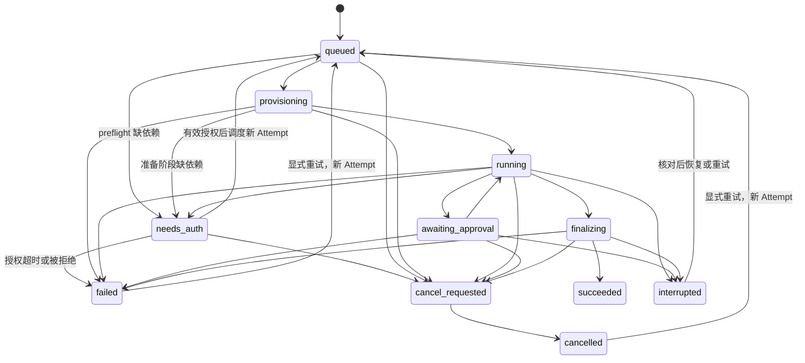

# API、事件与执行状态约定

版本：0.5 · 2026-10-30 · 设计协议，尚无运行实现

以下路径、字段和事件是 WorkX 自建契约，不是 Claude 或 E2B 的官方 HTTP API。REST 数据契约将由 FastAPI OpenAPI 与 JSON Schema 发布，前端生成 TypeScript 类型。

## 前端与控制面

API 前缀 `/api/v1`。租户包含 personal／organization，遵循 [统一租户模型](TENANCY-MODEL.md)。路径 tenant_id 是选择器，服务端核验 User、Membership 与租户状态；不使用全局“当前空间”Cookie 无条件覆盖多标签页请求。

| 方法与路径 | 语义 |
| --- | --- |
| GET /me / GET /me/tenants | 当前用户、personal_tenant_id 与已加入空间（含 type／role／plan）列表 |
| POST /tenants | 创建 organization；personal 由注册流程幂等创建，不能借此重复创建 |
| GET/PATCH /tenants/{tenant_id} | 空间信息；管理权限与版本冲突检查；type／personal owner 不能用普通 PATCH 改动 |
| GET/POST /tenants/{tenant_id}/departments | 可选人员属性扩展；不参与首版权限继承；personal 不支持 |
| GET/PATCH /me/profile / preferences | 全局用户资料与偏好；不更新组织设置或外部平台授权 |
| GET /tenants/{tenant_id}/members | 当前空间成员目录；按读取权限返回脱敏成员信息，不枚举全局用户 |
| GET/PATCH /tenants/{tenant_id}/members/{id} | organization 成员角色／状态；personal 不允许新增成员，所有权转移走独立流程 |
| GET/POST /tenants/{tenant_id}/invitations | organization 邀请列表／批量创建；邮箱、角色、配额与邀请权限校验；邮件异步投递 |
| POST /tenants/{tenant_id}/invitations/{id}/cancel | 撤销仍有效的邀请，一次消费仲裁；不撤回已加入的 Membership |
| POST /invitations/accept | 已登录且邮箱已核验的用户提交一次性邀请凭据，原子建立目标 Membership；不迁移个人数据 |
| GET/PATCH /tenants/{tenant_id}/resources/{type}/{id}/sharing | 固定空间归属，资源管理权限、active 成员／项目和具体 actions 校验；无部门继承 |
| GET /tenants/{tenant_id}/roles | 预设角色权限；首版不开放任意自定义权限 |
| POST /tenants/{tenant_id}/sessions | 建立业务会话、伙伴和资源范围 |
| POST /tenants/{tenant_id}/tasks | 提交目标、session_id、项目及附件引用；需 Idempotency-Key，返回 202 + task_id |
| GET /tenants/{tenant_id}/tasks/{task_id} | 最新任务快照、执行状态、成果引用及独立投递状态 |
| GET /tenants/{tenant_id}/tasks/{task_id}/events | SSE，支持 Last-Event-ID／after_seq，在授权范围内补发 |
| POST /tenants/{tenant_id}/tasks/{task_id}/cancel | 请求取消，202 表示已受理，不表示已经停止 |
| POST /tenants/{tenant_id}/tasks/{task_id}/retry | 可恢复状态才创建新 Attempt；副作用不明确时返回需核对 |
| POST /tenants/{tenant_id}/approvals/{id}/decision | 同意／拒绝，检查审批人、期限、操作散列与当前授权 |
| POST /tenants/{tenant_id}/deliveries/{id}/retry | 仅回传原成果版本，不重新执行任务 |
| GET/POST /tenants/{tenant_id}/integration-bindings | 生态绑定配置、伙伴和能力；配置更新递增 revision |
| POST /tenants/{tenant_id}/integration-bindings/{id}/test | 真实连接测试归入独立任务；不继承原型模拟通过状态 |
| POST /tenants/{tenant_id}/files/uploads | 获得受限上传目标；完成接口验证上传并触发处理 |
| POST /tenants/{tenant_id}/knowledge/search | 有范围的检索，返回片段、引用、版本与来源 |
| GET/POST /tenants/{tenant_id}/artifacts/{id}/versions | 成果版本与编辑保存，读取前核验资源范围 |
| GET /tenants/{tenant_id}/sandboxes/{id}/status | 脱敏状态；不返回供应商管理凭证或直连控制地址 |

POST 幂等键按租户、主体、操作作用域存储请求散列；重复键同输入返回原结果，不同输入返回冲突。错误响应统一含 `code, message, request_id, retryable`；401/403 用于认证授权，404 可用于隐藏无权资源，409 用于状态或版本冲突，429 用于配额，5xx 表示服务故障。

平台入口单独使用 `/channels/{platform}/{binding_public_id}/events` 等适配路径，不接受回调 payload 自称的 WorkX tenant_id。HTTP 回调或平台长连接各自验签、解密及确认，成功落库后再异步执行；具体平台 API 语义继续依据 [生态调研](../workmates-prototype/docs/ECOSYSTEM-INTEGRATION-RESEARCH.md)。

## WorkX Runner 协议 v1

Worker 提交 RunSpec：

```json
{
  "protocol_version": "1",
  "task_id": "task_123",
  "attempt_id": "attempt_1",
  "workx_session_id": "session_123",
  "fencing_token": 7,
  "agent_revision": "agent_v3",
  "knowledge_revision": "knowledge_v8",
  "input_manifest": "/run/workx/attempt_1/input.json",
  "cwd": "/mnt/session/workspace",
  "resume_ref": null,
  "limits": {"wall_seconds": 600, "max_turns": 30}
}
```

目录常量见 [沙箱文件系统规范](SANDBOX-FILESYSTEM.md)，成果采集根为 `/mnt/session/outputs`。数值只是契约示例，不是供应商固定限制。模型 ID、工具策略和票据由可信配置装配，不接受客户端原样传入的 cwd／resume_ref／工具清单。敏感票据不出现在日志和业务事件中。

Runner 输出单行事件帧：`protocol_version, runner_event_id, attempt_id, fencing_token, type, payload`。支持 heartbeat、assistant_delta、tool_started、tool_finished、approval_requested、auth_required、artifact_candidate、sdk_result、runner_error；auth_required 只报告缺少逻辑依赖，由控制面核验并创建授权请求。SDK 原始消息默认不持久保存；如需诊断，先脱敏并以受限保留期存储，不直接透传前端。

Worker 校验帧版本、长度、Attempt、租约和 fencing token；去重后生成业务 seq。Runner 自带序号不能覆盖数据库顺序。进程退出码 0 和 sdk_result success 都只是执行报告；成果验证、授权写操作及最终状态由控制面决定。

控制文件协议包括 `cancel` 和 `approval_decision`，携带 control_id、attempt_id、fencing_token；Runner 记录已消费 control_id。审批请求必须有 operation_id、输入散列与期限；超时拒绝，决议后调用工具时再次验证。取消的最终保障是 Worker 可终止执行环境，不依赖 Runner 永远遵守控制文件。

## 业务事件与 SSE

```json
{
  "event_id": "evt_123",
  "task_id": "task_123",
  "attempt_id": "attempt_1",
  "seq": 42,
  "type": "artifact.published",
  "schema_version": 1,
  "occurred_at": "2026-10-30T18:00:00Z",
  "payload": {"artifact_id": "art_1", "version_id": "artv_1"}
}
```

| 事件族 | 展示用途 |
| --- | --- |
| task.queued / provisioning / running | 排队、准备环境、开始执行 |
| assistant.delta | 文本增量，前端按事件去重追加；可合并短片段控制体积 |
| tool.started / finished | 经脱敏的工具进度，不默认显示完整参数或返回值 |
| approval.requested / resolved | 待人工确认和处理结果 |
| auth.required / resolved / expired | 缺少本租户依赖：含 authorization_request_id、逻辑 Connector／scope 与脱敏状态；不含 OAuth 链接里的临时秘密 |
| artifact.staged / published / rejected | 成果采集和可用状态 |
| task.finalizing / succeeded / failed / interrupted / cancelled | 业务执行阶段，不与投递合并 |
| delivery.queued / sending / delivered / failed / unknown / blocked | 平台回传、回执及异常 |
| sandbox.status / usage.updated | 执行环境与用量摘要 |

SSE `id` 使用本任务 seq；数据库事件日志是补发来源。流消费采用至少一次语义，前端根据 task_id + seq 去重，不能把断线重连当作重新创建任务。事件保留期届满时返回明确的 `EVENT_CURSOR_EXPIRED`，客户端重取任务快照和新的 cursor。鉴权失败时停止订阅；运行中的 SSE 定期检查成员与资源授权撤销。

## 执行状态机



`needs_auth` 是 Task 等待状态，不是长期占着 Worker 的活动执行。保存授权请求与 PendingOperation，停止新副作用，撤销当前票据；若已有 Attempt，则中断并排空 SDK 消息、终结为 waiting_auth、释放租约。等待期限独立于单次运行 wall-time；同 Session 的后续任务排队，不与待恢复工作并发写工作区。

有效回调同事务检查 tenant／subject／scope、请求未消费、Task 仍等待且未过期／取消，然后写 auth.resolved 与调度 outbox；重复回调最多使相同任务入队一次。仍用原 Task，但创建新 Attempt／fencing token／票据。兼容检查点可恢复；材料缺失、未知外部副作用或策略变化时进入明确的恢复／核对流程，不承诺原进程原地继续。授权拒绝／超时进入 failed（带原因），取消作废关联授权请求，晚到回调不复活任务。详见 [凭证规范](CREDENTIAL-SOLUTION.md#needs_auth-挂起与恢复)。

Task 保留聚合状态，Attempt 记录每次尝试终结原因；重试不覆写旧 Attempt。`cancel_requested` 与终结提交通过 row_version/CAS 仲裁，已提交 succeeded 后的取消不倒退状态；取消先提交则晚到 success 不可覆盖。已发布部分成果仍保留版本记录。超时、预算耗尽、模型故障、模板错误、权限撤销与采集失败分别记录 error_code，不都归为“AI 失败”。

## 投递与副作用

投递独立状态：`queued → sending → delivered / failed / unknown / blocked`，failed 可重试；unknown 必须核对平台回执或进入人工处理，不能盲目重发。绑定被撤销、revision 不匹配或原会话不再允许回复则 blocked；不自动改投其他平台或新机器人。

输入去重按绑定和平台事件标识；Gateway 写操作按 operation_key；成果按 task_id、attempt_id、内容散列／版本约束去重；delivery 按固定成果版本与目标保存独立记录。不能笼统承诺端到端 exactly-once：平台不支持幂等或回执查询时，发送超时可能已发生副作用。

Redis 消费组配合可重放 outbox 分发，Worker 心跳续租，Reconciler 处理超时和孤儿 Attempt；数据库唯一键与 fencing token 控制重复执行影响。仅恢复事件流不会重新调用工具；重试执行前核对已持久化工具操作。

## 外部授权接口增补

统一凭证策略见 [凭证与 Connector](CREDENTIALS-AND-CONNECTORS.md)，落地分类与分期见 [凭证落地方案](CREDENTIAL-SOLUTION.md)。以下均是 WorkX 拟定接口，前端不获取原始 Provider Token。接口中的个人／共享指本租户的 owner 范围，不允许跨个人和组织空间使用连接：

| 方法与路径 | 语义 |
| --- | --- |
| POST /tenants/{tenant_id}/connections/authorization-sessions | 指定 Provider、个人／企业主体、拟申请 scope，核验后返回一次性授权交互句柄 |
| GET /tenants/{tenant_id}/authorization-requests/{id} | 已登录的指定主体获取授权要求／短期交互入口；群聊只给 WorkX 登录入口，不暴露设备码或 Token |
| GET /oauth/callback/{provider} | 服务端校验 state／issuer／回调绑定，完成换码与连接登记；具体提供方可用其他回调形态 |
| GET /tenants/{tenant_id}/connections/{id} | 返回归属、scope、状态、expiry 摘要与可用能力，不返回凭证明文 |
| POST /tenants/{tenant_id}/connections/{id}/reauthorize | 重新授权或补充 scope；失败不扩大原范围 |
| POST /tenants/{tenant_id}/connections/{id}/rotate | 权限限定的管理员密钥轮换／新版本验证 |
| POST /tenants/{tenant_id}/connections/{id}/disconnect | 阻止新调用、撤销内部票据，并异步请求外部撤销；分别反馈结果 |

`credential.refreshing / degraded / needs_reauth / revoked` 只发布脱敏状态；OAuth code、device_code、state 原文、PKCE verifier、Token、密钥、工具票据不进入 SSE 和任务事件。内部票据签发／刷新接口仅供受信 Worker，Gateway 在每次调用时核验有效授权与 Attempt 租约。

内部 Broker 只处理 WorkX 原生 Adapter 与 Secret Resolver，不使用第三方连接平台 ID。轮换、断开均按 authz_epoch／SecretVersion 生效；在途写请求按回执核对，不能通过重新授权自动重放。

邀请 token 不进入 URL 日志、SSE 或普通审计内容，数据库仅存摘要；接受与撤销／到期用事务仲裁，重复接受不重复建成员。`#settings`、`#team` 是前端路由，不是服务端鉴权边界；本地“演示接受”不会调用这些正式 API。
