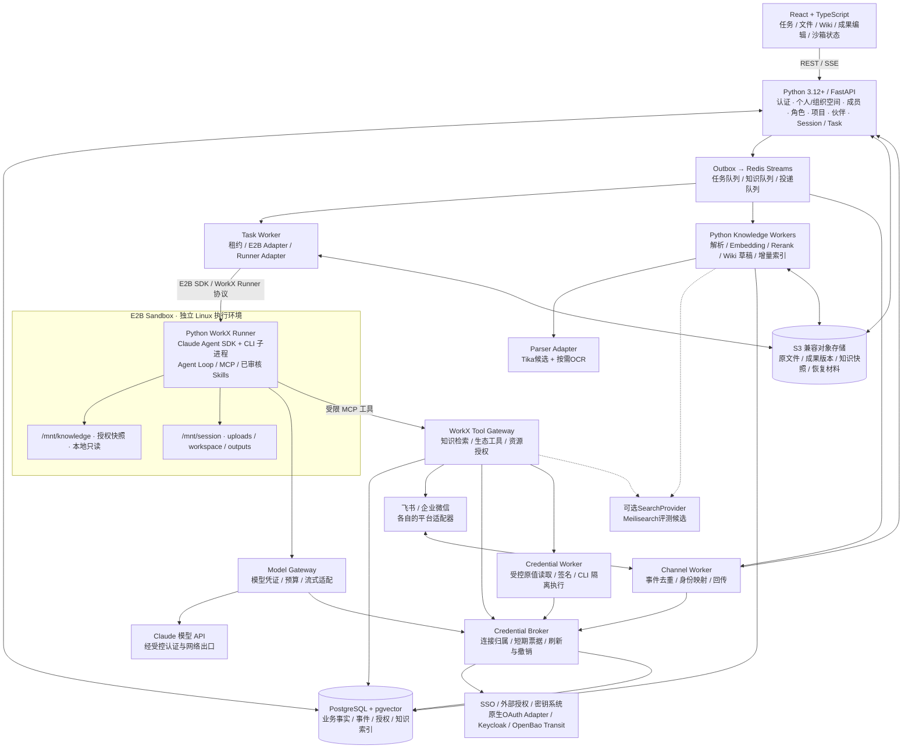

# WorkX 总体架构

版本：0.6 · 2026-10-30 · 目标设计

## 架构结论

保留原图的 React／Python／E2B／Knowledge Workers／存储分层。执行层调整为 **E2B Sandbox → WorkX Runner → Claude Agent SDK → Claude CLI／模型 API**。WorkX 管理任务和授权，Claude Harness 管理一次执行中的规划、工具循环和上下文。

首版采用模块化后端与独立 Worker 进程，保持一个仓库和统一领域模型；暂不把每个模块拆成微服务。任务执行、知识处理、渠道连接可以独立扩容。



图中箭头表示逻辑依赖，不代表沙箱可以直连数据库或渠道凭证。API、Broker、受信 Worker 和 Gateway 按各自服务身份访问获准的存储与凭证，不因此共用全部解密权限。

## 语言与模块职责

| 层 | 技术 | 负责 | 不负责 |
| --- | --- | --- | --- |
| Web | React + TypeScript | 工作台、Agent Chat、项目、文件、Wiki、Artifact Editor、SSE 投影、组织管理 | 保存供应商密钥、决定租户授权、直接访问 E2B |
| API | Python 3.12+ / FastAPI | 认证、租户成员角色、资源授权、REST、事件订阅、知识及成果接口 | 在请求处理器里运行 Agent 或解析大型文件 |
| Task Worker | Python | 调度、租约、配额、沙箱生命周期、输入准备、事件落库、产物收集 | 自己再实现一套 LLM 工具循环 |
| WorkX Runner | Python，运行在 E2B 内 | 校验执行输入、调用 Claude Agent SDK、桥接 SDK 消息、响应取消 | 作出可信的企业鉴权、读取全局凭证 |
| Claude Harness | Claude Agent SDK 及其 CLI | 单次执行的 Agent loop、工具调用、上下文与 SDK 会话 | WorkX 租户、业务任务、渠道回传和最终成果数据库 |
| Knowledge Workers | Python | 解析、分块、Embedding、Rerank、索引、Wiki 草稿维护 | 与某个临时沙箱共享可写知识目录 |
| Channel Worker | Python | 平台验签／解密适配、去重、身份映射、发送策略、回执与重试 | 用平台消息直接绕过 WorkX 资源权限 |
| Tool Gateway | Python，首版可部署在 API 服务内 | MCP 工具、权限／额度校验、外部 API 调用、操作去重和审计 | 将长期平台 Secret 下发沙箱 |
| Model Gateway | 可信区独立服务进程 | 模型认证、受限代理、流式适配、预算与用量 | 将真实模型 API key 下发 Runner |
| Credential Worker | 可信区隔离执行单元 | 经审核的原值读取、签名和 CLI 程序；按实例装配 env／文件 | 执行 Agent 任意 shell、跨租户复用秘密环境 |
| 持久层 | PostgreSQL / pgvector / S3 / Redis | 业务状态、检索索引、文件版本、异步分发 | 让 Redis 或沙箱磁盘独占保存唯一成果 |

## 相比原图的调整

| 原图内容 | 新设计 |
| --- | --- |
| OpenCode Harness | Claude Agent SDK + WorkX Runner；不只是更换模型名。 |
| E2B SDK + OpenCode HTTP API | E2B SDK 管理沙箱；自建 Runner 控制／事件协议驱动 SDK。Claude SDK 不被假设具有 OpenCode 兼容 HTTP 服务。 |
| Sandbox 内 Headless Server | 首版不开放公网 Runner HTTP 端口，使用 E2B 命令进程 stdin/stdout 的 NDJSON；控制输入用受限控制文件传递。 |
| /knowledge RO | 改为 `/mnt/knowledge/<revision>` 本地只读副本，不能用 E2B beta 卷模拟只读。 |
| /workspace RW | 改为 `/mnt/session/workspace`；输入和交付分置 uploads／outputs；单 Session 独占。 |
| Sandbox ↔ Knowledge Workers | Worker 读写持久存储，Task Worker 选择快照放入沙箱；动态检索经过 Knowledge API／MCP。 |
| User / Auth | 扩展成 personal／organization 租户、全局用户、成员、角色、资源授权和外部身份映射；部门仅可选人员属性，无默认继承。 |
| Event Stream | 持久事件日志 + SSE 补发；运行状态、成果状态、渠道回传状态分别维护。 |

## 四条核心链路

1. **工作台任务**：登录成员选择当前个人／组织空间、项目与伙伴 → API 校验权限和额度 → 同事务写任务与 outbox → Task Worker 获取租约 → 准备快照／工作区 → E2B Runner 执行 → 流式事件落库 → 成果版本入库 → 工作台显示可审阅成果。
2. **平台机器人任务**：平台事件先校验并持久化去重 → 独立于长任务完成平台要求的确认响应 → 映射成员或显式配置的受限服务主体 → 同一任务服务 → 执行完成 → delivery outbox → Channel Worker 向原绑定和会话回传。平台响应窗口按接入方式单独实现，不等 Agent 执行完成才应答。
3. **知识处理**：上传原件 → 扫描与解析 → 分块、向量和权限元数据 → 发布知识版本 → 生成带来源的 Wiki 草稿 → 按权限审阅发布。任务固定 knowledge revision，正在执行时不偷偷换底稿。
4. **成果编辑**：Runner 输出待登记文件清单 → Task Worker 独立验证文件、大小、路径与内容类型 → 上传对象存储 → 数据库登记版本与引用 → 编辑器通过 Artifact API 创建新版本；模型成功结束不等于成果已发布。

## 首版部署与目录建议

```text
apps/web/                 React + TypeScript，后续逐页替换原型
services/api/             FastAPI，领域服务、REST、SSE、Tool Gateway
services/workers/         task / knowledge / channel 消费进程
services/gateways/        model / credential-worker 可信区进程与隔离适配
runtime/claude-runner/    E2B 内 Python Runner，SDK Adapter 与协议
infra/e2b/               模板构建、用户权限、网络策略与验证脚本
packages/contracts/      JSON Schema、事件枚举与 TypeScript 生成类型
migrations/              数据库、RLS 策略、索引与回滚
workmates-prototype/     当前原型，迁移期间用于产品验收参考
docs/                    本目录
```

以上是建议布局，当前没有创建这些服务空壳。CLI 企业扩展可以增加一个轻量 Go wrapper 构建步骤；Tika 候选为独立 Java 解析服务，主后端仍保持 Python。首版模型 ID、区域、配额、SDK／CLI 版本均通过部署配置与锁文件确定；不在前端绑定“最新模型”别名，也不照搬原型中的多模型选项。

具体生命周期见 [执行设计](CLAUDE-E2B-RUNTIME.md)，数据关系见 [数据与租户](DATA-AND-TENANCY.md)。

目录与持久卷的具体区分见 [沙箱文件系统规范](SANDBOX-FILESYSTEM.md)。原生持久卷若启用只挂 `/mnt/persist`，默认架构仍通过 S3 物化与采集，不依赖 beta 卷。

## 凭证与知识层补充选型

MCP、Skill、Connector 与实际 Connection 分开建模；Skill 不持有长期凭证。Credential Broker 维护连接归属、刷新责任方和内部短期票据；SSO 登录不等于外部业务授权。沙箱只得到面向 Gateway 的受限票据，飞书 CLI 默认运行在受控 Connector Worker，用官方扩展接集中凭证与命令策略。详见 [凭证与 Connector](CREDENTIALS-AND-CONNECTORS.md)；按使用方式分类的注入路径与分期见 [凭证落地方案](CREDENTIAL-SOLUTION.md)。

知识链路为“Connector／上传 → S3 → Worker → Tika 等 Parser → 标准化块／版本／ACL → SearchProvider → Knowledge API → Claude”。Meilisearch 属检索候选，不是文件解析器；若选其作为主混合检索层，就不默认重复维护 pgvector 同功能索引。当前 pgvector 基线暂保留，待相同中文语料与 ACL 场景评测后定案，见 [Knowledge 选型](KNOWLEDGE-PIPELINE.md)。

## 异构认证与 Skill 运行配置

当前不引入 Nango，连接授权采用原生 OAuth／平台 Adapter。Connector Registry 声明 transport、auth_mode、usage 与 execution_location：无认证走普通 Adapter，静态／OAuth 走 Gateway，换取／签名和需要原值的程序在可信 Worker。Skill env／文件只按 [运行契约](SKILL-RUNTIME-CONTRACT.md) 装配，不向 Agent E2B 下发真实 Secret。
Meilisearch 候选已核实可配置自动 Embedder 和语义／混合检索，下一阶段优先验证其作为主检索层；WorkX 保留文件解析与业务切块。模型、索引及 ACL 验证通过前，原 pgvector 基线作为对照／回退，不默认建设两套自动向量化管线。

## 统一租户与审查结论

[个人／组织租户](TENANCY-MODEL.md) 共用数据、权限、凭证、用量和执行模型；个人空间有唯一本人 owner，企业连接不能读取个人空间凭证。加入组织不搬移已有数据，切换空间不改变后台任务归属。

本轮统一了密文存储、模型与工具出口、渠道服务解密分权、needs_auth 新 Attempt 恢复、原生 OAuth 与 CLI sidecar 边界。详细修正、优先级和待验证风险见 [架构审查记录](ARCHITECTURE-REVIEW.md)。


## 空间制 SaaS 与前端管理层级

个人设置属于全局 User；组织管理属于当前 organization Tenant，二者采用各自二级导航。账号菜单承载空间切换、创建组织与邀请入口；日常协作仍在工作台／项目。个人空间使用相同资源与连接基础，但无邀请、成员扩展或部门权限。

后端分离 UserProfile／Tenant／Membership／Invitation／ResourceGrant／Connection。空间创建不复制个人数据；接受邀请只建立 Membership；角色管理权与资源访问权分开，部门不参与首版权限继承。详细流程及 Schema 约束见 [租户规范](TENANCY-MODEL.md)。

本地原型以独立空间 data 对象演示上述入口，原 WorkX 记录留在旧组织。浏览器命名空间、角色按钮限制与共享范围元数据不替代服务端鉴权、RLS 或真实 Vault；真实后端阶段不因此跳过安全与恢复验证。
