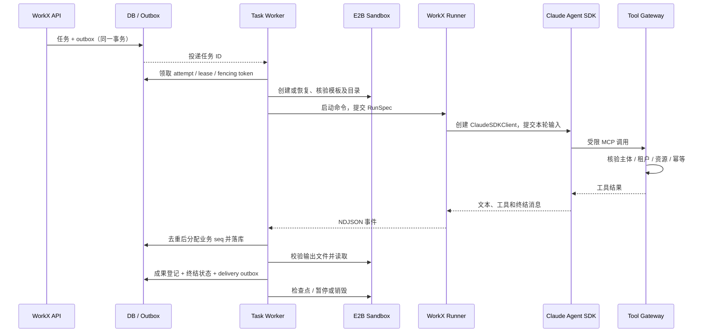

# Claude Harness 与 E2B 执行设计

版本：0.4 · 2026-10-30 · 目标设计

## 执行内核的定义

这里的“Claude”指 **Claude Agent SDK 驱动的 Harness**，不仅是通过 Anthropic Client SDK 发一条聊天请求。Agent SDK 提供执行循环；WorkX Runner 是我们编写的适配程序。采用 Python SDK 以统一后端和运行时代码，不再引入 OpenCode 服务。

[官方托管文档](https://code.claude.com/docs/en/agent-sdk/hosting) 将 SDK 定位为具有本地进程、工作目录和会话状态的执行程序，因此放在 E2B 执行层，而不是直接放在共享 FastAPI 进程。



## 三个必须分开的标识

| 标识 | 所属 | 生命周期 |
| --- | --- | --- |
| workx_session_id | WorkX | 业务上下文与参与人范围；可以包含多个顺序任务。 |
| claude_session_id | SDK | SDK 执行历史；服务端映射到 WorkX 会话，不能由用户随意传入恢复。 |
| sandbox_id | E2B | 当前执行环境；可暂停、丢失、重建，不能替代业务会话 ID。 |

Task 是一次业务交付目标；Attempt 是一次实际执行尝试。执行失败后重试保持 task_id，增加 attempt_id；追问通常在同一 WorkX Session 创建后续 Task。Project 可以包含多个 Session。平台消息的默认 Session 范围为租户、绑定、会话及可验证的参与者／授权范围；不同平台不自动合并上下文。

同一 Session 首版同一时刻仅允许一个活动 Attempt，通过数据库租约和单调递增 fencing token 保证。组聊成员或授权范围发生变化时，不继续复用含有旧敏感资料的 SDK 上下文；新建会话或缩小输入。取消完成前不向旧客户端塞入下一轮输入。

## Runner 的位置与通信

- Python Runner 和 Claude SDK／CLI 均运行在 E2B。FastAPI 和 Task Worker 所在主机不执行模型生成的 shell。
- 首版 Worker 用 E2B SDK 启动 Runner 命令。RunSpec 写入本 Attempt 的输入文件或通过 stdin 提交；stdout 为 NDJSON 帧，stderr 为脱敏诊断。E2B 回调可能切分一行，Adapter 必须有增量行缓冲和帧大小上限。
- 取消与审批决议经 E2B 文件操作投递到本 Attempt 控制文件，Runner 轮询读取。协议由 WorkX 定义，不假设 SDK 有 HTTP API。若所选 E2B SDK 版本支持稳定的 stdin 续写，可后续替换控制文件传输，保持同一协议。
- Runner 是受模型代码影响的执行域，其事件是“报告”，不是可信授权证据。Worker 重新验证任务状态与文件，Tool Gateway 自己核验权限。
- 所有 SDK 类型转换封装在 ClaudeAdapter；Web 与平台适配器只理解 WorkX 事件和状态。

## 沙箱与目录

首版每个活动 WorkX Session 独占一个 E2B 沙箱，不采用“企业所有成员共用一个沙箱”。空闲可暂停，到保留期销毁；不同 Session 追求隔离，不因同一租户而直接共享可写磁盘。

目录、挂载类型和来源依据统一见 [沙箱文件系统规范](SANDBOX-FILESYSTEM.md)。规范对齐 Claude 官方公开的 `/mnt/session` 输入输出语义；这是 WorkX 自建目录约定，不是 Agent SDK 的强制路径。

```text
/mnt/session/uploads/           本轮授权输入副本，本地只读
/mnt/session/workspace/         SDK cwd，计算和草稿，RW
/mnt/session/outputs/           待登记成果，RW
/mnt/knowledge/<revision>/      本轮知识快照，本地只读
/mnt/skills/<bundle_revision>/  已审核 Skills 源包，本地只读
/mnt/persist/                   可选会话持久卷，仅 RW 检查点用途
/opt/workx/                     Runner 与工具，只读模板内容
/run/workx/<attempt_id>/        本次输入／控制／事件临时文件
/home/agent/.claude/            本 Session SDK 状态与受控配置
```

首版通过受信准备步骤复制授权材料到沙箱本地文件系统，再配置拥有者及只读权限；Runner 使用无 sudo 的非 root 用户，必须实测无法改写 uploads、knowledge、skills 和运行时代码。不能仅依赖提示词或 SDK Read/Edit 规则。成果采集只允许解析后仍在 `/mnt/session/outputs` 内的普通文件，校验路径穿越与符号链接。

E2B 原生 Volumes 当前是 private beta，官方说明不支持只读挂载，Linux 用户间读写权限位也不生效。因此只读资料不放在 beta 卷；可选卷只挂 `/mnt/persist` 保存本 Session 的已冻结检查点。默认保留 S3 物化／上传方案，不能用 `chmod` 把 beta 卷当作只读知识卷。详见 [官方限制](https://docs.e2b.dev/faq/volumes-beta-limitations)。

实际模板若无法证明本地资料只读，改用 Knowledge MCP，不下发原始知识。`/mnt` 只是路径，不能代替真实挂载、权限与备份配置。

## SDK 使用约定

以 [Python SDK](https://code.claude.com/docs/en/agent-sdk/python) 为编码依据：长执行、追问和取消采用 `ClaudeSDKClient`，将 SDK 输入、响应与中断封装进 Adapter。`query()` 可以用于一次性联调，但不作为本产品完整会话管理器。

WorkX 的配置装配顺序：平台安全基线 → 企业可用能力 → 伙伴版本 → 项目授权范围 → 本轮 RunSpec。用户输入和知识内容不能修改上述授权。伙伴指令、模型、工具目录、Skills 与知识 revision 在 Attempt 开始时固定，并记录版本；配置变更不悄悄改变正在运行的上下文。

[权限文档](https://code.claude.com/docs/en/agent-sdk/permissions) 说明 `allowed_tools` 是自动批准规则而不是完整工具暴露白名单，且自动批准可以跳过权限回调。因此：

- 不把 `allowed_tools` 当作企业授权控制；未批准的敏感工具还需显式禁用、回调处理或经 Gateway 二次鉴权。
- 首版不采用全局 `bypassPermissions`；需要人工确认的企业工具不设置自动批准。审批与实际操作均检查资源范围。
- Bash 可用于沙箱内文件计算；网络和平台写操作仍经受控出口／Gateway。不能用命令字符串黑名单替代系统和网络权限。
- SDK Hooks 用于观测和流程控制；持久审计和操作幂等在沙箱外实现。

Skills 只来自已审核、有版本的运行时包。按 [Skills 文档](https://code.claude.com/docs/en/agent-sdk/skills) 显式配置发现来源，禁用任意用户或上传仓库自动带入的配置。具体 `setting_sources` 与目录组合在 PoC 验证，不默认加载不可信 `/mnt/session/workspace/.claude/`。`/mnt/skills` 并非 SDK 自动发现目录，Adapter 需显式适配审核来源。执行前拷入审核包、校验散列，冻结本轮版本；Skills 内容也不能扩大工具授权。

## 凭证与网络

凭证分层、保存、刷新与交互的统一约定见 [MCP／Skill／Connector 凭证架构](CREDENTIALS-AND-CONNECTORS.md)，落地分类与注入路径见 [凭证落地方案](CREDENTIAL-SOLUTION.md)。Runner 生成 SDK 的 MCP 配置时把上游地址改写为 WorkX Gateway 地址，`headers` 只写任务票据。个人 OAuth、企业应用身份、WorkX SSO 与内部工具票据不可混用；同一 Refresh Token 只有一个刷新责任方。飞书 CLI 默认在受控 Connector Worker 执行，不复制员工本机登录缓存到 E2B。

E2B 管理 API key 只在控制面。飞书／企业微信长期 Secret 只在密钥存储与 Gateway／Channel Worker，沙箱通过短期、可撤销、限定租户／资源／Attempt 的工具票据请求能力。票据不能指定另一个 tenant_id 覆盖服务端绑定。

模型认证使用 Anthropic API 体系，不将员工个人 Claude 登录用于 SaaS。优先验证统一模型出口代理与预算计量；若 PoC 使用原生 API key，单独使用受限测试密钥并仅注入该 Runner 环境，不能声称密钥对沙箱内代码不可见。生产网关和密钥方案在正式接入前定案，不假设现成代理自动兼容所有 SDK 功能。

网络只开放模型出口、必要 Gateway 和经验证的依赖地址；模板预装依赖，默认禁止任意公网及内网访问。域名、重定向与私网地址处理由网络层／Gateway 保证。沙箱票据可视为已暴露给沙箱内代码，按其可能被读取来限制权限与时效。

## 知识、文件与成果持久化

S3 保存原文件、版本化知识材料、成果与恢复包；PostgreSQL 保存目录、授权与版本关系。沙箱只持有本轮工作副本。Knowledge Workers 不直接改活动沙箱文件。

成果发布分为 Runner 输出、受信采集验证、对象上传、数据库登记四步。上传失败时 Task 保持 finalizing 或标记持久化失败；不得把一条 SDK success 消息映射为已交付。对象 key 由服务端按租户生成，不接受模型提供的任意 bucket/key 或远程下载地址。

## 暂停、取消与恢复

| 情境 | WorkX 处理 |
| --- | --- |
| SSE 断线或浏览器关闭 | Agent 继续执行；客户端按 seq 补发，不重新执行。 |
| 用户取消 | DB 写 cancel_requested 并撤销新增敏感操作票据，Runner 请求 SDK interrupt，消费终结消息；超时则 Worker 终止 Runner／沙箱。已发生外部操作不能靠取消回滚。 |
| 空闲 | 无活动 Attempt 且恢复包确认后才暂停；E2B 生命周期与 WorkX 保留期限分开配置。 |
| Worker 宕机／租约丢失 | Reconciler 核对 Attempt、运行进程和事件位置，先接管或终止旧进程；旧 fencing token 不能落库或执行 Gateway 写操作。 |
| SDK／沙箱故障 | 已发布成果保留，未确认操作进入 reconciliation；恢复前检查权限、模板、模型、配置和知识版本。 |
| SDK 会话恢复 | 显式指定服务端映射的 claude_session_id，并恢复匹配的工作区／SDK 会话材料；不能仅保存 ID 就假定可续跑。 |
| 不兼容或恢复材料缺失 | 新 Attempt 标注“根据已保存结果重新开始”，不宣称无损恢复；有外部写操作时先核对副作用。 |

[SDK 会话文档](https://code.claude.com/docs/en/agent-sdk/sessions) 区分会话历史与文件系统，fork 不自动复制工作目录。首版不开放用户会话 fork。恢复包在已排空执行且状态一致的边界保存，并记录 `runtime_version / cwd / config_revision / knowledge_revision / event_cursor`。可评估官方 SessionStore 能力，跨主机兼容性在锁定版本上验证后再启用。

[E2B 暂停恢复](https://docs.e2b.dev/sandbox/persistence) 可用于保留执行环境，但不能代替产品数据的备份。恢复后仍要重新检查租约、票据和授权；WorkX 主动清理过期沙箱和恢复包，不依赖供应商替我们执行企业保留策略。

原型中的 execution 与 delivery 分离保持不变：重新回传已有成果不重新运行 Claude。完整状态机见 [API 与事件](API-AND-EVENTS.md)。

## MCP／Skill 配置装配增补

SDK 支持的 stdio env 和远程 headers 通过已审核 RuntimeBinding 装配，不把所有 Skill 变量放进整个 Agent 环境。普通 Skill 指令触发 Bash 不会自动获得专属 env；需经 Launcher 执行。远程无认证 MCP 不附加上游授权头，OAuth 由控制面完成，SDK 的 needs-auth／failed 应反馈给产品层。详见 [Skill 运行契约](SKILL-RUNTIME-CONTRACT.md)。

原生静态凭证必须被程序读取时，优先在可信 Connector Worker 运行；确需独立执行环境时作为明确的凭证型任务，生命周期、暂停与结果导出按运行契约处理。不能既把上游原始 key 注入 env／文件，又声称凭证从未进入执行进程。
