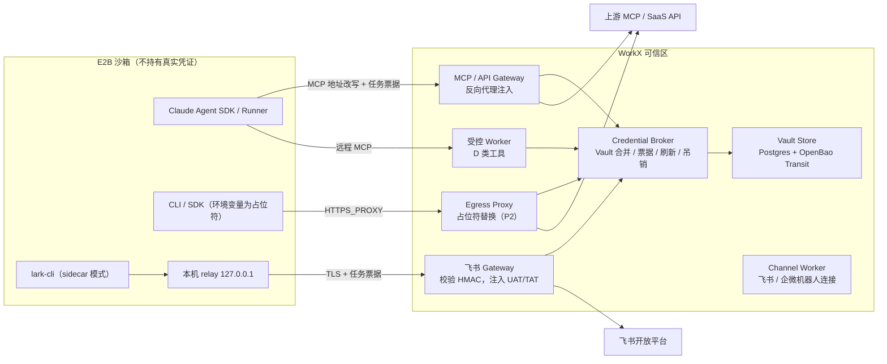

# MCP／Skill／Connector／Plugin 凭证落地方案

版本：0.1 · 调研日期：2026-10-30 · 状态：推荐方案，待 PoC 验证

本文是凭证问题的**落地决策**。分层原则、数据对象和中间件对照见 [凭证与 Connector 架构](CREDENTIALS-AND-CONNECTORS.md)，Nango 边界见 [Nango 引入评审](NANGO-ADOPTION.md)，Skill 运行装配见 [Skill 运行契约](SKILL-RUNTIME-CONTRACT.md)。决策记录见 [ADR-0002](adr/0002-credential-broker-and-egress-injection.md)。

## 结论

1. **按“凭证在运行时如何被使用”分类，而不是按 MCP／Skill／Connector／Plugin 来源分类。** 来源只决定从哪里读取声明；处理路径由使用方式决定。
2. **真实凭证不进入沙箱。** 沙箱只持有占位符和任务票据，真实值在沙箱外的 Gateway、出口代理或 sidecar 中注入。程序必须读取原始密钥时，改到受控 Worker 执行。
3. **自建一层薄的 Credential Broker，边缘复用开源组件。** 目前没有一个开源产品能同时覆盖 MCP、Skill 环境变量、CLI 和国内平台；Nango、ContextForge 等只作为可替换的 Adapter。

## 为什么会卡住

此前按来源列出 MCP、Skill、Connector、Plugin，每一类内部又同时存在无认证、静态 Key、OAuth、环境变量、`.env`、证书等方式，组合数量随来源和认证方式相乘，也找不到能统一接管的中间件。

换一个角度看：无论来源是什么，凭证最终只有四种被使用的方式。按使用方式划分后，每一类都有确定的处理路径，新接入的 MCP、Skill 或 Plugin 只需归到对应类别。

## 参照模型：Claude Managed Agents Vault

Anthropic 官方的 [Vault](https://platform.claude.com/docs/en/managed-agents/vaults) 已经给出了同类问题的产品化答案，WorkX 在自托管 E2B 上复刻这一模型。

| 官方机制 | 说明 | WorkX 对应 |
| --- | --- | --- |
| Vault 按终端用户组织，创建会话时传 `vault_ids` | Agent 声明需要哪些服务，会话提供凭证 | 伙伴／Skill 声明需求，Task 创建时由 Broker 合并个人、企业、伙伴绑定的 Vault |
| MCP 凭证（`mcp_oauth`、`static_bearer`）以 `mcp_server_url` 为键 | 连接该地址时自动注入；提供 refresh 信息时由平台代为刷新，失败发出 `refresh_failed` 事件 | Gateway 按 MCP 地址注入；Broker 刷新并发布 `credential.needs_reauth` |
| 环境变量凭证（`environment_variable`）在沙箱内为不透明占位符 | 出站请求时才替换为真实值，Agent 看不到原值；`allowed_hosts` 限定可替换的目标域名；`injection_location` 控制替换 Header 还是 Body | 出口代理占位符替换（P2） |
| 官方列出的限制 | 只适用于原样发送密钥的客户端；SigV4 这类签名会失败；client_credentials 等换取流程返回的 token 会以明文进入沙箱，应在沙箱外完成交换后再存入 Vault | C 类凭证在沙箱外完成交换或签名 |
| 凭证只写不读；运行中周期性重新解析 | 轮换、归档在运行中的会话生效，无需重启 | 凭证 API 不回显原值；任务运行中可吊销、可轮换 |

官方同时说明：**自托管沙箱暂不支持环境变量凭证，需要自行运行出口代理替换占位符。** WorkX 使用 E2B 自托管执行，因此这部分需要自建。Agent SDK 的 [安全部署指南](https://code.claude.com/docs/en/agent-sdk/secure-deployment) 也推荐同一架构：代理位于 Agent 边界之外，负责注入凭证、域名白名单和审计；默认代理不检查加密流量，需要更强保证时使用 TLS 终止代理。

## 四类使用方式

| 类别 | 判定条件 | 典型例子 | 处理路径 | 沙箱内可见 |
| --- | --- | --- | --- | --- |
| 0. 无凭证 | 上游不校验身份 | 公开远程 MCP、仅指令 Skill | 照常经 Gateway，不附加上游凭证 | Gateway 地址 + 任务票据 |
| **A. 请求头令牌** | 凭证原样放在 HTTP Header 发出 | API Key MCP、Bearer、自定义 Header、支持配置 BASE_URL 的 SDK | **Gateway 反向代理**按目标注入 | Gateway 地址 + 任务票据 |
| **B. 用户委托 OAuth** | 需要代表某个用户，有 consent 和 refresh | 飞书用户身份、OAuth MCP、Google／Notion 等 SaaS | **Broker** 保存 refresh token 并刷新；Gateway 注入 access token | Gateway 地址 + 任务票据 |
| **C. 换取或签名** | 密钥要先换 token 或参与签名计算 | 飞书 app_secret 换 tenant_access_token、企业微信 corpsecret 换 access_token、AWS SigV4 | 在沙箱外的 Broker 或 sidecar 中完成交换或签名 | 占位符或 sidecar 地址 |
| **D. 必须读原始密钥** | 程序本地使用密钥，无法代理 | stdio MCP 连接数据库、证书／私钥、SSH、读取 `.env` 的脚本 | 到**受控 Worker**执行，以远程 MCP 工具暴露给 Claude；确需沙箱时按凭证型执行环境处理 | 只有工具接口 |

判定顺序：

1. 上游需要凭证吗？不需要 → 0 类。
2. 凭证是否原样出现在请求中？是 → 代表用户则 B 类，否则 A 类。
3. 是否需要换取 token 或计算签名？是 → C 类。
4. 以上都不满足，程序要在本地读取原值 → D 类。

**Plugin 不是单独的类别。** Plugin 打包 Skill、MCP、Hook 等组件，其凭证需求等于内部各组件 manifest 声明的并集。安装 Plugin 时逐项归类、逐项绑定，Plugin 包本身不得携带密钥。Skill 自带的 `.env`、Plugin 声明的环境变量都先登记为逻辑凭证，再按上表归类；绝大部分 `.env` 中的 API Key 实际属于 A 类，可以改为 Gateway 注入或出口占位符，不必真的写 `.env` 文件。

## 凭证生命周期

| 层级 | 内容 | 存放位置 | 有效期 |
| --- | --- | --- | --- |
| 长期 | App Secret、refresh token、API Key、client secret、证书 | Vault Store（只写不回显，信封加密） | 长期，可轮换 |
| 中期 | OAuth access token、tenant_access_token | Broker 服务端缓存，提前刷新 | 跟随平台下发的 `expires_in` |
| 短期 | **任务票据**、出口占位符映射 | 唯一进入沙箱的凭证 | 与 Attempt 同生命周期，可立即吊销 |

任务票据绑定 `tenant_id + 发起主体 + 伙伴 + task_id／attempt + sandbox_id + 允许的目标与工具 + authz_epoch`，使用 opaque token 并由 Gateway 在线校验，任务结束、取消或授权变更时立即失效。

短期票据只缩短**沙箱获得的代理访问权**，并不会让长期凭证本身变成短期凭证；静态 Key 的风险仍需靠最小权限和轮换控制。

## 组件与执行链路

### 组件职责

| 组件 | 职责 | 首版做法 |
| --- | --- | --- |
| Vault Store | 保存长期凭证，只写不读 | Postgres 存记录，OpenBao Transit 做信封加密；不在首版同时部署两套密钥系统 |
| Credential Broker | 按任务合并 Vault、签发与吊销票据、刷新中期 token、发布状态事件 | 自建，Python，属于 WorkX 控制面 |
| MCP／API Gateway | 校验票据，按目标地址注入凭证，执行工具 allowlist、审计与脱敏 | 自建 FastAPI 反向代理；不做 TLS 中间人。后续可评估 [IBM ContextForge](https://www.getmaxim.ai/articles/best-open-source-mcp-gateway-for-secure-ai-agent-access-2026.md) |
| Egress Proxy | 替换沙箱请求里的占位符，只对 `allowed_hosts` 生效 | P2 建设，需要 TLS 终止，沙箱模板预装 WorkX CA |
| 飞书 Gateway | lark-cli sidecar 协议的服务端，验证签名后注入真实 token | 参考官方 multi-tenant demo 实现 |
| 受控 Worker | 运行必须持有原始密钥的程序，以远程 MCP 方式提供工具 | 每类凭证独立执行环境，不与不互信的 Skill 共用 |
| Channel Worker | 持有机器人渠道凭证，收发消息 | 已有设计，与工具凭证完全分开 |

### MCP 与 SDK 的接入方式

- **MCP（A／B 类）**：Runner 生成 SDK 的 MCP 配置时，把上游地址改写为 `https://gw.workx/mcp/{installation_id}`，`headers` 只写任务票据。Gateway 根据 Installation 找到真实上游地址和凭证。无需 TLS 中间人，SDK 也看不到上游 token。
- **可配置 BASE_URL 的 SDK／CLI（A 类）**：同样指向 Gateway 的 API 代理路径，优先于出口代理方案。
- **只能直连官方域名的 CLI／SDK（A 类）**：P2 使用出口代理。沙箱环境变量写入占位符 `wxph_<随机串>`，代理只在目标域名属于 `allowed_hosts` 时替换，并按 `injection_location` 决定是否替换 Body。

### E2B 网络约束

- 按沙箱配置出网 allowlist：只允许模型出口、WorkX Gateway、Egress Proxy 和经审核的依赖源，其余全部拒绝。
- E2B 提供的 SOCKS5 [自带代理（BYOP）](https://docs.e2b.dev/network/byop)，其官方文档和企业页对成熟度说法不一致，自托管构建也不支持，因此首版不依赖它，改用“allowlist + `HTTPS_PROXY`”。
- E2B [没有固定出口 IP](https://docs.e2b.dev/faq/egress-ip-ranges)。上游需要 IP 白名单的服务，请求必须从 WorkX Gateway 发出，这也是 A／B 类走 Gateway 的另一个理由。

## 飞书与企业微信

### 飞书 lark-cli：官方 sidecar 模式

lark-cli（MIT 许可）提供官方 auth sidecar 模式，源码注释写明真实 token 不出现在沙箱中。[源码](https://github.com/larksuite/cli/blob/main/extension/credential/sidecar/provider.go)、[协议](https://github.com/larksuite/cli/blob/main/sidecar/protocol.go)

- 沙箱内设置 `LARKSUITE_CLI_AUTH_PROXY`、`LARKSUITE_CLI_APP_ID`、`LARKSUITE_CLI_PROXY_KEY`（与 sidecar 共享的 HMAC 签名密钥），CLI 使用 `sidecar-managed-uat／tat` 占位值走完认证流程；请求由传输拦截器签名后转给 sidecar，sidecar 注入真实 token。
- `LARKSUITE_CLI_STRICT_MODE` 可限定只允许 `user` 或 `bot` 身份。请求头携带目标域名、身份、时间戳（允许 60 秒偏差）和 Body 摘要，可防止篡改和重放。
- 需要使用 `authsidecar` 构建标签编译 CLI。
- **限制：sidecar 地址必须是本机回环或同主机别名**，官方明确不支持跨机器部署。E2B 是远程 microVM，WorkX 服务无法与它同机，因此采用两段式：沙箱内运行一个只监听 `127.0.0.1` 的 relay，经 TLS 和任务票据转发到 WorkX 飞书 Gateway，真实 token 只在 Gateway 中。relay 中的 HMAC key 与任务票据同等对待，按任务签发、随任务失效。
- 官方仓库提供 `sidecar/server-multi-tenant-demo`（含 allowlist、audit、auth_bridge），作为飞书 Gateway 的实现参考。

lark-cli 在受控 Connector Worker 中运行，仍是更简单、更稳的默认方式；只有确实需要 Agent 在沙箱内直接调用 CLI 时，才启用 sidecar 两段式。

### 飞书应用身份与用户身份

- tenant_access_token 属于 C 类：app_secret 只在 Broker 中使用，换取后缓存于服务端。
- user_access_token 属于 B 类：用户授权后 refresh token 由 Broker 保存。授权要从 WorkX 发起，**不复制员工本机的 lark-cli 登录缓存**。

### 企业微信

- **智能机器人的 Bot ID／Secret 属于渠道凭证**，只用于 Channel Worker 建立长连接或校验回调，不属于工具凭证，不进入 Broker 的任务 Vault，更不进入沙箱。[长连接说明](https://developer.work.weixin.qq.com/document/path/101463)
- 调用企业微信业务 API（自建应用 corpsecret 换 access_token）属于 C 类，由 Broker 完成交换，Gateway 注入。

## 用户交互

1. **安装 MCP、Skill、Plugin**：系统读取 manifest，列出所需凭证、类别、作用范围（企业共享或个人）、目标域名。企业共享凭证由管理员填写一次，个人凭证显示“连接”按钮。
2. **执行中缺少个人授权**：任务进入 `needs_auth` 状态并挂起，不算失败。在 WorkX 和来源会话（飞书、企业微信）推送授权卡片，用户完成 OAuth 后任务自动从断点继续。超时未授权则任务结束，并说明缺少哪项授权。
3. **身份映射**：来自机器人的消息先将发送人 open_id／userid 映射到 WorkX 成员，再使用该成员的 Vault。不得用机器人身份或其他成员的授权代替缺失的个人授权。
4. **凭证异常**：刷新失败、被吊销、scope 不足时发布脱敏事件，并通知凭证所有者重新连接；管理员可查看企业凭证的状态与最后使用时间，但看不到原值。
5. **轮换与断开**：轮换后运行中任务在下次解析时使用新凭证；断开时先阻止新调用、吊销票据，再请求上游撤销。

`needs_auth` 需要补充到任务状态机，见 [接口与事件约定](API-AND-EVENTS.md)。

## 自建与复用

| 能力 | 选择 | 原因 |
| --- | --- | --- |
| Vault 模型、Broker、任务票据、策略 | **自建** | 与租户、成员、伙伴、任务深度耦合，是 WorkX 的核心 |
| 密钥加密 | OpenBao Transit（MPL-2.0） | 信封加密、审计、密钥轮换 |
| 远程 MCP 的 OAuth 客户端 | **按 MCP 规范自行实现，基于官方 MCP SDK 的 OAuth 客户端** | 一套标准协议，不是逐家写 Provider：资源元数据发现、CIMD 优先、DCR 兜底、PKCE、RFC 8707 资源指示；[2026-07-28 版](https://modelcontextprotocol.io/specification/2026-07-28/changelog)要求校验 `iss`，客户端凭证按 issuer 隔离存放 |
| 飞书、企业微信 OAuth | 原生 Adapter | 国内平台，海外 OAuth 中间件覆盖不确定 |
| 长尾 SaaS 的 OAuth | Nango 作为可选 Adapter | Nango 的通用 MCP 授权同样要求 DCR 或 CIMD，在 MCP 场景下并不比自建省事；适合它已支持的 SaaS 目录 |
| MCP Gateway | 首版自建反向代理，后续评估 ContextForge | 策略与租户模型需要自控 |
| 企业 SSO | Keycloak，后期支持 MCP Enterprise-Managed Authorization | [Keycloak 已实验性支持](https://aaif.io/blog/using-keycloak-as-an-mcp-authorization-server) |
| 托管型方案（Arcade、Composio 等） | 不采用 | 主要是海外 SaaS，自托管需企业版，与数据驻留要求不符 |

这与“不自写全平台 OAuth 框架”的原则一致：通用 MCP OAuth 只实现一套标准协议；针对具体平台只做首批飞书、企业微信 Adapter；其余交给可选的 Nango。

## 分期

| 阶段 | 范围 | 验收要点 |
| --- | --- | --- |
| **P0** | Vault Store、manifest 声明、企业共享的 A 类凭证、Gateway 注入、任务票据、0 类 MCP | 沙箱内无法读出任何真实凭证；票据过期或吊销后调用失败；两个租户互相不可见 |
| **P1** | B 类个人 OAuth（MCP OAuth、飞书用户身份）、`needs_auth` 挂起与恢复、C 类飞书和企业微信交换、lark-cli 在 Connector Worker 中运行 | 授权后任务自动继续；refresh 并发不损坏；消息发送人身份映射正确 |
| **P2** | Egress Proxy 占位符替换、lark-cli sidecar 两段式、D 类受控 Worker、Nango 长尾、Keycloak 企业 SSO | 占位符不会发往非 allowlist 域名；Body 替换只在声明时生效；D 类执行环境销毁后不残留凭证 |

## 明确禁止

- 把真实密钥写入 E2B 环境变量、沙箱模板或启动命令。
- 在 `/mnt/session/workspace`、`/mnt/persist`、`/mnt/skills` 下写入真实 `.env` 或密钥文件；D 类例外须在独立执行环境中进行。
- Skill、MCP、Plugin 包内携带密钥，或复制员工本机 CLI 的登录缓存。
- 凭证或票据出现在 Prompt、工具说明、Claude 对话记录、日志、事件、交付成果或恢复包中。
- 将渠道机器人凭证用于工具调用，或用机器人身份代替用户授权。

## 待 PoC 验证

- Claude Agent SDK 的 MCP 地址改写与 `headers` 注入，在 initialize、tools/list、tools/call、流式响应和重连中都能正常工作。
- E2B 出网 allowlist 与 `HTTPS_PROXY` 的组合，能否覆盖 Claude CLI、Python、Node 的主要客户端。
- 出口代理 TLS 终止对证书固定（pinning）的客户端的影响。
- lark-cli `authsidecar` 构建、本机 relay 转发到远程 Gateway 的延迟与签名校验。
- 至少一个支持 CIMD 的远程 MCP 完成授权、调用、刷新、吊销、重新授权全流程。
- 企业微信智能机器人长连接下，消息发送人到 WorkX 成员的映射。

## 参考资料

- [Claude Managed Agents：Vaults](https://platform.claude.com/docs/en/managed-agents/vaults)
- [Agent SDK：Secure deployment](https://code.claude.com/docs/en/agent-sdk/secure-deployment)
- [MCP 2026-07-28 变更记录](https://modelcontextprotocol.io/specification/2026-07-28/changelog)
- [WorkOS：MCP 2025-11-25 规范更新（CIMD）](https://workos.com/blog/mcp-2025-11-25-spec-update)
- [Aaron Parecki：Enterprise-Managed Authorization](https://aaronparecki.com/2025/11/25/1/sms:+15035678642)
- [lark-cli 扩展说明](https://github.com/larksuite/cli/blob/main/extension/README.md)
- [E2B：自带代理](https://docs.e2b.dev/network/byop)、[出口 IP](https://docs.e2b.dev/faq/egress-ip-ranges)
- [Deno Sandbox：出口处替换密钥](https://docs.deno.com/sandbox/security/)
- [企业微信智能机器人长连接](https://developer.work.weixin.qq.com/document/path/101463)
