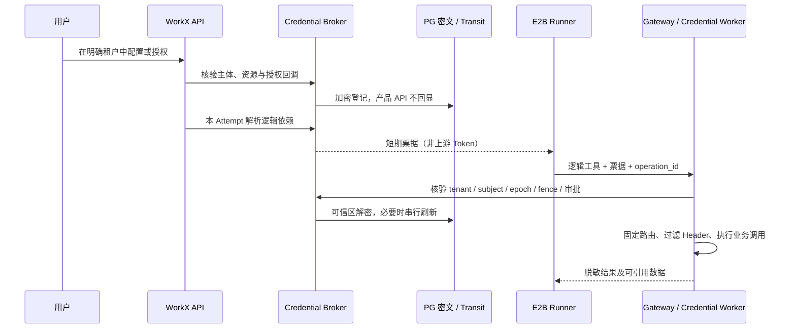

# MCP／Skill／Connector／Plugin 凭证落地方案

版本：0.2 · 2026-10-30 · 状态：架构规则已统一；运行实现待 PoC

本文是凭证领域的规范入口；实体与 API 见 [凭证架构](CREDENTIALS-AND-CONNECTORS.md)，执行装配见 [Skill 运行契约](SKILL-RUNTIME-CONTRACT.md)，任务状态见 [API 与事件](API-AND-EVENTS.md)。本次审查取代此前相互冲突的注入例外与存储方案，决策记录见 [ADR-0002](adr/0002-credential-broker-and-egress-injection.md)。

## 建设决定

- 自建薄层 Credential Broker、Tool／Model Gateway 与原生 OAuth Adapter，复用标准 MCP SDK、OpenBao Transit 和官方 CLI 扩展。**Nango 不引入**，不部署、不作为依赖或后续阶段的默认交付项。
- 所有业务资源、连接和凭证都有非空 tenant_id，适用于 [个人与组织租户](TENANCY-MODEL.md)。企业内成员的私有连接仍属于该组织租户，不等于用户个人租户的连接。
- **真实上游凭证不进入 Agent E2B 执行域**：包括模型 API key、平台 App Secret／Token、数据库密码、证书与 Refresh Token。E2B 里只有面向 WorkX 的短期票据、必要的临时 relay 签名材料或占位符。
- 必须读取原始密钥的程序在沙箱外、受限的 Credential Worker 运行；它是明确划定的可信执行域，不是向通用 Agent 沙箱注入密钥的例外。暂不支持的程序不得启用。
- 个人登录、组织 SSO、外部业务授权、机器人渠道身份与工具执行票据分开管理。首版必须有真实登录；企业 SSO／目录同步可后续扩展。

## 官方模式可参考，不能混同产品

[Claude Managed Agents Vault](https://platform.claude.com/docs/en/managed-agents/vaults) 可以参考其主体归属、凭证不回显和出口注入模式。WorkX 采用的是 **Claude Agent SDK + E2B**，不是 Managed Agents 的会话／Vault API；不能因 E2B 是远程沙箱，就把它等同于 Managed Agents 的 self-hosted environment。

[Agent SDK 安全部署](https://code.claude.com/docs/en/agent-sdk/secure-deployment) 支持沙箱外代理／工具模式。WorkX 首版以 Gateway 为出口，HTTPS 代理环境变量只用于路由，普通 CONNECT 隧道不能解密或替换请求头。需要任意 HTTPS 内容替换时才考虑 TLS 终止、CA 和客户端兼容性；不能把设置 HTTPS_PROXY 写成已实现密钥注入或不可绕过的网络隔离。

E2B 另有 [Secrets](https://docs.e2b.dev/secrets) 与 [HTTPS Header 注入](https://docs.e2b.dev/secrets/inject)。后续可评估为 EgressAdapter，先验证目标方法、路径、撤销、区域与权限；它不是 OAuth 刷新服务，不替代 Broker。默认不把所有 WorkX 密钥再复制到供应商 Secret Store。供应商 [Workload Identity](https://docs.e2b.dev/iam/workload-identity) 当前有私测条件，也不作为首版前置依赖。

## 按使用方式分类

| 类别 | 用途 | 执行路径 | Agent 可见 |
| --- | --- | --- | --- |
| 0 无凭证 | 公开 MCP、仅指令 Skill | Gateway／受审 MCP Adapter，无上游认证头 | 工具与任务票据 |
| A 原样发送 | API key、Bearer、Basic、自定义 Header | Gateway 在受控目标请求中注入 | Gateway 地址与票据 |
| B 用户 OAuth | 代表已授权成员操作 | 原生 OAuth Adapter 刷新，Gateway 注入访问 Token | 授权状态与票据 |
| C 换取／签名 | 飞书应用凭证换 Token、企微 API、请求签名 | Broker／受控签名 Worker 交换或签名，再调用上游 | 逻辑操作与票据 |
| D 本地读取原值 | 数据库驱动、SSH、证书、无法代理的脚本 | Credential Worker 独立进程／执行单元，受限工具返回结果 | 工具接口，不含原值 |

0/A/B/C/D 是**五种执行路由，其中四类需要凭证**。B 可同时具有 C 的计算步骤，分类不代替 auth_mode、transport 和主体范围。Plugin 的依赖是组件声明的并集，不产生独立的“万能凭证”。`.env` 的内容按项分类：非敏感配置可以下发，代理票据／占位符只临时使用，真实 Secret 只能在可信 Worker 装配。

## 唯一存储方案与信任边界

首版选 **PostgreSQL 保存加密记录 + OpenBao Transit 保管加密主密钥**。不是“OpenBao KV 和 PostgreSQL 同时各存一份原始值”。[Transit](https://openbao.org/docs/secrets/transit/) 负责密码学操作，不保存传入的业务 Secret；密文保存在应用的持久库。

| 数据 | 位置与处理 |
| --- | --- |
| Credential 元数据 | PG：tenant、Vault／Connection、owner、usage_class、scope、版本、状态、过期摘要。 |
| SecretVersion 密文 | PG 受限表：AEAD 密文、nonce/tag、经 Transit 包装的 DEK、key_version；使用经审查库，关联 tenant／owner／credential／version 作为认证上下文。 |
| Transit 主密钥 | OpenBao：工作负载身份、最小策略、审计、seal／备份流程；不下发 E2B。 |
| 解密后的上游 Secret | 仅 Broker／Gateway／Credential Worker 的受限内存；短时缓存可选加密，禁入一般日志、队列、浏览器和任务事件。 |
| OAuth Refresh Token | 同一 SecretVersion 机制，仅原生 OAuth Adapter 刷新，single-flight + CAS 原子提交轮换。 |
| 上游 Access Token | 受限服务端缓存；TTL 使用供应商 expires_in，并保守提前更新。不能把静态 key 包装后称为上游动态凭证。 |
| 任务票据 | 高熵 opaque token，服务端只留 hash／归属／有效期；Gateway 在线检查。E2B 内存中可见，但不进入 Prompt／转录／恢复包。 |
| OAuth 临时材料 | 单次授权记录，加密 verifier／device_ref；state 只存摘要，过期作废，一次消费。 |

“只写不回显”指**产品及管理读取 API 不返回明文**。获授权的服务身份必须能在可信区解密使用，否则无法调用上游；不能描述成数据库或服务端永远不能读取。内部解密接口不得向普通用户或 Agent 提供；管理员也没有“显示原始 Secret”按钮。

Broker 是逻辑服务，可与 API／Worker 同仓不同进程，不先拆成微服务。解密与租户授权不直接依赖用户传来的 Vault 路径；被授权访问 Secret 的服务进程也是信任边界，不能只靠数据库字段加密就宣称运行时隔离。

## Vault／Connection 的选择与范围

- Vault 有 tenant_id 和 owner_type=member／tenant／service；每个 Credential 有 usage_class=tool／channel／model／infrastructure。记录归属与可使用策略，不按全局 User 把所有企业秘密合并。
- Agent、Skill、Plugin 只声明依赖，RuntimeBinding 明确选择 Connection／Credential 引用。伙伴绑定不是新的所有者，也不自动授予创建者的个人凭证。
- 执行集合是当前租户、调用主体、安装授权、资源范围、Connection scope、Attempt 工具范围和审批的交集。个人凭证不因共享伙伴而共享，企业管理员也不自动具有业务内容读取权。
- Channel Worker 的机器人 Secret 使用同一加密基础设施，但只允许渠道服务解密。Bot Secret 不作为任务工具票据；工具 API 凭证必须另有明确授权。
- 私密授权链接只交给指定成员；群消息中只发不含 Token／code 的 WorkX 登录入口，登录后核验请求人。OAuth 完成不自动把个人租户授权关联到企业任务。

## 调用、刷新与撤销

票据绑定 tenant_id、membership／service_principal、Session、Task、Attempt、sandbox_id、audience、installation、允许的工具／资源、authz_epoch、fencing token 和 expiry。短期 TTL 与活动 Attempt 绑定但不等于整个任务无限有效；续租需再鉴权。地址和工具映射由服务端生成，不接受模型指定任意上游 URL、认证 Header 或密钥引用。

代理必须处理路径规范化、DNS／私网／重定向、Header 注入、请求／响应大小、MCP 会话和流式协议。敏感写操作记录 operation_id 并核对回执。OAuth 刷新后的 401 重试也不允许盲目重放写操作。

撤销或取消先在 DB 递增 authz_epoch／作废票据，再清缓存和异步请求上游撤销；Gateway 对新调用立即拒绝。已发送到上游的请求不保证可撤回，进入回执核对。新 SecretVersion 验证后激活，后续新调用用新版本；在途调用记录使用版本。供应商无重叠换钥窗口时不可承诺无中断轮换。

## `needs_auth` 挂起与恢复

任务缺少依赖时先做 preflight，可能在排队、准备或执行时进入 needs_auth。保存 PendingOperation、授权请求及安全检查点，阻止新工具副作用、撤销当前票据；Runner 中断并排空结果，旧 Attempt 终结为 waiting_auth，释放租约。不无限持有运行 Worker／租约等用户扫码。

完成授权后只在任务仍等待、未过期／取消、主体仍有效且授权范围满足时调度。同一 Task 创建新 Attempt，获得新 fencing token／票据；恢复材料兼容且操作未发生时才从断点继续。材料缺失显示“需重新开始”；操作结果未知时先核对，不自动重复外发。授权回调重复或晚到不能使取消任务复活，也不复用旧票据。具体状态机以 [API 与事件](API-AND-EVENTS.md) 为准。

## CLI、模型与出口

- 模型请求经 Model Gateway。使用 SDK 支持的受控 Base URL，沙箱只提交本 Attempt 的模型代理票据；上游 API key 留在 Gateway。PoC 也不把真实模型 key 注入 Agent E2B。
- 飞书 CLI 默认在 Connector Worker 执行，用官方 credential／transport 扩展和明确的 user／bot 身份；不复制本机登录缓存。
- [官方 sidecar](https://raw.githubusercontent.com/larksuite/cli/main/sidecar/protocol.go) 限同机；E2B 中的 loopback relay → TLS → WorkX Gateway 是**我们尚未验证的自建扩展**，不是官方支持的跨机方案。HMAC key 可被同沙箱代码读取，不能证明某个请求来自“可信 CLI”。时间戳校验仅限制时间窗口，不自动防止窗口内重放；需要 request_id／nonce 记录、操作幂等与服务端策略。
- EgressAdapter 属可选 P2：先评估 E2B 原生出口注入，不匹配时再考虑自建 TLS 终止代理。仅原样发送秘密的协议适用；签名、证书、换 Token 走 C／D。不能无条件做全字符串替换或把凭证发给任意 allowed_host 路径。
- 网络层强制出口范围，env 只是客户端提示；忽略代理的程序必须被网络拒绝。可信上游也可能回显 Token，代理应屏蔽认证回显与敏感诊断，不能把注入本身当作绝对防泄漏保证。

## 建设顺序与验收

| 阶段 | 范围与门槛 |
| --- | --- |
| P0 | 个人／组织租户与真实登录、Vault 密文＋Transit、0/A 路由、Model Gateway、任务票据、最小 Credential Worker 隔离框架。需 D 类能力的包未通过受控 Worker 验证前不可启用。 |
| P1 | 标准 MCP OAuth 客户端及首批飞书／企微原生 Adapter、B/C、needs_auth、新 Attempt 恢复、CLI 服务端执行。 |
| P2 | 出口注入 Adapter、可选 sidecar relay、更多 D 类格式／协议、企业 SSO 与目录治理；不包含 Nango。 |

PoC 必测：两租户／同用户不同空间隔离、个人连接不可被组织任务引用、票据 audience／fence／epoch、普通 Token 与 Channel Secret 分权、刷新并发／轮换失败、OAuth state／issuer／PKCE／SSRF、授权后取消竞态、工具写超时回执、CLI 代理重放、模型 key 不入沙箱、结果／日志／检查点脱敏。脱敏不是唯一安全措施，恶意或不可代理组件需隔离／拒绝。

[架构审查记录](ARCHITECTURE-REVIEW.md) 列出本轮修正的冲突、规则与待实测项。上述均是目标实现与验收标准，未宣称完成实际平台联调。
