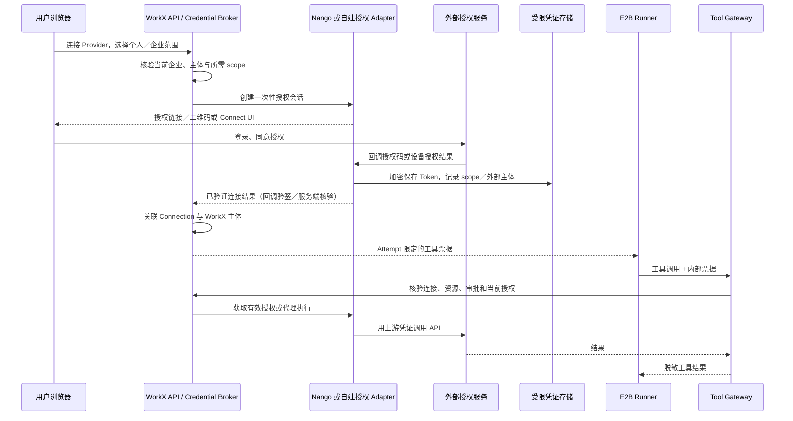

# MCP、Skill、Connector 与凭证架构

版本：0.3 · 调研日期：2026-10-30 · 状态：选型建议与目标协议，未部署

> 落地决策已汇总到 [凭证落地方案](CREDENTIAL-SOLUTION.md)：按使用方式分为 0／A／B／C／D 五类，真实凭证不进沙箱，参照 Claude Managed Agents Vault 自建 Broker，并给出 P0–P2 分期。本文保留分层原则、数据对象与中间件对照。

## 结论与选型建议

采用四层分工：**WorkX 登录／SSO → 外部连接授权 → 密钥保管 → 执行时工具代理**。企业登录令牌、外部 OAuth 令牌和沙箱工具票据分别管理；登录了 WorkX 或飞书不代表已经授权读取用户的飞书文档。

建议将 **Keycloak、OpenBao 与 WorkX Credential Broker／Tool Gateway** 作为基础方案候选；**Nango** 优先做连接授权中间件 PoC。Infisical 是替代 OpenBao 的候选，不在首版同时部署两套密钥系统。凭证域与密钥接口先解耦，第三方产品通过 Adapter 接入，避免被某个连接目录绑定。

进一步的建设判定见 [Nango 引入边界](NANGO-ADOPTION.md)：有条件作为可替换 OAuth Adapter，不承担全部 MCP／Skill 配置。独立 `.env`、环境变量与密钥文件按 [Skill 运行契约](SKILL-RUNTIME-CONTRACT.md) 处理；上游 `auth_mode=none` 与静态认证不强制进入 OAuth。

## 可复用中间件对照

| 项目 | 适合承担的职责 | 不能据此假定的能力 | 许可证／部署核对 |
| --- | --- | --- | --- |
| [Keycloak](https://www.keycloak.org/securing-apps/overview) | WorkX 登录、OIDC／SAML SSO、上游企业身份接入。 | 不是所有第三方 API 的授权、刷新及连接代理；非标准 IdP 需适配。 | 开源身份基础设施；实际发行版依赖与所需身份适配按 PoC 确认。 |
| [Nango](https://github.com/NangoHQ/nango) | 外部 API 连接、OAuth、Token 刷新、代理；功能适用性很接近本需求。 | 不是 WorkX 的企业 RBAC 或密钥基础设施全集；也未确认开箱支持本项目全部飞书／企业微信方式。 | Elastic License，不能按 MIT／Apache 的宽松开源组件理解；托管模式与功能需单独核对。 |
| [OpenBao](https://openbao.org/docs/what-is-openbao/) | 集中保存静态密钥、机器身份、租约、审计及支持引擎的动态秘密。 | 把飞书 Refresh Token 存进 KV 不会自动刷新或撤销飞书授权。 | [MPL-2.0](https://github.com/openbao/openbao/blob/main/LICENSE)。 |
| [Infisical](https://github.com/Infisical/infisical) | 密钥管理、机器身份、短期访问和轮换管理候选。 | 不是通用第三方连接授权与刷新系统；高级功能需核对版本。 | [主体 MIT、ee 目录单独许可](https://github.com/Infisical/infisical/blob/main/LICENSE)。 |
| [lark-cli 扩展](https://github.com/larksuite/cli/blob/main/extension/README.md) | 复用飞书命令，替换凭证来源、传输适配、命令限制与审计。 | 不是跨平台的 OAuth Broker，也不是所有 CLI 的通用凭证注入标准。 | CLI 官方仓库 MIT；自建 wrapper 需锁 CLI／扩展接口版本。 |

Nango 官方支持 [自动刷新与失效恢复](https://nango.dev/docs/guides/auth/token-refreshing)、[MCP OAuth 与代理](https://nango.dev/docs/guides/auth/mcp-auth)，也提供 [Agent sessions](https://nango.dev/docs/guides/agent-sessions) 将连接和工具限定后暴露给 Agent。但 [当前自托管说明](https://nango.dev/docs/guides/platform/self-hosting/self-hosting) 将免费自托管限定为较轻量的 Auth／Proxy；MCP Server、工具执行、Webhook、RBAC 等不在免费功能矩阵内。自托管管理台也不是不互信客户的安全边界。因此它是能力匹配的候选，不能直接写成“免费自托管即可获得完整多租户 MCP 平台”。

本轮未从检索到的 Nango provider 目录确认飞书／企业微信专用连接覆盖；后续需要核对中国飞书与海外 Lark 的域名、授权方式、scope、刷新机制及应用身份，必要时实现自定义 Provider Adapter。

## MCP、Skill 与 Connector 的边界

- **Skill**：版本化指令／脚本包，声明需要哪些逻辑工具和能力；不在分发包中内嵌 Secret、Refresh Token 或个人登录缓存。需要 `.env`、env 或证书的包通过运行绑定显式声明与注入；安装 Skill 不等于授予凭证。
- **MCP Server**：工具协议服务。远程 HTTP MCP 有无认证、静态密钥和 OAuth 等模式，按服务身份／用户身份适配；本地 stdio MCP 的凭证传递机制不同，不能假定会自动打开浏览器完成远程 OAuth。
- **Connector**：WorkX 中的外部系统适配器，包含 auth adapter、能力定义、API／CLI 调用、限流、错误归一化及可选同步／事件适配。一个 Connector 可提供多个 MCP 工具、被多个 Skill 使用。
- **Connection**：某企业／成员实际完成的一次外部授权。多个生态机器人绑定可以引用同一允许共享的企业连接，但个人连接不能因关联同一伙伴而被其他人使用。
- **Credential Broker**：装配可信执行身份、寻找授权连接、签发短期内部票据、调用唯一刷新责任方、处理撤销与审计。不是把所有第三方 Token 导出给模型的接口。

[MCP 当前授权规范](https://modelcontextprotocol.io/specification/2026-07-28/basic/authorization) 对 HTTP 与 stdio 分别说明，并要求 HTTP 凭证用于正确资源／受众。WorkX Gateway 的入站令牌与飞书等上游 API 的访问令牌分开使用；不能把 WorkX 登录 Token 或上游 API Token 原样当成任意 MCP Server 的授权。

## 长期与短期凭证分别保存在哪里

“长期／短期”是生命周期描述，不是统一的安全等级；短期 Bearer Token 被读取后仍可在有效期内被使用。

| 类型 | 保存与使用位置 | 生命周期与交互 |
| --- | --- | --- |
| OAuth Client Secret、飞书 App Secret、Webhook Secret、回调加密密钥 | 密钥系统；PostgreSQL 仅保存 credential_ref、版本与归属。 | 管理员写入／轮换，不回显原文；轮换时验证新版本并逐步停旧。 |
| OAuth Refresh Token | 连接授权系统的加密存储；如 Nango 管理连接则 Nango 是唯一刷新责任方。自建 Provider 则 Broker＋密钥系统负责。 | 串行刷新，Refresh Token 轮换原子更新；不可由 Nango 与自建 Worker 同时刷新同一授权。 |
| Provider Access Token | Broker／授权系统的服务端受限缓存，可按恢复需要加密保存；不进入浏览器或一般任务事件。 | 按供应商实际 expires_in 提前刷新，抖动退避；失败区分临时故障、撤销、缺 scope 与需重新授权。 |
| WorkX 登录会话／SSO Token | 受控登录会话存储；Web 优先 BFF＋Secure、HttpOnly Cookie，配置 CSRF 防护。 | 身份验证，不直接用于外部 API；登出、停用、企业切换单独处理。 |
| WorkX 工具票据 | Runner／stdio adapter 的临时运行配置或进程内存；不写入 `/mnt` 持久卷、会话转录与日志。 | 限定 aud、tenant、subject、connection、tool、attempt、fencing、expiry；短期续租需服务端再鉴权。 |
| 机器身份／基础设施动态凭证 | 可信 API、Broker、Worker 通过工作负载身份向密钥系统申请。 | 只有供应商或 Secret Engine 支持动态签发／撤销时才是真正的动态秘密。 |
| OAuth state、PKCE verifier、device_code、Connect session | 授权服务的加密短期存储；浏览器仅接收必要链接与一次性会话句柄。 | 绑定发起用户、企业和 Provider，超时作废、一次性消费，不进普通聊天历史。 |
| Meilisearch Admin／Search key | 管理与查询服务分别持有最小权限 key。 | 默认搜索经 Knowledge API，不将共享索引的 Search key 下发前端。Tenant Token 后续单独设计。 |

[OpenBao 租约说明](https://openbao.org/docs/concepts/lease/) 明确区分动态秘密与普通 KV：静态 KV 不自带上游租约撤销。把长期飞书凭证包在五分钟内部票据后，获得的是五分钟的代理访问权，并没有把飞书凭证本身变成五分钟有效。

加密密钥与密文分开管理，考虑 KMS／HSM 或独立密钥系统的 seal/unseal 与备份流程；Redis、数据库、队列、SSE、SDK transcript、错误堆栈及恢复包均纳入脱敏验证。沙箱可读的票据视为已暴露给沙箱代码，以最小权限和短时效设计；Broker 不提供批量导出全部连接密钥的沙箱接口。

## 授权与执行交互

回调不能只相信前端的“授权完成”消息；验证 state、issuer、redirect URI、PKCE（适用时）、外部企业与用户映射。授权所需管理员审批、应用开通 scope、用户 consent 和具体资源访问范围分别记录。网页登录成功不自动建立全部 Connector 权限。

连接状态：`unconfigured → authorizing → active → refreshing / needs_reauth / revoked / disabled`；临时错误记录 degraded 和退避信息，不将一次网络失败直接判为永久撤销。缺 scope 进入增量授权，授权取消不扩大旧范围。

断开连接时：先禁止 WorkX 新调用并递增 authz_epoch → 撤销内部票据／缓存 → 请求供应商撤销（支持时）→ 标记与处理失败重试。清本地缓存、退出 WorkX、密钥库删除、外部授权撤销是不同动作，UI 应分别告知结果。

## 飞书：SSO、应用身份、用户授权与 CLI

| 场景 | 身份与凭证 | WorkX 设计 |
| --- | --- | --- |
| 飞书账号登录 WorkX | 用户登录身份与企业映射；不等于全部业务 API 授权。 | 经符合实际协议的 SSO／身份 Adapter 接入；仅 OAuth 登录不可直接假定兼容 OIDC，Keycloak 对非标准端点可能需要插件。 |
| 机器人／应用任务 | 应用身份及已开通的 API scope、可访问资源。 | App Secret 服务端保管，按官方应用凭证流程维护 Token；用户登录不能代替管理员开通应用权限。 |
| 代表用户读写资料 | 用户身份、用户授权及实际资源权限。 | 个人 Connection 绑定 WorkX Membership 和外部主体，限制委托使用范围；不因群里有人触发就借用某员工全部权限。 |
| 个人本机 lark-cli | CLI 自己管理配置、设备授权流程和本机凭证。 | 适合个人使用；不把此缓存上传到企业共享卷或模板。 |
| WorkX 服务端使用 CLI | 官方 credential／transport／platform 扩展支持集中接入。 | CLI Adapter 在受控 Connector Worker 运行，接 Broker，限定命令与身份，返回结构化结果。 |

[官方 CLI](https://github.com/larksuite/cli) 提供设备授权分步流程与系统钥匙串存储；[extension](https://github.com/larksuite/cli/blob/main/extension/README.md) 允许替换凭证源、请求传输与审计／命令策略。推荐复用官方扩展编译 WorkX wrapper，而不是猜测某个通用环境变量能安全注入所有 CLI；具体接口和无桌面 Linux 的凭证行为在固定版本验证。

飞书网页 Token 文档入口：[获取用户凭证](https://open.feishu.cn/document/authentication-management/access-token/get-user-access-token)、[刷新用户凭证](https://open.feishu.cn/document/authentication-management/access-token/refresh-user-access-token)。这些页面本轮抓取未返回正文，因此不据此填写固定 Token 时长、Refresh Token 重用规则或断言 CLI 的设备流程可直接由 Nango 接管；需用固定应用和当前 API 文档完成 PoC。

本轮也参考本机 lark-shared 身份说明：显式区分 `--as user` 和 `--as bot`，scope 不足按身份处理，本机 logout 不等于服务端撤销。此说明用于设计对照，最终集成以锁定 CLI 的公开接口和实测为准。没有读取用户密钥或发起授权。

### 首选部署方式

沙箱 Skill／MCP → WorkX Gateway → 受控 Connector Worker → CLI wrapper／OpenAPI。长期凭证和需要原始上游 Token 的 CLI 进程均留在可信服务端。此处 Go 只用于已有 CLI 的扩展编译，不改变 Python 作为 API／Worker／Runner 主语言的决定。

如果以后确需沙箱内 CLI：官方已提供 `authsidecar` 构建模式，CLI 只持有占位 token 和 HMAC 签名 key，真实 token 由 sidecar 注入；但 sidecar 地址必须是本机回环或同主机别名，不支持跨机器。E2B 场景采用“沙箱内回环 relay → TLS + 任务票据 → WorkX 飞书 Gateway”两段式，详见 [凭证落地方案](CREDENTIAL-SOLUTION.md#飞书-lark-cli官方-sidecar-模式)。同时仍需保证：先验证官方 transport 扩展可将请求送往受限 Gateway，Gateway 基于真实目标、方法、资源、身份与操作幂等检查后才添加上游凭证。不能只“重写 URL”就允许任意请求；命令裁剪、Skills 裁剪与服务端授权仍独立。若某命令必须把上游 Token 暴露给本地进程，应明确标为降级模式，不能同时宣称 Token 从未进入沙箱。

## WorkX 数据与接口增补

| 对象 | 关键字段 |
| --- | --- |
| connector_definitions | provider、auth_modes、工具 schema、所需身份／scope、适配器版本 |
| connections | tenant_id、owner_type/member/service、owner_id、provider、external_org/user、scopes、status、authz_epoch、credential_owner、credential_ref／nango_connection_id |
| credential_versions | connection_id、密钥引用、version、fingerprint、valid_from/to、rotation_status；没有明文返回字段 |
| authorization_sessions | tenant、发起人、provider、scope、state_digest、加密 verifier/device_ref、expires_at、consumed_at |
| credential_leases | attempt、subject、audience、connection、tools、policy_revision、fencing、expiry、revoked_at；高熵票据可只存 hash |

设计接口：创建授权会话、服务端回调、查询连接状态、重新授权、轮换、断开；内部签发工具票据与调用接口不对普通前端开放。票据签发优先使用短期 opaque token＋Gateway introspection，使 authz_epoch 变更可立即阻止新调用；如改 JWT，也必须加在线撤销检查，不能只验证 exp。

同一 Refresh Token 串行刷新／CAS 更新；普通 GET 遇到 401 可经验证刷新后重试一次，写请求需幂等键或回执核对后才重试。权限交集为：WorkX 主体授权 ∩ 当前 Connection scope ∩ 外部实际资源权限 ∩ 本 Attempt 工具范围 ∩ 具体审批。不存在因 Skill 安装、伙伴共享或 SSO 成功而自动扩权。

## 选型 PoC 门槛

验证两个企业／多个成员连接隔离、OAuth 回调替换攻击、刷新并发、Refresh Token 轮换、scope 增补、撤销、新旧 App Secret 切换、Gateway aud 错配、票据重放、失效后的新调用、CLI 无桌面执行及 SDK 日志脱敏。必须分别记录 Nango 所选版本／许可下可用功能；无 Nango 时仅实现首批飞书／企业微信 Adapter，不自写一个全平台 OAuth 框架。
