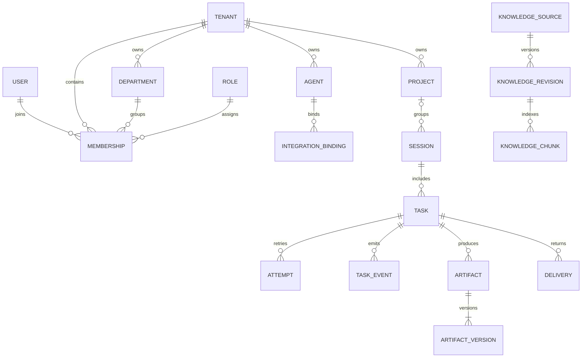

# 数据、知识与租户设计

版本：0.3 · 2026-10-30 · 目标设计

## SaaS 基础

承接 [SaaS 产品基础](../workmates-prototype/docs/SAAS-FOUNDATION.md)：全局 User 不直接归属唯一企业，通过 Membership 加入 Tenant；Department 组织人员；企业 Role 控制管理操作；ResourceGrant 决定具体资源范围。企业管理员不因此自动可读全部业务内容。

首版基线用 PostgreSQL 关系数据、pgvector 检索和 S3 兼容对象存储，保留统一 Knowledge API／SearchProvider。新增 Tika 通用解析候选与 Meilisearch 主检索候选，按 [Knowledge 选型](KNOWLEDGE-PIPELINE.md) 评测后确定一个首版检索实现，不默认同时维护两套混合检索。

图中是核心关系；Task、Agent、Project、Binding、Knowledge、Artifact、Event 等业务表均带 tenant_id，跨实体引用也要同租户。资源授权和身份映射另表记录。

## 核心表与约束

| 对象 | 关键字段／约束 |
| --- | --- |
| tenants | id、name、status、plan_id、created_at；企业状态可阻止创建新执行。 |
| users / memberships | users 为全局登录身份；memberships 有 tenant_id、user_id、role_id、department_id、status；同租户用户唯一。 |
| departments / roles | 部门有 tenant_id、parent_id，防循环、同级重名；企业角色预设 owner/admin/member，所有权转移独立事务。 |
| resource_grants | tenant_id、resource_type、resource_id、principal_type、principal_id、actions；授权给成员／部门／服务主体需明确继承规则。首版可先只支持成员与项目成员集合。 |
| agents / agent_versions | 企业拥有伙伴；版本固定指令、模型配置、工具目录、Skills、发布人；执行引用不可变版本。 |
| projects / project_members | 项目和成员资源范围，不把可见项目列表当作真正的访问限制。 |
| sessions | tenant_id、project_id、agent_id、principal_scope、source_scope、status；上下文归属和授权范围清晰。 |
| tasks | session_id、agent_version_id、source_message_id、execution_status、row_version、created_by；任务目标与成果关联。 |
| attempts | task_id、attempt_no、sandbox_id、claude_session_id、lease_owner、lease_expires_at、fencing_token、config_revision、knowledge_revision、status；同任务序号唯一。 |
| task_events | tenant_id、task_id、seq、attempt_id、runner_event_id、type、payload、occurred_at、received_at；任务 seq 唯一，Runner 事件重复可去重。 |
| integration_bindings | tenant_id、platform、method、external_enterprise_id、agent_id、capabilities、credential_ref、revision、status；配置与凭证版本分开。 |
| external_identities | tenant_id、platform、external_enterprise_id、external_user_id、membership_id 或受限 service_principal_id；不按昵称自动匹配。 |
| inbound_messages | tenant_id、binding_id、platform_event_key、source_conversation、sender、trigger_scope、payload_ref；平台事件在绑定内唯一。 |
| deliveries | task_id、artifact_version_id、binding_id、binding_revision、原始会话快照、status、attempts、platform_receipt；执行与投递独立。 |
| tool_operations | tenant_id、attempt_id、tool_call_id、operation_key、status、external_receipt；危险写操作开始前持久记录，超时进入 unknown。 |
| files / file_versions | tenant_id、owner／grant、object_key、hash、size、mime、scan_status、version；原文件与产物共用底层对象存储但授权分开。 |
| artifacts / artifact_versions | task_id、类型、file_version_id、source_revision、状态、创建来源；编辑生成新版本，不覆盖已投递版本。 |
| knowledge_sources / revisions / chunks | tenant_id、来源、来源权限快照、revision、内容散列、embedding_profile、chunk_ref、索引状态与撤销状态。 |
| approvals / audit_logs / usage_records | 审批绑定具体操作和输入散列；审计记录主体、对象、结果；用量按 Attempt 去重汇总。 |
| outbox | 同事务记录待分发事件，含租户、聚合对象、分发类型和重试位置。Redis 丢失时可重放。 |

所有外键通过 `(tenant_id, id)` 组合约束或等价数据库机制防跨租户引用；不能只在 API 中验证一遍。全局 users、公共模型目录等明确例外，不给这些公共表虚构 tenant_id。

## 数据隔离与授权

API 从已验证登录会话与 Membership 决定当前 tenant_id，不信任请求体声明。Worker 从数据库任务恢复可信上下文，不信任队列或 Runner 传来的企业信息。

首版采用应用层资源授权加数据库 RLS。连接池事务内设置可信租户上下文、事务后清理；受限应用角色不具备 BYPASSRLS，表所有者与应用角色分离。后台批处理通过显式管理入口和审计访问，不复用一个可读取所有企业的 Agent 凭证。RLS 策略与事务连接池行为需实际测试。

对象存储前缀如 `tenants/<tenant_id>/artifacts/<id>/<version>/...` 只用于组织数据，不自动等于访问控制。下载签名在服务端鉴权后短期签发；不把长期 bucket 凭证或跨租户列表权限交给沙箱。API 支持 HTTP 条件写入／版本冲突，编辑器不会覆盖他人已保存版本。

向量检索必须在召回时施加 tenant 与资源过滤，而不是全库检索后只在展示阶段过滤。Rerank、缓存、引用解析也沿用同一范围；缓存 key 包含租户、授权范围版本、知识 revision 和 embedding profile。权限撤销后停止新查询并清缓存；已有沙箱包含撤销材料时终止或重新建立授权快照，不能宣称模型已经“忘记”读取过的数据。

连接、授权会话、密钥版本与凭证租约的数据对象见 [凭证架构](CREDENTIALS-AND-CONNECTORS.md)。业务库保存归属、scope、状态和密钥引用；OAuth 刷新责任方唯一，不把所有 Token 复制到多个系统。

## 知识与 Wiki 的发布链路

1. API 建立 File 与 KnowledgeSource，签发上传目标；上传完成后校验对象散列、大小和内容类型。
2. Worker 扫描后调用 ParserAdapter（通用 Tika 候选，原生文本／平台结构化正文按来源处理），按需 OCR；不在主 API 进程解析不可信附件。失败显示原因，原件与失败记录保留。
3. 创建知识 revision，分块并生成 Embedding，写入向量和引用元数据；Embedding 模型与维度固定记录，迁移时重建索引。
4. Rerank 按需调用；首版抽象 provider，模型选择和成本通过 PoC 确认，不能把 Claude Harness 等同于 Embedding 服务。
5. Wiki Maintainer 基于已授权来源生成草稿，保留引用和来源版本；人工或配置策略发布。生成内容不直接覆盖权威知识。
6. revision 全部处理成功后原子切换 published_revision；旧版本按保留策略清理。源撤销时禁用新检索并回收已下发快照。

知识计算、业务执行和 Wiki 生成可以共享基础设施，但使用独立队列、服务身份和配额。首版 Wiki Maintainer 为可选增量能力，不能阻塞“上传→检索→任务引用”的核心链路。

## 成果与恢复包

成果状态：`staging → available → superseded / deleted`；不合格内容可进入 `rejected`。Task 只有在所需成果登记为 available 后才满足交付条件；纯文本任务也将最终文本作为可持久化结果保存。

恢复包包含工作区清单、SDK 会话材料及配置元数据，标记敏感等级并按租户加密、限制下载。恢复包不是普通成果，不默认展示给所有项目成员；到期清理与审计策略独立于用户文件。

保留期、数据驻留区域、备份恢复目标与企业删除策略需在生产部署前确认。企业停用停止新任务和新工具操作；删除采用可审计状态机，覆盖对象文件、向量、缓存、恢复包和 E2B 活跃／暂停资源。

沙箱文件布局按 [文件系统规范](SANDBOX-FILESYSTEM.md) 执行：S3 是原件与成果的持久事实来源；`/mnt` 目录不自动持久化，可选 `/mnt/persist` 卷不替代权限与版本登记。
