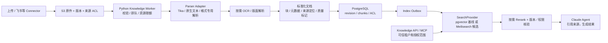

# Knowledge：Tika 解析与 Meilisearch 检索选型

版本：0.3 · 调研日期：2026-10-30 · 状态：方案与 PoC 建议，尚未接入

## 结论

**可以使用 Tika 与 Meilisearch，二者负责不同阶段。** Tika 是通用文件检测、文本／元数据抽取工具；Meilisearch 是搜索引擎，接收结构化文档用于关键词、语义或混合搜索。Meilisearch 的 document 指索引里的数据记录，不等于“自动解析任意 PDF／Office 原文件”。

建议将 Tika 作为首批通用解析候选，Python Knowledge Worker 调用独立 Java 解析服务／进程；下一阶段优先验证 Meilisearch 作为自动 Embedding＋主混合检索 SearchProvider，与既有 PostgreSQL＋pgvector 基线比较。未经评测不同时建设两套完整混合检索系统。PostgreSQL 始终保留租户、授权、版本和任务等业务事实，S3 保留原件、结构化解析结果和成果。

## Embedding、切块与向量检索的确认结论

用户提出的自动向量化和向量检索能力已确认，上一版“支持 Embedding 集成”的描述不够具体，应明确为 **配置 Embedder 后可由 Meilisearch 自动生成／缓存向量，并负责语义或混合检索**。这部分不要求 WorkX 再建一套重复的向量生成与向量数据库。

| 能力 | 本次确认 | WorkX 分工 |
| --- | --- | --- |
| 配置 Embedding Provider／模型 | 支持；也可以使用本地或 REST Embedder，具体支持与配置按固定版本验证。 | 配置模型、版本、凭证／模型出口及资料使用范围。 |
| 自动向量化与缓存 | 配置自动 Embedder 后，引擎处理入库记录和查询的向量生成。 | 选一种向量责任方；不再由 Worker 重复调用相同模型计算同一内容。 |
| 向量与混合检索 | 支持；搜索可选择 Embedder，并调整 semanticRatio。 | 服务端构造可信 ACL filter、控制版本和结果引用。 |
| 长文档业务切块 | 官方实践建议先将长内容按标题／段落等逻辑边界拆成独立索引记录。 | Parser／Chunker 负责 chunk_id、来源定位、长度与重叠策略，不能假定 Embedder 自动补齐。 |
| PDF／Office 解析与 OCR | 不由 Embedder 配置解决。 | Tika／专用 Parser／OCR 处理后再索引。 |

依据：[自动 Embedding 与查询](https://www.meilisearch.com/docs/capabilities/hybrid_search/getting_started)、[切块实践](https://www.meilisearch.com/docs/getting_started/good_practices)。本轮未确认“一个任意长原文件自动变为有独立页码、chunk_id、ACL 的全部可检索块”这一完整服务；不把批量请求、模板裁剪或多个向量混同为 WorkX 所需的业务切块。

### 自动 Embedder 配置示例

下面是发送到 `/indexes/workx_chunks/settings/embedders` 的配置结构示例。模型仅用于展示官方配置形态，不是本项目中文模型的最终选型。

```json
{
  "workx-text": {
    "source": "openAi",
    "model": "text-embedding-3-small",
    "apiKey": "<由受控服务端在发送前解析的密钥值>",
    "documentTemplate": "{{doc.title}}\n{{doc.content}}"
  }
}
```

[配置 API 依据](https://www.meilisearch.com/docs/reference/api/settings/update-embedders)。示例中的占位文本不能原样发送，也不假设 Meilisearch 自动读取 WorkX `.env`。生产集成优先选受控 Embedding Gateway，Meilisearch 只持相应服务认证材料，上游模型 key 由 Gateway／Broker 按统一密文方案管理；此原生 Provider 示例仅说明配置形态，不表示另建长期 key 副本。所有模式不向 Agent E2B、Git、浏览器和日志暴露原值。若选支持本地／受控 REST 模型服务的 Embedder，则由对应服务身份和网络策略管理，不必使用该示例 Provider。

入库的一条 document 是 WorkX 的一个已切分 chunk，包含 id、source_id、revision、title、content、locator 和 ACL。documentTemplate 只选应参与 Embedding 的字段，不能把密钥、ACL 标识或管理元数据误送入模型。

查询形态示例（filter 的真实值由服务端生成，客户端不能覆盖）：

```json
{
  "q": "如何申请项目预算",
  "hybrid": {"embedder": "workx-text", "semanticRatio": 0.7},
  "filter": "tenant_id = tenant_demo AND source_revision = revision_demo",
  "limit": 10
}
```

semanticRatio 数值仅为示例。真实请求还需按当前主体合并资源 ACL，不能仅靠 tenant_id 过滤。先验证文档尾部、跨块引用、长输入截断、中文／编号查询与撤销场景，再据此选择模型及 chunk 参数。

## 能力核对

| 组件 | 官方确认的定位 | WorkX 需要自己补齐 |
| --- | --- | --- |
| [Apache Tika](https://tika.apache.org/) | 多格式类型检测、文本与元数据提取。 | 外部 Connector 下载、租户授权、任务调度、分块、知识版本、索引发布和引用。 |
| [Tika 格式／OCR](https://tika.apache.org/docs/4.2.x/formats.html) | 支持多类文档；图像文字识别需要配置 Tesseract 等 OCR。 | 中文语言包、扫描质量判断、版面／复杂表格策略与质量评测。不能把能打开文件等同于能完整恢复布局。 |
| [Meilisearch 文档格式](https://www.meilisearch.com/docs/resources/internals/documents) | 索引接受 JSON、NDJSON、CSV 等数据集。 | 先把 PDF／DOCX 等解析成规范化文本、元数据和 chunk，再写索引。 |
| [Meilisearch 混合检索](https://www.meilisearch.com/docs/capabilities/hybrid_search/overview) | 可结合关键词与语义搜索，支持 Embedding 集成。 | 企业授权、检索评估、引用一致性、模型版本与成本管理；Claude Harness 不是 Embedding 服务。 |
| [Tenant Tokens](https://www.meilisearch.com/docs/capabilities/security/overview) | 在共享索引的搜索请求上施加受限过滤规则。 | 不等于保护所有管理接口或自动同步 WorkX 权限；动态权限撤销仍需应用设计。 |

Meilisearch [Community 为 MIT，Enterprise 为 BUSL](https://www.meilisearch.com/docs/resources/self_hosting/enterprise_edition)。评测按所需功能和实际发行版进行，不把 Cloud／Enterprise 功能默认写进免费部署承诺。Tika 版本、JRE、解析包和 OCR 依赖在 PoC 后锁定，避免照搬新旧版本不同的服务参数。

## 推荐链路



这是一条逻辑链路，普通文本文件可跳过 OCR。飞书云文档优先用平台结构化 API 获取正文和块／节点定位；二进制附件再走解析器。Tika 无法替代登录授权、飞书 API、内容同步和来源权限映射。

## 解析服务设计

ParserAdapter 输入 file_version_id、S3 受限读取句柄、解析 profile；输出 ParseResult：

- source_id、file_version_id、content_hash、parser_name/version、OCR／语言参数。
- 文本／标题／表格等 blocks，metadata，以及有依据时的页码、slide、sheet、平台 block_id。
- 明确的 locator_quality、truncated、warnings、failed_parts；不可用的页码不能由模型补造。
- 解析质量与状态，供人工查看“已解析／部分提取／需 OCR／加密文档／解析失败”。

Tika REST／命令行等接入方式见 [官方入口](https://tika.apache.org/docs/4.2.x/using-tika/index.html)。Python 负责调度与标准化，不要求为使用 Tika 将整个后端改成 Java。解析进程单独限 CPU、内存、解压深度、嵌套附件数、输出大小与耗时；[Tika 限额文档](https://tika.apache.org/docs/4.2.x/advanced/setting-limits.html) 可作配置依据，具体参数按锁定版本验证。

解析服务不暴露公网，不持有企业 Connector 密钥，不自动跟随文件里嵌入的外部 URL。扫描件 OCR、复杂版式、财务表格和图片理解分别评测；Tika 文本抽取不足时通过同一 Adapter 增加专用解析器，避免让通用解析结果伪装成完整结构化数据。

## Meilisearch 怎么放进现有方案

| 方案 | 组合 | 适用与取舍 |
| --- | --- | --- |
| A：保留基线 | PostgreSQL＋pgvector；关键词能力按语料验证；Tika 负责文件解析。 | 运维简单，适合作为第一条真实知识链路。中文检索和关键词召回需要实测，不能只测向量。 |
| B：Meilisearch 主检索候选 | PostgreSQL 业务事实＋S3＋Tika＋Meilisearch 关键词／混合检索。 | 更重视工作台即时搜索、过滤与语义联合召回时评测；Meilisearch 承担自动 Embedding 与主检索层，不要求再维持一套同功能 pgvector 索引。 |
| C：两套并用 | Meilisearch 关键词＋pgvector 向量，再融合／Rerank。 | 只有评测证明单引擎不足才采用，需承担双索引一致性、成本和故障恢复。首版不默认选择。 |

本轮结论是优先验证候选 B 的自动 Embedding＋混合检索链路，尚未把它写成已经通过生产验收的组件。既有主架构保持 A 作为基线，以 SearchProvider 隔离实现；后续选定 B 时同步关闭无用的双索引与 Embedding 生成流程，避免重复计费。

首版如使用 Meilisearch，优先由 Knowledge API 服务端代理检索。索引记录包含 tenant_id、source_id、source_revision、chunk_id、授权范围标识、标题、内容及 locator；filterable 字段与搜索字段分别配置，不让客户端提供任意 filter 来代替后端强制约束。

如果以后直接向前端签发 Tenant Token，需限制索引、搜索规则与 expiry，且不得签发管理 key；权限快速撤销、索引 ACL 更新延迟和过期前可访问窗口必须明确。初期不直接开放前端直查，更容易统一资源鉴权与撤销。

## 索引一致性与权限撤销

- canonical revision、ACL 与发布状态在 PostgreSQL；索引仅为可重建投影。解析与分块落库后通过 outbox 发布，写入幂等键包含 chunk_id 与 revision。
- Meilisearch 索引更新是异步任务：等待索引任务成功并确认 revision 后再标记 published，HTTP 接收成功不代表搜索已更新。
- ACL 必须在召回阶段强制约束；仅在 Top-K 返回后剔除越权结果既可能泄露也可能损伤召回。受权变更期间旧投影的过滤可能过时，因此撤销时先在 Knowledge API 禁用受影响 source 的查询与结果引用，再更新索引并确认完成，最后解除临时阻断。
- 若无法计算安全的召回前过滤范围，则对相关搜索范围 fail closed，不把正文、snippet 或高亮先返回再过滤。详情／引用解析仍以 canonical 权限再次核验。
- Embedding 配置变更按新 profile 重建，旧新维度／向量不混用；自己计算向量与引擎自动计算二选一并记录责任方。
- 删除源文件同时触发 chunk、向量／搜索记录、缓存、知识快照与恢复材料的保留／清理策略；不可只删前端文件列表。

## PoC 样本与验收

使用中文／英文混合样本：文本 PDF、扫描 PDF、DOCX、PPTX、XLSX、图片、Markdown、飞书结构化文档及损坏／加密文件。分别记录解析完整性、表格定位、OCR 准确性、可引用性、耗时和资源用量。

检索用相同授权语料、chunk 策略和查询集比较 A 与 B：人名／编号／缩写、精确短语、中文分词、语义问答、过滤、高亮、Top-K 召回、延迟、Embedding 成本和索引耗时。验证两个租户同名文档不串数据，撤销后 snippet／引用／缓存不再可用。

最终以评测选择一个首版 SearchProvider，并记录版本、许可、模型与运维成本；不依据“搜索引擎支持 AI”就省掉解析、版本、ACL 或质量验收。

租户过滤同时适用于 personal／organization；同一全局 User 跨空间搜索也不合并授权，见 [租户模型](TENANCY-MODEL.md)。密钥与代理规则以 [统一凭证方案](CREDENTIAL-SOLUTION.md) 为准。
