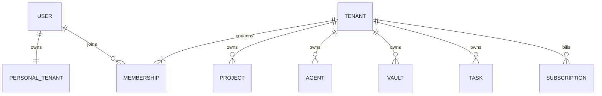

# 个人空间与组织空间的统一租户模型

版本：0.2 · 2026-10-30 · 空间制 SaaS；已有本地多空间交互，服务端隔离待建设

## 产品决定

WorkX 同时服务个人和组织。**每个个人用户拥有一个独立 personal 租户；团队／企业拥有 organization 租户，二者共用 Tenant、Membership、资源归属、权限、用量与执行基础设施。** UI 称“个人空间”和“组织空间”，不要把个人空间说成真实企业法人机构。

这属于常见可行的 SaaS 建模选择，而非所有平台必须采用的标准。例如 [Clerk](https://clerk.com/docs/guides/organizations/configure) 区分个人账户与组织，支持仅个人或加入组织的产品形态；WorkX 进一步在自己的领域层把两者统一为 tenant_id，不照搬其个人账户没有组织成员关系的具体实现。

## 对象关系

PERSONAL_TENANT 是 TENANT 中 type=personal 的子集，不是额外的一套业务表。图表示完成注册且有效的用户状态；注册中／已删除账号按生命周期处理。

| 对象 | 规则 |
| --- | --- |
| users | 全局身份，同一人可加入多个空间。不要把 users.tenant_id 当作唯一归属。 |
| tenants | id、type=personal/organization、owner_user_id、status、name、plan_id、authz_epoch。所有业务对象 tenant_id 非空。 |
| memberships | tenant_id、user_id、role_id、status、department_id；同空间用户唯一。角色属于空间内成员关系。 |
| personal | 每个有效用户一个；owner_user_id 唯一，只有本人一个 active owner Membership；无部门、邀请、所有权转让。 |
| organization | 可有多成员、部门和角色；至少一个 active owner。单成员组织仍是 organization，不按人数自动变成 personal。 |
| billing／usage | 按 tenant 归集，用量不因同一 User 在多个空间而混账；付款人与资源所有者是不同字段。 |

唯一约束包括 personal 的 owner_user_id 部分唯一索引、Membership 的 `(tenant_id,user_id)`；“个人空间不得增加第二个成员”、owner 关系一致、最后一个组织 owner 不可直接移出需要服务层＋数据库事务／触发约束实现，不能只隐藏按钮。

## 创建、加入与切换

- 首次完成注册时，同事务或可恢复的注册状态机幂等创建 personal Tenant 与 owner Membership；重试与并发不得产生多个个人空间。明确接受邀请可建立目标 organization Membership，但不会吞并个人空间。
- 用户可创建／加入 organization，再通过空间选择器切换。切换只改变当前操作上下文，不搬移项目、文件、知识、任务、伙伴、连接、Vault 或账单。
- 当前租户由请求明确选择，服务端重新核验 User、Membership、状态和相应的身份认证要求。单个“当前空间”Cookie 不能无条件决定全部多标签页后台请求。
- 每个标签页、草稿、缓存、SSE、WebSocket 和上传句柄绑定明确 tenant_id；切换时关闭旧订阅并隔离旧草稿。后台任务固定接收时的 tenant，不因用户后来切换而改归属。
- 企业 SSO 的强制要求只影响相应 organization；不得用个人账号会话绕过企业的 reauth／IdP 策略，也不将组织的身份绑定直接改造成个人空间所有权。

## 角色与资源归属

个人 owner 使用相同 RBAC＋资源授权检查，只是缺少团队管理操作；它仍需满足工具、Connection scope 和上游权限，不具备平台运营管理员能力。组织 owner／admin 不自动读取全体成员的私有资料或凭证。

Task、Session、Artifact、KnowledgeSource、IntegrationBinding、Installation、RuntimeBinding、Connection、Credential、沙箱映射和索引均归属一个 tenant。全局 User／公共审核包目录等明确例外通过受控引用关联，不用 null tenant_id 表示个人数据。

“个人凭证”必须区分：

1. **个人空间连接**：tenant=personal、owner=本人；组织任务不可引用。
2. **组织内成员私有连接**：tenant=该 organization、owner=该 Membership；仅按本人及明确委托策略使用，不向全组织默认共享。
3. **组织共享／服务连接**：tenant=该 organization、owner=tenant／service principal；需要明确授权谁能使用哪些操作。

同一上游账号若需要在两个空间使用，首版分别建立授权绑定，不默默复制 Refresh Token 或扩大一次 consent 的本地委托范围。外部同意复用和同一 OAuth grant 的联动撤销是未来独立能力，不在首版承诺。

## 从个人使用到团队使用

首版“开通团队”=新建 organization。个人空间保留，不原地改 type，不改变已有 Task／Session／Artifact 的 tenant_id；非敏感资源的迁入／复制留作后续独立能力。

首版不提供隐式跨空间移动；后续资源迁移应单独建模为带审计的导出／导入或复制任务，重新检查原／目标权限与配额。Connection、Secret、审批、审计和运行中任务不随文件复制；目标空间必须重新授权。升级个人套餐仅改变 plan，不把个人空间转成企业空间。

## 离开、停用与删除

- 从组织离职／移出撤销该 Membership 的会话授权、工具票据、待授权请求与成员私有连接；组织内其负责的任务由策略取消或显式接管，接管必须重新授权，不能使用离职者凭证。个人空间及其资料保持独立。
- 个人 owner 不可“退出自己的 personal”；停用／删除账号走账号生命周期，停止个人任务、撤销连接并按保留策略清理。用户还是组织最后所有者时，先转让／关闭组织或进入明确的管理员处置流程，禁止孤儿组织。
- 删除组织不等于删除全球 User 或其 personal。账单、审计、恢复包与备份遵守保留策略，不能承诺立即物理清零；停用与删除状态分开。
- 个人用户可使用受平台支持的个人连接与服务；没有外部企业租户／应用权限时，相应飞书／企微企业能力不可配置或标为不满足条件，不自动伪造企业身份。

## 验收样例

一名用户同时拥有 personal、加入组织 A 与 B：三空间同名文件、同名伙伴、连接、密钥、检索和计费不混用；A 的管理员不能读取 personal 或 B；离开 A 后 personal／B 仍可用；并发首次注册只有一个 personal；重复邀请不多建成员；切换标签页不把任务发到错误空间；个人不能加第二名成员，单成员组织仍可邀请。

相关：[数据模型](DATA-AND-TENANCY.md)、[凭证规范](CREDENTIAL-SOLUTION.md)、[SaaS 产品要求](../workmates-prototype/docs/SAAS-FOUNDATION.md)。本地原型已支持个人／组织空间切换和独立数据命名空间；登录、跨账号协作、RLS 与真实凭证隔离仍为目标设计。

## 信息架构与入口

采用“全局个人设置＋当前空间管理＋项目协作”，不将所有能力平铺在团队页：

| 入口 | 范围与页面 |
| --- | --- |
| 侧栏底部账号菜单／当前空间栏 | 列出 personal 与 organization、当前空间标记、创建组织；组织可邀请成员并进入组织管理。 |
| 个人设置 `#settings/general / profile / spaces` | 全局 User 的语言、提醒偏好、显示名称和空间列表；不配置组织策略，不因当前组织切换而迁移偏好。 |
| 空间设置 `#team/general` | 当前空间基本信息；organization 下称组织管理，personal 下只有本人资源与连接管理。 |
| 组织二级导航 | 基本信息、成员与邀请、角色与权限、数据与共享、连接与凭证、使用情况、活动记录。 |
| 工作台／项目 | 日常任务、成员分工、共享背景、伙伴与成果审阅；不放进组织管理后台。 |

首版一个 Tenant 对应一个产品空间，不再增加一层可跨 Tenant 共享资源的 Workspace 实体。参考截图的信息层级，不声称复刻其他厂商的内部数据模型。

## 首版权限：角色与资源分开

1. 空间 Membership 必须 active；个人只有本人。空间角色 owner／admin／member 决定组织管理操作，不能自动解锁成员私有资料或凭证。
2. 资源归属固定 tenant；另有资源 owner／created_by，与任务负责人／assignee 分开。更换任务负责人不转移数据或凭证所有权。
3. 可见范围为 private（仅本人）、selected（指定 active 成员）、project（本租户项目成员）、space（本组织 active 成员）。个人空间固定 private；项目、成员引用同租户，移出或停用后按实时成员关系失效。
4. visibility 仅描述可见／使用范围，不自动授予编辑、删除、转共享、导出或高风险工具调用权；actions 由 ResourceGrant 明确记录。服务端、搜索、下载、事件投影和 Worker 必须一致校验。
5. Department 不作为首版授权主体，不按上下级推导访问、不默认级联继承。保留旧部门元数据及可选成员属性；完整通讯录／目录同步后续独立建设。
6. 共享伙伴仅共享伙伴资源；其 RuntimeBinding 仍须在执行主体与 Connection 权限交集中解析。成员私有连接不能因伙伴共享而被全组织使用。

## 组织邀请

组织 owner／admin 可按邮箱邀请 member／admin，不能通过邀请创建 owner 或扩大自己可管理的权限。邀请固定 tenant、受邀规范化邮箱、role、邀请者、7 天默认 expiry 与 pending／accepted／cancelled／expired 状态；批量地址验证与去重后提交，不接受部分有效、部分静默失败。

正式系统使用随机高熵邀请凭据、只存摘要、一次消费；邮件投递走 outbox，与创建邀请分开记录。接受者必须登录并核验邮箱／身份、邀请仍有效、组织与邀请者策略仍允许、席位配额满足。接受同事务幂等创建 Membership，不增加第二个 personal、不迁移个人资源或 OAuth consent。重复、过期或撤销后的接受不增加成员；晚到邮件无权恢复已撤销邀请。

本地“演示接受”只创建当前组织的一条演示成员记录，没有邮件、邀请凭据、真实身份验证或账号切换，不可据此验收正式邀请安全。

## 当前原型与存储边界

`workx-spaces-v1` 保存 User 偏好、空间目录、activeSpaceId 与每个空间各自的 data。旧 `workmates-prototype-v1` 只作为迁移输入：旧任务／文件／伙伴／绑定全部留在旧 WorkX organization，personal 新建独立空资源空间；新组织也不复制个人资源或凭证，仅提供固定内置伙伴示例。迁移不删除旧快照、不再向旧 key 写新业务记录。

前端始终用当前空间的数据对象；切换关闭配置弹窗并清除敏感临时参数，重置资源路由、筛选与选择。普通任务／Code 草稿按空间仅在内存保留，切回可继续，刷新不恢复；不缓存密钥草稿。后台演示回调捕获原数据对象，完成后只更新原空间；旧回调不能导航或重绘新空间。刷新按已保存 activeSpaceId 恢复。

数据与共享页可维护资源可见范围元数据；连接页仅登记当前 tenant、成员私有／组织服务归属、认证类别、关联伙伴与启停，不收集原始 Secret，不把待授权登记描述为连接成功。机器人渠道仍在生态接入配置并与工具凭证分区。

这只是单浏览器演示：全部数据仍在本机存储，不是数据库隔离、真实 RBAC、跨账号协作或多标签页并发同步。正式服务继续按本文件的请求级租户与生命周期要求验收。
