# Part 2 — Architecture diagrams

Conventions used in every diagram:

- **Trust zones**: *Client* (browser, untrusted), *Control plane* (WorkX API/workers, trusted for business logic), *Trusted credential zone* (Broker, gateways, Credential Worker, key provider — only zone allowed to see plaintext upstream secrets), *Execution zone* (E2B sandbox, **untrusted**: model-directed code), *External* (third parties).
- **SoR** = system of record. PostgreSQL (PG) is SoR for business facts; object storage (S3-compatible) is SoR for file bytes.
- Dashed arrows are asynchronous (jobs/events). Solid arrows are synchronous calls.

## B1. System context and actors

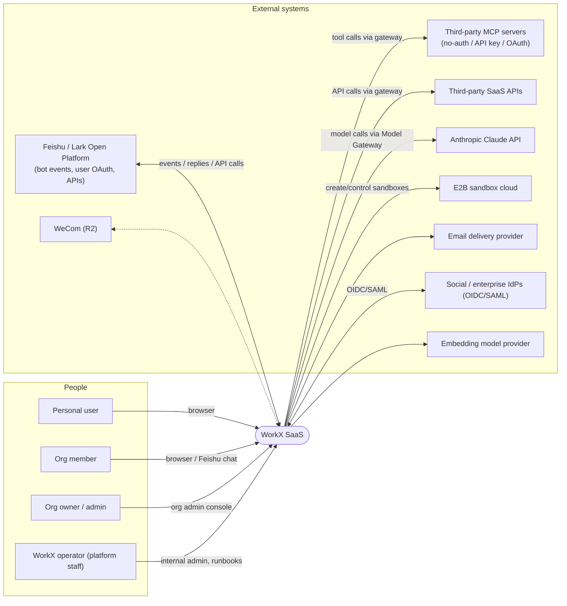

Data ownership: WorkX owns tenants, users, memberships, tasks, artifacts, knowledge, connections, audit. External providers own their accounts and data; WorkX stores only tokens/keys it was granted (encrypted) and synchronized copies explicitly authorized by a tenant.

## B2. Overall logical architecture

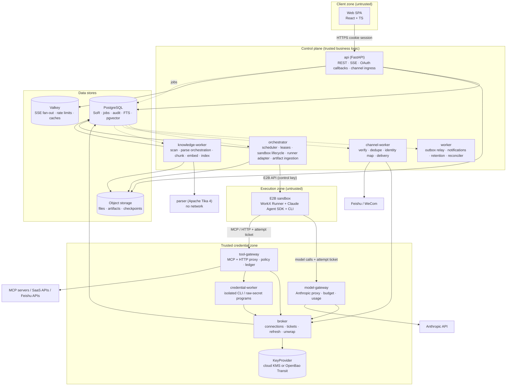

Key rules: the sandbox reaches only the two gateways (enforced by E2B egress rules, see Part 4 §8); only the Broker can unwrap data-encryption keys; workers re-load tenant context from PG and never trust job payloads.

## B3. Frontend and workbench modules

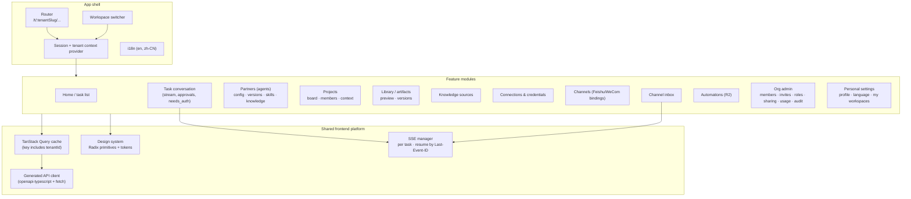

Every query key and SSE subscription includes `tenantId`; switching workspace clears tenant-scoped caches and closes streams (Part 9 §4).

## B4. Backend domain modules and control-plane boundaries

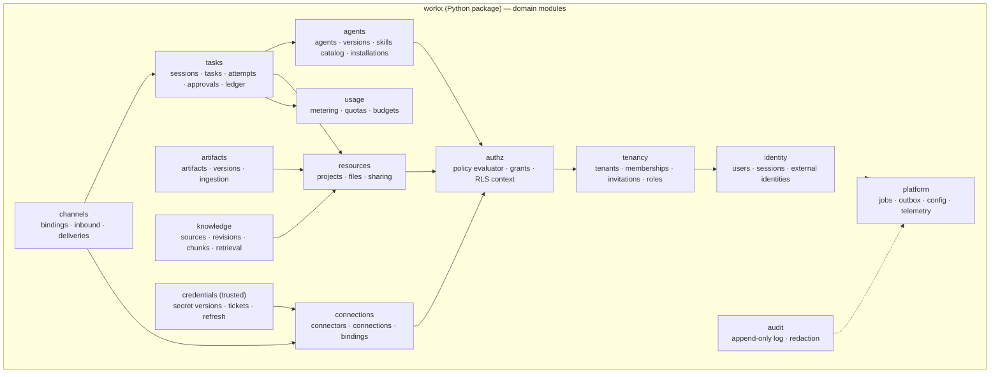

Dependency rule: arrows point to modules a module may import. `credentials` is importable only from trusted-zone process entrypoints (`broker`, `tool-gateway`, `model-gateway`, `credential-worker`, `channel-worker`); the `api` process accesses credentials only through Broker RPC with metadata-only responses. Enforced by import-linter contracts (Part 12 §3).

## B5. Tenant, identity, and resource authorization model

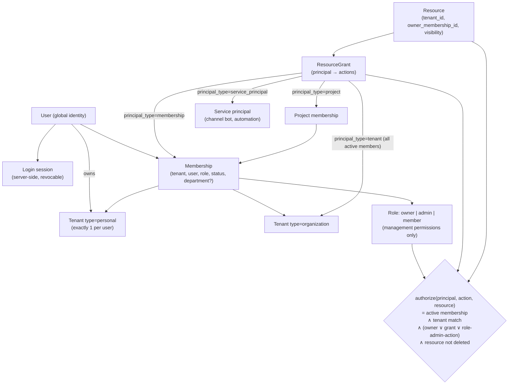

Note what is absent: no edge from Role to private resources, no department edge. Admin role grants management actions (members, invitations, connections policy, audit view) but not `read` on private resources (Part 3 §6).

## B6. Agent runtime: E2B sandbox, WorkX Runner, SDK, tools, workers

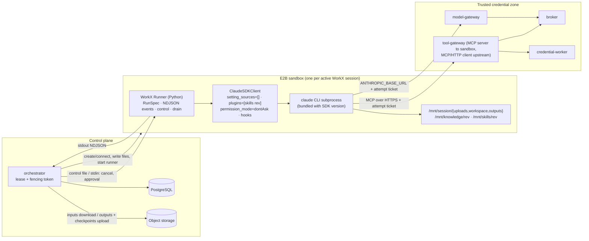

Authoritative state lives in PG (task, attempt, ledger, events) and object storage (inputs, outputs, checkpoints). The sandbox holds caches and working copies only (Part 4 §3).

## B7. Credential Broker, gateways, secret storage, OAuth trust boundaries

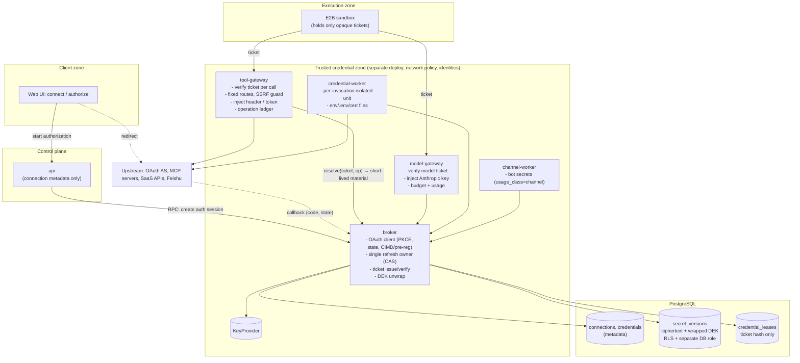

Boundary statements: plaintext upstream secrets exist only in trusted-zone process memory; `secret_versions` is readable only by the `broker` DB role; the OAuth callback endpoint is served by the Broker (routed via the public ingress), not by the general API process.

## B8. Skill, MCP, CLI, and connector execution routes

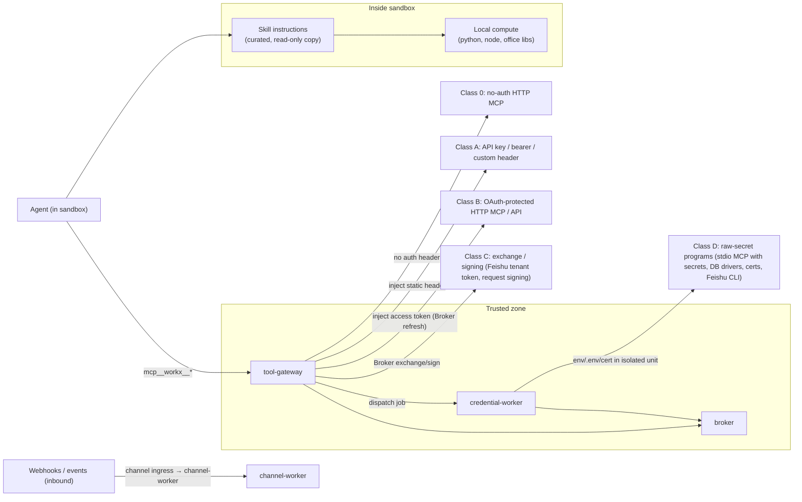

The agent sees one MCP server per installed connector (all served by the Tool Gateway). Upstream transport, auth class, and execution location are hidden behind a stable tool contract.

## B9. Knowledge ingestion, indexing, retrieval

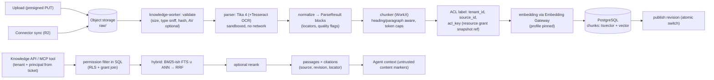

## B10. Task queues, workers, events, recovery

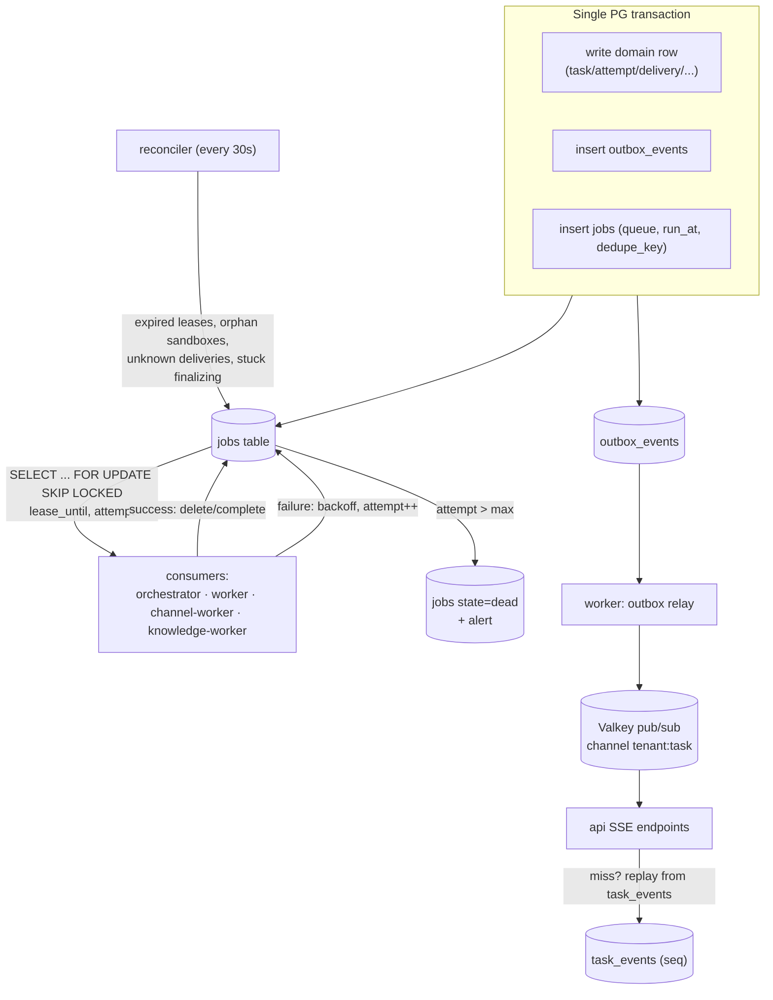

Recovery invariants: (1) jobs are at-least-once, handlers idempotent by `dedupe_key`; (2) an Attempt's writes are accepted only with the current fencing token; (3) Valkey loss loses only live fan-out — clients replay from `task_events`.

## B11. Deployment — MVP and scaled production

### B11a. MVP (single region)

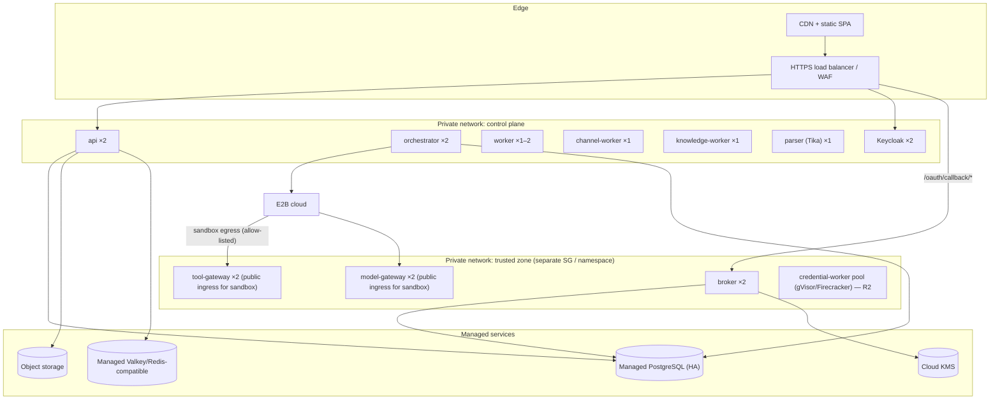

The gateways must be reachable from E2B's egress, so they have their own internet-facing ingress restricted to E2B egress IP ranges when available ([VALIDATE] S-03) and authenticated by attempt tickets regardless.

### B11b. Scaled production (multi-AZ, optional multi-region)

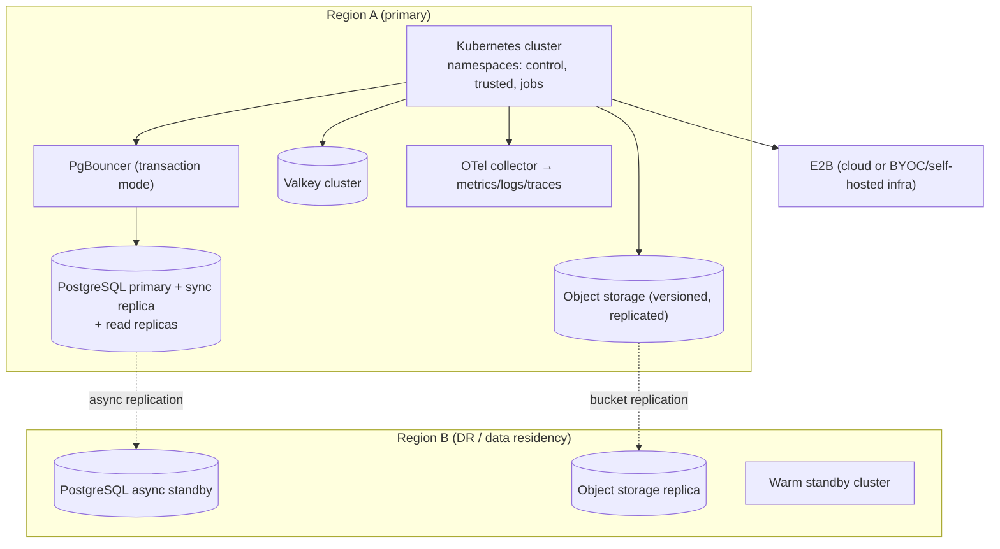

Data-residency deployments become *cells*: a full stack per jurisdiction with tenant-to-cell routing; tenants never span cells (Part 13 §9).

## B12. Repository and package dependency direction

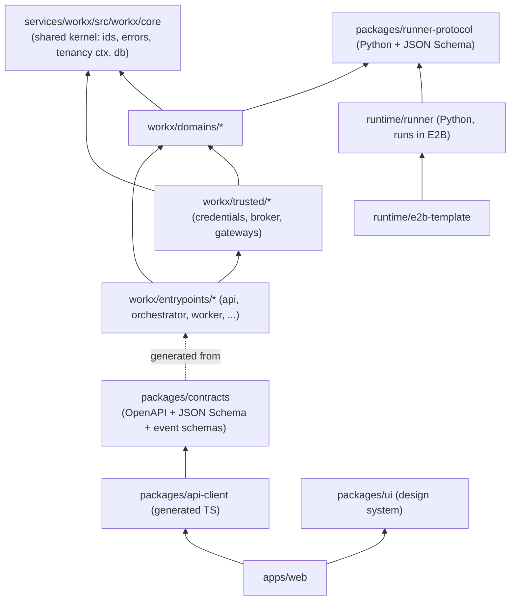

Arrows point from dependent to dependency. `runtime/runner` must not import `services/workx` (it runs in the untrusted zone and only knows the protocol). `domains/*` must not import `trusted/*`.
