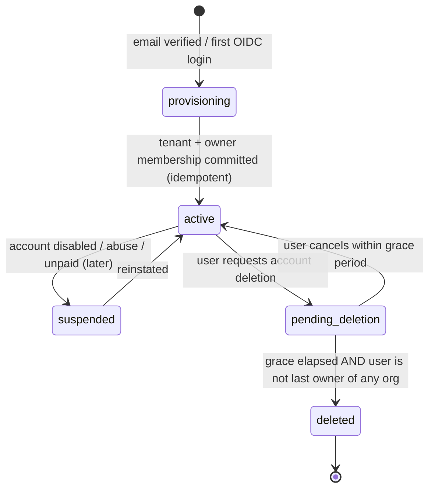
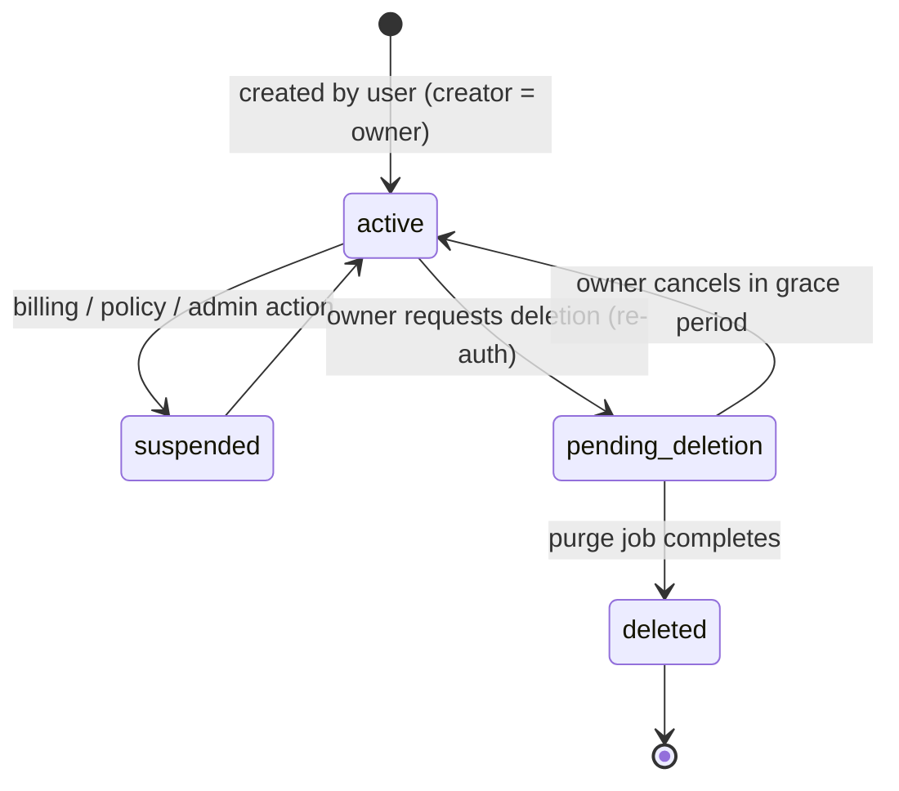
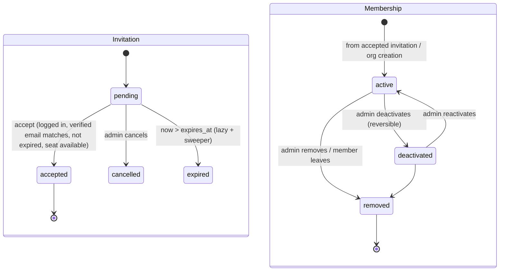

# Part 3 — SaaS identity, tenancy, and permissions (request §5.1)

Status: the personal/organization model, separation of settings, invitation lifecycle, and sharing scopes exist as **[PROTO]** (browser localStorage under `workx-spaces-v1`, simulated invitations with no email, single demo user "Alex"). Everything below is **[DOC]/[REC]** for the production backend.

## 1. Core entities

| Entity | Scope | Key fields | Invariants |
| --- | --- | --- | --- |
| `User` | Global | `id`, `primary_email` (verified), `status` (active/disabled/deleted), `locale`, `display_name`, `idp_subject` | One account per verified email; no `tenant_id`. |
| `Tenant` | Global row, owns everything else | `id`, `slug`, `type` (`personal`/`organization`), `owner_user_id`, `status` (active/suspended/pending_deletion/deleted), `plan_id`, `authz_epoch`, `region_cell` | Personal: exactly one per user (partial unique index on `owner_user_id where type='personal'`). Organization: ≥1 active owner membership. |
| `Membership` | Tenant | `tenant_id`, `user_id`, `role` (`owner`/`admin`/`member`), `status` (invited/active/deactivated/removed), `department_id?`, `authz_epoch` | Unique `(tenant_id, user_id)`. Personal tenant: exactly one membership (owner). |
| `Invitation` | Tenant (org only) | `tenant_id`, `email_normalized`, `role` (`admin`/`member`), `token_digest`, `expires_at`, `status` (pending/accepted/cancelled/expired), `invited_by_membership_id`, `consumed_by_user_id` | One pending invitation per `(tenant_id, email_normalized)`; token stored as SHA-256 digest; single use. |
| `Role` | Static catalog in R1 | `owner`, `admin`, `member` with fixed management permission sets | No custom roles in R1. |
| `Department` | Tenant (org only) | `tenant_id`, `name`, `parent_id?` | Attribute only; never a policy principal in R1. |
| `Resource` (abstract) | Tenant | `tenant_id`, `id`, `resource_type`, `owner_membership_id`, `visibility`, `deleted_at` | Every concrete resource table (project, agent, file, artifact, knowledge_source, connection, automation, session) carries these columns. |
| `ResourceGrant` | Tenant | `tenant_id`, `resource_type`, `resource_id`, `principal_type` (`membership`/`project`/`tenant`/`service_principal`), `principal_id`, `actions[]`, `granted_by`, `expires_at?` | Composite FK to the resource and principal in the same tenant. |
| `ServicePrincipal` | Tenant | `tenant_id`, `kind` (`channel_binding`/`automation`/`system`), `ref_id`, `allowed_actions` | Never owns private member data; acts only with explicit grants. |
| `ExternalIdentity` | Tenant | `tenant_id`, `provider`, `external_tenant_key`, `external_user_id`, `membership_id?`, `verified_via` | Unique per `(tenant_id, provider, external_tenant_key, external_user_id)`. |
| `LoginSession` | Global | `user_id`, `session_hash`, `created_at`, `last_seen_at`, `expires_at`, `revoked_at`, `auth_strength`, `idp_session_ref` | Server-side, revocable; cookie holds opaque value only. |

`visibility` is a convenience summary (`private`/`selected`/`project`/`organization`) maintained from grants; the **grants are authoritative**. This matches the prototype's sharing UI (SA-09) while removing ambiguity about write actions.

## 2. Workspace lifecycles

### 2.1 Personal workspace



- Creation is part of the sign-up state machine: `INSERT ... ON CONFLICT DO NOTHING` on the partial unique index, then read back. Concurrent first logins create one personal tenant.
- A personal tenant cannot invite, cannot have departments, cannot have `organization` visibility, cannot hold service principals for channels that require an enterprise app (Feishu enterprise bot), and cannot transfer ownership.
- Deletion is blocked while the user is the last owner of any organization (they must transfer or close it first) — no orphan organizations.

### 2.2 Organization workspace



Suspension blocks new tasks, new tool calls, new channel replies, and new logins into that tenant; data remains readable to owners for export unless policy says otherwise. Deletion runs a purge job across all stores (Part 13 §6).

### 2.3 Membership and invitation



Acceptance is one transaction: lock invitation row → check status/expiry/email/seat quota/tenant active → insert membership (unique constraint makes duplicates impossible) → mark invitation accepted → audit + outbox. Retries return the same membership.

## 3. Trusted tenant context and workspace switching

**Rule:** the tenant for any request is selected by the URL (`/api/v1/tenants/{tenant_id}/...`), then **verified** server-side against the authenticated user's active membership. Nothing in a request body, header, cookie, or job payload is trusted as the tenant.

```text
request → session cookie → LoginSession (not revoked, not expired) → User (active)
        → path tenant_id → Membership(tenant_id, user_id) active AND Tenant active
        → TenantContext{tenant_id, membership_id, role, authz_epoch, auth_strength}
        → DB transaction: SET LOCAL app.tenant_id, app.membership_id
        → handler → policy evaluator for each resource action
```

- Membership lookups are cached in Valkey for ≤ 30 s keyed by `(user_id, tenant_id, membership.authz_epoch)`; any membership/role change increments `authz_epoch`, invalidating caches immediately for new requests.
- **Switching workspace** in the UI only changes which path the client calls. There is no server-side "current tenant" that background requests inherit; multiple tabs can work in different tenants concurrently. The UI remembers the last tenant in user preferences purely for navigation.
- Background work (tasks, deliveries, indexing) carries `tenant_id` + IDs in the job payload; the consumer reloads the row with RLS context set to that tenant, and verifies the referenced principal is still authorized before acting.
- Organization SSO policy (R2) is enforced on tenant entry: if the org requires SSO and the current `LoginSession.auth_strength` lacks a matching IdP assertion, the API returns `403 TENANT_REAUTH_REQUIRED` with the IdP hint; the personal workspace is unaffected.

## 4. Identity/SSO versus external API authorization

| Concept | Purpose | Stored where | Never used for |
| --- | --- | --- | --- |
| WorkX login (Keycloak OIDC; password, social, later org SAML/OIDC) | Prove who the user is | Keycloak + `login_sessions` | Calling Feishu/Google/etc. APIs |
| Org SSO assertion (R2) | Satisfy an organization's sign-in policy | `login_sessions.auth_strength` | Granting resource access by itself |
| External connection (OAuth/API key) | Let WorkX act in an external system on behalf of a member or the org | `connections` + `secret_versions` | Logging into WorkX |
| Channel bot identity (Feishu app bot) | Receive/send chat messages | `channel_bindings` + channel credentials | Reading user docs without user consent |
| External identity mapping | Map a Feishu/WeCom user to a WorkX membership | `external_identities` | Auto-matching by display name |
| Attempt ticket | Let one sandbox attempt call specific gateway tools | `credential_leases` (hash) | Anything outside that attempt and tool scope |

Even if a user signs into WorkX *with* Feishu login (possible later as an OIDC-like IdP), the IdP token is not reused as an API token; a separate, scoped connection consent is required.

## 5. Deactivation, removal, session revocation, ownership transfer

| Event | Immediate effects (same transaction) | Asynchronous effects (jobs) |
| --- | --- | --- |
| Member **deactivated** | membership.status=deactivated; `authz_epoch++` on membership and tenant | Revoke attempt tickets for tasks *started by* this member in this tenant; cancel or pause their running tasks per policy; close their SSE streams in this tenant; disable their member-private connections in this tenant (status `suspended`, tokens kept for reactivation); remove from future invitation approvals |
| Member **removed** (or leaves) | membership.status=removed; `authz_epoch++` | As above, plus: member-private connections in this tenant revoked (local tickets invalidated, upstream revocation requested, secret versions destroyed after retention); `external_identities` unlinked; resources they own remain with `owner_membership_id` pointing to the removed membership and are reachable only by grants others already had, until an owner reassigns them (C-10, Q-05) |
| User **disabled** (platform) | user.status=disabled; all `login_sessions` revoked; every membership `authz_epoch++` | Same as removal for in-flight work in every tenant, without deleting data |
| User **deletes account** | Blocked if last owner of any org | After grace: personal tenant purge; memberships removed; PII minimized in audit (pseudonymized actor id) |
| **Org ownership transfer** | Requires current owner re-auth; target must be an active admin or member; both role changes in one transaction; at least one owner remains | Audit; email both parties |
| **Resource ownership reassignment** | Org owner/admin with `resource.reassign` action on the resource type; new owner must be active member; grants preserved | Audit; notify new owner |
| **Session revocation** | `login_sessions.revoked_at` set; Keycloak back-channel logout | SSE connections check revocation every ≤ 60 s and on each reconnect |

Task ownership: `tasks.created_by_membership_id` (initiator, whose authorizations the run uses) is distinct from `tasks.assignee_membership_id` (prototype's "owner/assignee" for coordination). Reassigning work does not move authorizations; a task can only use connections its *initiator* or an explicit service principal is allowed to use. A new initiator must start a new task (or a new attempt via explicit "take over" that re-resolves bindings under the new principal).

## 6. Permissions matrix

### 6.1 Management actions (role-based)

| Action | Personal owner | Org owner | Org admin | Org member | Notes |
| --- | --- | --- | --- | --- | --- |
| View tenant settings | ✔ | ✔ | ✔ | ✔ (basic) | |
| Rename tenant / change slug | ✔ | ✔ | ✔ | ✗ | |
| Delete / suspend tenant | (account deletion) | ✔ (re-auth) | ✗ | ✗ | |
| Transfer org ownership | n/a | ✔ | ✗ | ✗ | |
| Invite members | ✗ | ✔ | ✔ (role ≤ admin) | ✗ (R1) | Admins cannot invite owners |
| Change member role | n/a | ✔ | ✔ (member↔admin, not owners) | ✗ | |
| Deactivate / remove member | n/a | ✔ | ✔ (not owners, not self-escalation) | leave self | |
| Manage departments (attribute) | n/a | ✔ | ✔ | ✗ | |
| Create org-shared (service) connection | n/a | ✔ | ✔ | ✗ | Connection policy decides who may *use* it |
| Create member-private connection | ✔ | ✔ | ✔ | ✔ | Owned by own membership |
| View any member's private connection metadata | n/a | ✔ (metadata only) | ✔ (metadata only) | ✗ | Never secret values; never use it |
| Revoke any connection in tenant | ✔ (own) | ✔ | ✔ | own only | Security kill-switch for admins |
| Install / enable Skills & connectors for tenant | ✔ | ✔ | ✔ | ✗ (R1) | |
| Configure channel bindings (Feishu bot) | ✗ (needs enterprise app) | ✔ | ✔ | ✗ | |
| View audit log | ✔ (own tenant) | ✔ | ✔ | ✗ | |
| View usage | ✔ | ✔ | ✔ | own usage | |
| Set quotas / budgets | n/a | ✔ | ✔ | ✗ | |
| Reassign owner of a departed member's resource | n/a | ✔ | ✔ | ✗ | |

### 6.2 Resource actions (grant-based)

Actions: `read`, `use` (e.g., run an agent, attach knowledge, invoke a connection), `comment`, `edit`, `share`, `delete`, `export`, `approve` (approve high-risk tool operations).

| Visibility (UI) | Grants created | Owner | Grant principals | Org admin (no grant) |
| --- | --- | --- | --- | --- |
| Private | none | all actions | — | **none** (cannot read); may only see existence metadata in admin inventory (type, owner, size, created_at) and may revoke/delete only via an audited "security takedown" action |
| Selected members | `membership:<id> → actions` | all | as granted (default `read`,`use`) | none unless granted |
| Project | `project:<id> → actions` | all | active members of the project (default `read`,`use`,`comment`) | none unless project member |
| Organization | `tenant:<id> → actions` | all | all active memberships (default `read`,`use`) | as a member |

Defaults never include `edit`, `share`, `delete`, `export`; they must be granted explicitly. Personal tenants support `private` only (prototype enforces this too).

### 6.3 Agent execution intersection

A tool call in a task is allowed only if **all** hold:

1. Initiator membership (or service principal) active in the task's tenant; tenant active.
2. Initiator has `use` on the agent version, every attached knowledge source, and every connection the tool needs.
3. The connection's own usage policy allows this principal (org-shared connection may restrict to roles, projects, or listed members).
4. The installation is enabled in the tenant and the tool is in the agent version's tool list.
5. The attempt ticket is valid (tenant, attempt, fence, epoch, expiry, tool scope).
6. Approval exists when the tool's risk level requires it.
7. Upstream scope permits the operation (enforced by upstream).

Sharing an agent never shares its creator's member-private connections: bindings resolve at run time against the *initiator* (Part 6 §4).

## 7. Representative policies

### 7.1 Policy evaluator (Python, used by API, workers, gateways, retrieval)

```python
# workx/domains/authz/policy.py
from dataclasses import dataclass

READ_DEFAULTS = {"read", "use"}

@dataclass(frozen=True)
class Principal:
    tenant_id: str
    membership_id: str | None          # None for service principals
    service_principal_id: str | None
    role: str | None                   # owner|admin|member for memberships
    project_ids: frozenset[str]        # active project memberships
    authz_epoch: int

def authorize(p: Principal, action: str, r: "ResourceRef", grants: list["Grant"]) -> bool:
    if r.tenant_id != p.tenant_id or r.deleted_at is not None:
        return False                                  # never cross-tenant, never deleted
    if p.membership_id and r.owner_membership_id == p.membership_id:
        return True                                   # owner has all resource actions
    for g in grants:                                  # grants preloaded for (resource, principal set)
        if g.expires_at and g.expires_at <= now():
            continue
        if action not in g.actions:
            continue
        if g.principal_type == "membership" and g.principal_id == p.membership_id:
            return True
        if g.principal_type == "project" and g.principal_id in p.project_ids:
            return True
        if g.principal_type == "tenant" and g.principal_id == p.tenant_id and p.membership_id:
            return True
        if g.principal_type == "service_principal" and g.principal_id == p.service_principal_id:
            return True
    return False                                      # role alone grants no resource access

def authorize_management(p: Principal, action: str) -> bool:
    return action in ROLE_MANAGEMENT_ACTIONS[p.role]  # §6.1 table, static in R1
```

List endpoints use the same rule in SQL (one query, not N calls) via the `visible_resources` predicate below so pagination never leaks counts.

### 7.2 PostgreSQL RLS (defense in depth)

```sql
-- Every tenant-scoped table:
ALTER TABLE agents ENABLE ROW LEVEL SECURITY;
ALTER TABLE agents FORCE ROW LEVEL SECURITY;

CREATE POLICY tenant_isolation ON agents
  USING (tenant_id = current_setting('app.tenant_id')::uuid)
  WITH CHECK (tenant_id = current_setting('app.tenant_id')::uuid);

-- Resource visibility (applied to SELECT for app_rw role):
CREATE POLICY resource_visibility ON agents FOR SELECT TO app_rw
  USING (
    tenant_id = current_setting('app.tenant_id')::uuid
    AND deleted_at IS NULL
    AND (
      owner_membership_id = current_setting('app.membership_id', true)::uuid
      OR EXISTS (
        SELECT 1 FROM resource_grants g
        WHERE g.tenant_id = agents.tenant_id
          AND g.resource_type = 'agent' AND g.resource_id = agents.id
          AND 'read' = ANY (g.actions)
          AND (g.expires_at IS NULL OR g.expires_at > now())
          AND (
               (g.principal_type = 'membership' AND g.principal_id = current_setting('app.membership_id', true)::uuid)
            OR (g.principal_type = 'tenant'     AND g.principal_id = agents.tenant_id
                AND current_setting('app.membership_id', true) IS NOT NULL)
            OR (g.principal_type = 'project'    AND g.principal_id IN (
                 SELECT pm.project_id FROM project_members pm
                 WHERE pm.tenant_id = agents.tenant_id
                   AND pm.membership_id = current_setting('app.membership_id', true)::uuid
                   AND pm.status = 'active'))
            OR (g.principal_type = 'service_principal'
                AND g.principal_id = current_setting('app.service_principal_id', true)::uuid)
          )
      )
    )
  );
```

- Application DB roles (`app_rw`, `worker_rw`) have no `BYPASSRLS`; table owner is a separate migration role.
- Settings are applied with `SET LOCAL` inside each transaction, which is compatible with PgBouncer transaction pooling (validated in spike S-07).
- Admin/ops cross-tenant tooling uses a separate `ops_ro` role with an audited break-glass procedure (Part 13 §8).
- Performance: grant lookups indexed on `(tenant_id, resource_type, resource_id)` and `(tenant_id, principal_type, principal_id)`; RLS predicates verified with `EXPLAIN` in CI for top queries.

### 7.3 Gateway ticket policy (per tool call)

```python
def check_tool_call(ticket_hash, tool, args, now):
    lease = leases.get(ticket_hash)                      # PG, cached ≤5 s
    assert lease and lease.revoked_at is None and lease.expires_at > now
    attempt = attempts.get(lease.attempt_id)
    assert attempt.status == "running" and attempt.fencing_token == lease.fencing_token
    tenant = tenants.get(lease.tenant_id)
    assert tenant.status == "active" and tenant.authz_epoch == lease.tenant_epoch
    principal = principals.load(lease.tenant_id, lease.principal_ref)   # rechecks membership active
    assert principal.authz_epoch == lease.principal_epoch
    assert tool in lease.allowed_tools
    binding = bindings.resolve(attempt.agent_version_id, tool, principal)  # Part 6 §4
    assert authorize(principal, "use", binding.connection, grants_for(binding.connection))
    if risk(tool, args) >= Risk.HIGH:
        assert approvals.valid_for(attempt.task_id, tool, hash_args(args))
    return binding
```

## 8. Tenant isolation across layers

| Layer | Mechanism | Test (Part 14 §5) |
| --- | --- | --- |
| HTTP API | Path tenant + membership verification; 404 for resources outside tenant or not readable (no existence leak) | T-ISO-01..05 |
| Database | `tenant_id NOT NULL` everywhere; composite FKs `(tenant_id, id)`; RLS FORCE; no BYPASSRLS | T-ISO-06..09 |
| Object storage | Keys `t/{tenant_id}/{kind}/{id}/{version}`; server-generated only; presigned URLs ≤ 5 min, single object, content-disposition attachment; bucket policy denies list for app role | T-ISO-10 |
| Cache (Valkey) | Key prefix `t:{tenant_id}:`; no cross-tenant keys except global user/session namespaces; values carry tenant id and are re-checked | T-ISO-11 |
| Search | PG queries run under RLS; chunk rows carry `tenant_id` and `acl_key`; no global index | T-ISO-12 |
| Jobs/queues | Payload `{tenant_id, ids}` only; consumer sets RLS context from payload and rechecks entity tenant | T-ISO-13 |
| Events/SSE | Stream authorized per request; Valkey channel `t:{tenant_id}:task:{id}`; replay query under RLS | T-ISO-14 |
| Sandbox | One sandbox per WorkX session; mapping `(tenant_id, session_id) → sandbox_id` server-side; metadata tags; never reused across sessions or tenants | T-ISO-15 |
| Credentials | `secret_versions` AEAD associated data includes `tenant_id, credential_id, version`; decrypt fails if moved | T-ISO-16 |
| Logs/traces | Structured `tenant_id` attribute; no payload bodies by default; access to logs for support is audited | T-ISO-17 |
| Connector callbacks | Tenant resolved from `binding_public_id` in URL + signature verification; payload-claimed tenant ignored | T-ISO-18 |
| Usage/billing | Usage rows keyed by attempt and tenant; aggregated per tenant | T-ISO-19 |

## 9. Defenses against spoofing and direct-object access

- **IDs**: UUIDv7 internally; public IDs prefixed (`tsk_`, `art_`) but authorization never relies on unguessability.
- **IDOR**: every handler fetches via repository functions that require `TenantContext`; a lint rule forbids raw `session.get(Model, id)` outside repositories.
- **Cross-tenant references**: composite FKs make "attach knowledge source from tenant B to agent in tenant A" impossible at the database level.
- **Confused deputy in workers**: jobs reference IDs; workers never accept credentials, URLs, or tenant IDs from the sandbox or from channel payloads.
- **Tickets**: bound to tenant, attempt, fence, epochs, audience, tool list; opaque; server-side lookup; revocable.
- **CSRF**: SameSite=Lax cookie + `X-WorkX-CSRF` double-submit token on state-changing requests.
- **Invitation abuse**: tokens high-entropy, digest stored, rate-limited acceptance, email must match verified email.
- **Response-level checks**: SSE event payloads contain IDs and redacted summaries; artifact/file downloads re-authorize at URL issuance.
