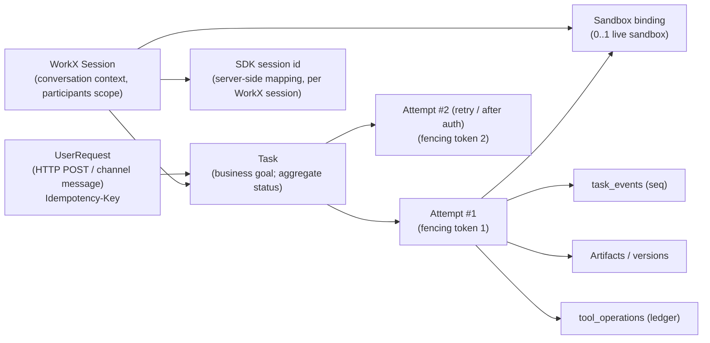
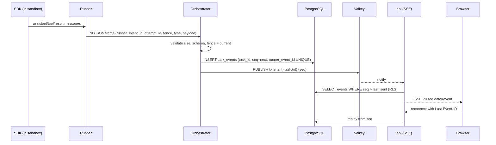

# Part 4 — Agent runtime: Claude Agent SDK + E2B (request §5.2)

Status: **[PO]** direction, **[DOC]** design in `CLAUDE-E2B-RUNTIME.md` and ADR-0001, **[VALIDATE]** for production. The prototype simulates execution with `setTimeout` (TK-06, CU-05); no model call, sandbox, or Runner exists.

## 1. Facts the design depends on (verified this session)

| Fact | Source |
| --- | --- |
| The SDK spawns a `claude` CLI subprocess over stdio; that subprocess owns a shell, working directory, and JSONL transcripts on local disk. One session = one subprocess. | [SDK hosting](https://code.claude.com/docs/en/agent-sdk/hosting) ✅ |
| Starting point 1 GiB RAM, 5 GiB disk, 1 CPU per agent; memory grows with session length. | same ✅ |
| `SessionStore` mirrors **transcripts only**, is best-effort (`mirror_error` messages), and memory files/artifacts need separate storage. | same ✅ |
| No top-level session timeout: bound with `max_turns`; recycle long sessions. | same ✅ |
| Multi-tenant hardening: `setting_sources=[]`, `CLAUDE_CODE_DISABLE_AUTO_MEMORY=1`, per-tenant `CLAUDE_CONFIG_DIR`, explicit `cwd`, per-tenant egress. | same ✅ |
| `ANTHROPIC_BASE_URL` routes sampling requests to a proxy that injects credentials; `HTTPS_PROXY` creates opaque CONNECT tunnels; Node `fetch()` ignores proxy env by default. | [SDK secure deployment](https://code.claude.com/docs/en/agent-sdk/secure-deployment) ✅ |
| `allowed_tools` auto-approves; unlisted tools remain available; `disallowed_tools` with a bare name removes the tool; `dontAsk` denies anything that would prompt; hooks run first and can deny even in bypass mode. | [SDK permissions](https://code.claude.com/docs/en/agent-sdk/permissions) ✅ |
| SDK does not run OAuth; servers report `needs-auth`/`failed`; the app supplies tokens via `headers`. | [SDK MCP](https://code.claude.com/docs/en/agent-sdk/mcp) ✅ |
| Skills load from setting sources or from a specific path via `plugins`; `skills=[...]` restricts invocation, but unlisted skill files stay reachable through Read/Bash. | [SDK skills](https://code.claude.com/docs/en/agent-sdk/skills) ✅ |
| E2B: egress can be disabled or allow-listed (`allowOut` hostnames/CIDRs with `denyOut` all traffic); rules can be updated live. | [E2B internet access](https://docs.e2b.dev/network/internet-access) ◐ |
| E2B pause keeps filesystem and memory (or filesystem only); resume resets timeout to default; auto-pause on timeout available. Retention limits for paused sandboxes not verified from E2B. | [E2B persistence](https://docs.e2b.dev/sandbox/persistence) ◐ |
| E2B infra is Apache-2.0; single-host "Embed" package ships as Terraform for GCP/AWS/Azure and a Kubernetes manifest; Enterprise BYOC exists. | [e2b-dev/infra](https://github.com/e2b-dev/infra) ✅ |

## 2. Components and responsibilities

| Component | Zone | Owns | Must not |
| --- | --- | --- | --- |
| `api` | Control | Task submission, idempotency, SSE, cancel/retry/approval endpoints | Run agents; parse files |
| `orchestrator` | Control | Scheduling, Attempt leases + fencing, sandbox lifecycle, input staging, Runner adapter, event persistence, artifact ingestion, checkpoint upload | Make tool calls on behalf of the agent; read upstream secrets |
| WorkX Runner | Execution | Validate RunSpec, configure `ClaudeSDKClient`, translate SDK messages to protocol frames, handle control messages, drain on stop | Authorize anything; hold long-lived secrets |
| Claude Agent SDK + CLI | Execution | Agent loop, built-in tools, context management, transcripts | Persist business state |
| `model-gateway` | Trusted | Validate model ticket, inject Anthropic key, enforce token budget, record usage, stream passthrough | Accept non-Anthropic upstreams in R1 |
| `tool-gateway` | Trusted | MCP server facing sandbox; per-call ticket + policy check; upstream MCP/HTTP client; operation ledger; result redaction | Accept upstream URLs from the agent |
| `broker` | Trusted | Ticket issuance/verification, connection resolution, token refresh, decryption | Expose plaintext to `api` |
| `reconciler` (in `worker`) | Control | Expired leases, orphaned sandboxes, stuck states, unknown operations | Re-run tools blindly |

## 3. Lifecycles and identifiers



| Lifecycle | States (summary; full machines in Part 11 §5) | Notes |
| --- | --- | --- |
| UserRequest | received → deduplicated → task created | Idempotency key scope `(tenant, principal, route)`; channel events dedupe on `(binding, platform_event_id)` |
| Task | queued → running → (awaiting_approval / needs_auth / waiting_external) → finalizing → succeeded / failed / cancelled | Aggregate; never "running" without a live Attempt |
| Attempt | pending → provisioning → running → draining → ended(reason) | Exactly one non-ended Attempt per WorkX Session; immutable after end |
| WorkX Session | open → idle → closed | Owns SDK session id and checkpoint lineage |
| Sandbox | requested → starting → ready → busy → idle → (paused) → terminated | Bound to one WorkX Session; replaceable |
| Artifact | staged → available → superseded / rejected / deleted | `available` only after validation + object upload + DB commit |

## 4. What is authoritative and what is cached

| State | Authoritative in | Cached/working copy in sandbox | Recovery if sandbox lost |
| --- | --- | --- | --- |
| Task/Attempt status, leases, fences | PG | — | none needed |
| Event history visible to users | PG `task_events` | Runner's in-memory buffer | Unacknowledged frames lost; Attempt marked `interrupted` |
| Tool side effects | PG `tool_operations` + upstream | — | Ledger drives reconciliation |
| Inputs (uploads, knowledge snapshot, skills) | Object storage + PG revision ids | `/mnt/session/uploads`, `/mnt/knowledge/<rev>`, `/mnt/skills/<rev>` | Re-stage from object storage by revision |
| Working files | Object storage checkpoint (at drain boundaries) | `/mnt/session/workspace` | Restore last checkpoint or start fresh (explicitly labeled) |
| Deliverables | Object storage + `artifact_versions` | `/mnt/session/outputs` until ingested | Lost if not yet ingested; Attempt reports partial results |
| SDK transcript | Object storage checkpoint (+ optional SessionStore mirror) | `$CLAUDE_CONFIG_DIR/projects/*.jsonl` | Resume from checkpointed transcript if compatible, else new SDK session with summary |
| Agent configuration | PG `agent_versions` (immutable) | Rendered system prompt + plugin dir | Re-render from version id |
| Credentials | Trusted zone only | **Opaque tickets only** | Re-issue on new Attempt |

## 5. Sandbox lifecycle policy

| Phase | Policy |
| --- | --- |
| Template | One E2B template per Runner release: pinned base image digest, Python version, `claude-agent-sdk` exact version (CLI binary is bundled and pinned to the SDK version per [SDK hosting](https://code.claude.com/docs/en/agent-sdk/hosting) ✅), Runner wheel, office/PDF libraries, fonts (CJK). Template ID recorded on every Attempt. |
| Version pinning | `runtime_releases` table: `{release_id, e2b_template_id, sdk_version, runner_version, protocol_version, status}`. Agents run on the tenant's pinned release; rollout by percentage of new Sessions; existing Sessions stay on their release until closed. |
| Creation | On first Attempt of a Session: create sandbox with metadata `{tenant_id, session_id, attempt_id, release_id}`, timeout = attempt wall limit + margin, egress allow-list = gateway hosts only, no `envs` containing secrets. |
| Staging | Orchestrator writes RunSpec and input manifest to `/run/workx/<attempt>/`, downloads inputs from object storage (orchestrator streams bytes; the sandbox receives no storage credentials), verifies SHA-256, sets permissions (Part 5). |
| Reuse | Same Session's next Attempt reuses the live sandbox if: same release, sandbox healthy, previous Attempt drained cleanly, and authorization context unchanged (participants, grants epoch). Otherwise replace. |
| Idle | After an Attempt ends: drain → checkpoint upload → revoke tickets → **terminate** (default). Optional optimization **[VALIDATE]**: if the user is likely to follow up within N minutes (chat UI open), pause instead; on resume, re-issue tickets and re-verify release and epochs. Paused state contains memory; tickets in it are already revoked server-side. |
| Teardown | Terminate on Session close, tenant suspension, member removal affecting the Session, release retirement, or idle TTL. Reconciler terminates any E2B sandbox whose metadata does not map to a live binding (orphan sweep every 5 min). |
| Recovery | Sandbox crash/unreachable → Attempt `interrupted(sandbox_lost)` → Task may auto-retry once (policy) with new sandbox, restored checkpoint, and ledger context. |
| Warm pool | Not in R1. Trigger: p95 time-to-first-token > 8 s attributable to sandbox start in production metrics. Pool contains unbound sandboxes from the current template with egress closed; binding to a tenant happens at claim time; unclaimed sandboxes expire after 10 min. Never pre-stage tenant data. |

## 6. Runner configuration and SDK options

RunSpec (protocol v1, extends `API-AND-EVENTS.md`):

```json
{
  "protocol_version": "1",
  "tenant_id": "ten_…", "task_id": "tsk_…", "attempt_id": "att_…", "workx_session_id": "ses_…",
  "fencing_token": 7,
  "release_id": "rt_2026_11_0",
  "agent_version_id": "agv_…",
  "model": "claude-<tier-id-from-config>",
  "system_prompt_ref": "/run/workx/att_…/system_prompt.md",
  "input_manifest": "/run/workx/att_…/inputs.json",
  "cwd": "/mnt/session/workspace",
  "plugins": ["/mnt/skills/skb_42/workx-curated"],
  "skills": ["report-writer", "xlsx-builder"],
  "mcp": {"workx": {"type": "http", "url": "https://tools.gw.workx.example/mcp/att_…", "ticket_ref": "env:WORKX_TOOL_TICKET"}},
  "model_gateway": {"base_url": "https://model.gw.workx.example", "ticket_ref": "env:WORKX_MODEL_TICKET"},
  "resume": {"sdk_session_id": "…", "transcript_ref": "/run/workx/att_…/transcript.jsonl"} ,
  "limits": {"max_turns": 40, "wall_seconds": 1800, "max_output_bytes": 524288000},
  "ledger_context_ref": "/run/workx/att_…/completed_operations.json"
}
```

Runner → SDK mapping (Python):

```python
options = ClaudeAgentOptions(
    cwd="/mnt/session/workspace",
    setting_sources=[],                          # no user/project/local settings, no .mcp.json, no CLAUDE.md discovery
    plugins=[{"type": "local", "path": p} for p in spec.plugins],   # curated Skills at a pinned revision
    skills=spec.skills,                          # explicit allow-list of invocable skills
    system_prompt=render(spec.system_prompt_ref),# platform baseline + agent version + project context
    model=spec.model,
    max_turns=spec.limits.max_turns,
    permission_mode="dontAsk",                   # anything not pre-approved is denied, never prompts
    allowed_tools=["Read", "Glob", "Grep", "Edit", "Write", "Bash", "Skill", "mcp__workx__*"],
    disallowed_tools=["WebFetch", "WebSearch"],  # network tools removed; web access only via gateway tools
    hooks={"PreToolUse": [path_guard, approval_gate], "PostToolUse": [emit_tool_event]},
    mcp_servers={"workx": {"type": "http", "url": spec.mcp.workx.url,
                           "headers": {"Authorization": f"Bearer {os.environ['WORKX_TOOL_TICKET']}"}}},
    env={"ANTHROPIC_BASE_URL": spec.model_gateway.base_url,
         "ANTHROPIC_API_KEY": os.environ["WORKX_MODEL_TICKET"],   # opaque model ticket, not a real key
         "CLAUDE_CONFIG_DIR": "/home/agent/.claude-ses",
         "CLAUDE_CODE_DISABLE_AUTO_MEMORY": "1"},
)
```

Notes:
- Exact option names and plugin path format are pinned to the SDK version during spike S-01; the table above shows intent.
- `path_guard` (PreToolUse) denies Edit/Write targets outside `/mnt/session/{workspace,outputs}` — a correctness guard, not the security boundary (Part 5 §4).
- `approval_gate` handles approval-required tools: emits `approval_requested`, ends the turn waiting for a control message (see §10), and lets the Tool Gateway verify the approval again server-side.
- Tickets enter the Runner process environment from a file the orchestrator writes at start, then the file is deleted. They are short-lived, revocable, and scoped (Part 6 §5).
- Prompt layering (highest precedence first): platform safety baseline → tenant policy → agent version instructions → project context → task input. Retrieved knowledge and tool results are inserted as quoted, labeled untrusted content.

### Resource and budget limits

| Limit | Enforced by | Default (to tune) |
| --- | --- | --- |
| Turns per Attempt | SDK `max_turns` | 40 |
| Wall time per Attempt | Orchestrator timer + E2B sandbox timeout | 30 min (chat), 2 h (long tasks) |
| Tokens / cost per Attempt and per Task | Model Gateway (rejects with budget error event) | Per plan; e.g., USD-equivalent cap |
| Tenant monthly budget | Model Gateway + `usage` module | Per plan |
| Concurrent Attempts per tenant | Orchestrator admission | Personal 2, org by plan |
| Sandbox CPU/RAM/disk | E2B template sizing | 2 vCPU / 4 GiB / 10 GiB [VALIDATE] |
| Tool calls per Attempt; per-tool rate | Tool Gateway | 300; per connector |
| Output bytes | Ingestion validator | 500 MiB per Attempt, 100 MiB per file |

## 7. Event streaming



- Text deltas are coalesced by the orchestrator (e.g., 100 ms windows) before persistence to keep `task_events` manageable; full final message text is stored once in `task_messages`.
- Backpressure: if PG writes lag, orchestrator buffers up to N frames per Attempt; beyond that, Runner is paused via control message (`throttle`).
- Raw SDK messages are not stored by default; a redacted diagnostic copy can be kept with short retention for debugging.

## 8. Network egress

- E2B egress policy at create: `denyOut: all traffic`, `allowOut: [tools-gw host, model-gw host, package mirror host (optional)]` ([E2B internet access](https://docs.e2b.dev/network/internet-access) ◐). Verify DNS, IPv6, raw IP, and redirect behavior in spike S-03.
- Package installs at run time are disabled by default; templates preinstall dependencies. If a tenant enables runtime package installation (R3), route through a WorkX-operated package proxy with allow-listed registries and malware scanning.
- Web browsing/fetching is offered as a Tool Gateway tool (`web_fetch`) with SSRF protection, content-type limits, and response sanitization; the built-in `WebFetch`/`WebSearch` tools are disabled.
- Gateways treat every request as hostile: ticket required, request size limits, per-ticket rate limits.

## 9. Long-running tasks and external callbacks

Rule: **never keep a sandbox alive to wait for something outside it.**

| Wait reason | Task state | Sandbox | Resume trigger |
| --- | --- | --- | --- |
| Human approval | `awaiting_approval` | Kept running up to 10 min; then drain → checkpoint → terminate (Attempt ends `awaiting_approval_timeout`) | Approval decision → same Attempt if alive, else new Attempt |
| Missing authorization | `needs_auth` | Drain → checkpoint → terminate | Connection becomes active (Part 6 seq 7) |
| External job (e.g., long export, third-party async API, webhook) | `waiting_external` | Drain → checkpoint → terminate | Signed callback or poll job marks the awaited operation complete → new Attempt with result injected |
| Scheduled continuation (automation) | `scheduled` | none | Scheduler job |

External callbacks reach `/api/v1/callbacks/{callback_id}` with an HMAC (or provider signature) bound to `(tenant_id, task_id, operation_id)`; the `callback_id` is single-use and expires.

## 10. Cancellation, retry, idempotency, checkpoints, partial results, recovery

### 10.1 Cancellation

1. `POST /tasks/{id}/cancel` → transaction: `task.cancel_requested_at=now`, `attempt.status='cancelling'`, revoke all leases for the Attempt (`credential_leases.revoked_at`), outbox `task.cancel_requested`. Returns 202.
2. Gateways reject further calls immediately (ticket revoked).
3. Orchestrator sends `cancel` control → Runner calls `client.interrupt()` → drains → exits.
4. If no exit within 20 s, orchestrator kills the Runner process; within 60 s, terminates the sandbox.
5. Outputs already in `/mnt/session/outputs` are ingested as **partial** artifacts if they pass validation (configurable per agent); Task → `cancelled`.
6. Side effects already sent upstream are not rolled back; the ledger shows them.

Race rule: terminal transitions use `UPDATE ... WHERE row_version = :v`; whichever commits first wins (cancel vs success), as defined in `API-AND-EVENTS.md`.

### 10.2 Retry

- Automatic: only for infrastructure failures (sandbox lost, gateway 5xx before any side effect, model overload) — max 1–2 retries with backoff.
- Manual: `POST /tasks/{id}/retry` → new Attempt with next fencing token; if the ledger has `unknown` operations, the API returns `409 RECONCILIATION_REQUIRED` with the list.

### 10.3 Idempotency layers

| Layer | Key | Guarantee |
| --- | --- | --- |
| Task submission | `Idempotency-Key` + request hash per `(tenant, principal)` | Same request → same task; different body → 409 |
| Channel inbound | `(binding_id, platform_event_id)` unique | One task per platform event |
| Jobs | `dedupe_key` unique while pending | One active job per key |
| Events | `(attempt_id, runner_event_id)` unique | Replayed frames ignored |
| Tool operations | `operation_key` (see below) | No duplicate side effect for the same logical operation within a Task |
| Artifacts | `(task_id, logical_name, content_sha256)` | No duplicate versions from retries |
| Deliveries | `(task_id, artifact_version_id, target)` | One delivery record per target; retries reuse it |

### 10.4 Preventing duplicate external actions across Attempts

A new Attempt is a new model run; it will not reproduce the same tool-call ids. WorkX therefore defines side-effect identity outside the model:

1. Every tool in the connector registry declares `effect: read | write_idempotent | write_non_idempotent` and an `operation_key_fields` list (e.g., for "send message": `channel_id`, `content_hash`; for "create doc": `folder_id`, `title`).
2. Before calling upstream, the Tool Gateway computes `operation_key = H(task_id, tool, normalized(key_fields))` and inserts `tool_operations(status='started')` with a unique constraint on `(task_id, operation_key)`.
3. On conflict: if `succeeded`, return the recorded result (marked `deduplicated: true`) without calling upstream; if `started`/`unknown`, return `OPERATION_IN_DOUBT` and require reconciliation.
4. Upstream timeout on a non-idempotent write → `unknown`; reconciler uses the connector's `reconcile` method (search by client reference, list recent items) if available; otherwise a human must confirm.
5. New Attempts receive `completed_operations.json` summarizing succeeded/unknown operations so the model does not attempt them again; the gateway check is the enforcement.
6. Where the upstream supports idempotency keys (header or client token), the gateway passes `operation_key` through.

### 10.5 Checkpoints and partial results

- Checkpoint = tarball of `/mnt/session/workspace` (size-capped, excluding caches) + SDK transcript JSONL + manifest `{release_id, cwd, config_revision, knowledge_revision, event_cursor, sha256}`; created only at drain boundaries (no tool call in flight), uploaded by the orchestrator to `t/{tenant}/checkpoints/{session}/{attempt}.tar.zst`, encrypted at rest, retention 14 days after Session close.
- Credentials, tickets, `CLAUDE_CONFIG_DIR` auth/config files, and `/run/workx` are excluded by allow-list (only `projects/**.jsonl` transcripts are taken).
- Partial results: any validated file in `outputs/` at termination becomes an `artifact_version` with `completeness='partial'`, visible with a clear label.

### 10.6 Dead letters and reconciliation

- Jobs exceeding max attempts → `state='dead'`, alert, operator runbook; UI shows the Task as `failed(system_error)` with retry.
- Reconciler loops (every 30 s): expired Attempt leases → probe sandbox → kill if fence superseded → Attempt `interrupted(lease_expired)`; Tasks in `finalizing` > 10 min → re-run ingestion idempotently; deliveries in `sending` beyond timeout → `unknown` → platform receipt query; orphaned sandboxes → terminate; `tool_operations` in `started` > timeout → `unknown`.

## 11. `needs_auth` in the runtime

Full credential sequence in Part 6 (sequence 7). Runtime specifics:

1. Detection points: (a) **preflight** at Attempt creation — Broker resolves every binding of the agent version for the initiator; missing/expired connection → Task `needs_auth` before any sandbox is created; (b) **mid-run** — Tool Gateway returns a structured MCP tool error `{code: "NEEDS_AUTH", authorization_request_id}` and emits `auth.required` through the orchestrator.
2. Mid-run handling: orchestrator sends `drain` → Runner lets the SDK finish the current turn (the agent sees the tool error text "authorization pending; stop and summarize") → Runner exits → checkpoint → Attempt ends `waiting_auth` → leases revoked → sandbox terminated.
3. `pending_operations` stores the tool, normalized args hash, and why it was blocked; the blocked call was **not** sent upstream, so it is safe to retry.
4. After authorization: new Attempt, new fence and tickets, checkpoint restored, ledger context injected, and a resume prompt ("Authorization for X is now available; continue from where you stopped").

## 12. Artifact ingestion

1. Runner emits `artifact_candidate {relative_path, logical_name, mime_hint}` for files in `outputs/`; at Attempt end the orchestrator also scans `outputs/` itself (Runner reports are hints, not trusted).
2. Orchestrator reads each file through the E2B filesystem API after resolving the path inside the sandbox and refusing symlinks, devices, hard-link tricks, paths outside `outputs/`, and files above size caps.
3. Validation outside the sandbox: magic-byte type detection; allow-list of types (md, txt, pdf, docx, xlsx, pptx, csv, png, jpg, svg sanitized, html → sanitized or stored as download-only); Office files checked for macros (reject `.docm` etc.); optional AV scan.
4. Upload to `t/{tenant}/artifacts/{artifact_id}/{version_id}` with server-generated key; insert `artifact_versions` with sha256, size, mime, source attempt, completeness; outbox `artifact.published`.
5. The Task becomes `succeeded` only after required artifacts are `available` (text answers are stored as an artifact of type `message`).

## 13. Threats specific to agent execution

| Threat | Controls |
| --- | --- |
| Prompt injection via documents, web content, tool results, chat messages | Untrusted-content labeling in prompts; tools never take credentials or URLs from model text for privileged routes; least-privilege tickets; approval gates for high-risk writes; egress allow-list (exfiltration limited to gateway tools, which have their own destination rules); output review for channel replies to external groups (policy) |
| Malicious or compromised Skill | Curated catalog only in R1; Skills reviewed and hashed; installed as read-only copies; Skills cannot add tools or permissions (tool list comes from agent version); Skill scripts run inside sandbox with no secrets |
| Malicious package/dependency | Pinned template; no runtime installs by default; SBOM + vulnerability scanning in template CI |
| Network exfiltration | E2B allow-list; gateway destination rules; DNS/IP tests; tickets scoped per attempt |
| Process execution abuse (crypto-mining, fork bombs) | E2B microVM resource limits; wall-time; cost caps; anomaly alert on CPU-heavy attempts |
| Sandbox escape | Relies on E2B Firecracker isolation; no secrets or tenant data from other sessions inside any sandbox limits blast radius; vendor security review (Part 13) |
| Ticket theft by in-sandbox code | Tickets are assumed readable by agent code: scoped to this attempt's tools, short TTL (≤ 15 min, renewed by orchestrator heartbeat), revoked on end/pause |
| Cross-session context bleed | One sandbox per Session; `setting_sources=[]`; auto-memory disabled; per-session `CLAUDE_CONFIG_DIR`; participants change → new SDK session |

## 14. Local development, integration tests, production readiness

| Level | Setup |
| --- | --- |
| Unit | Runner protocol, SDK adapter with recorded SDK message fixtures; policy evaluator; ledger; state machines (property tests). |
| Local dev | `docker compose` for PG, Valkey, object storage (SeaweedFS), Keycloak, Tika; **two sandbox backends behind `SandboxProvider`**: `E2BProvider` (real, dev API key) and `LocalDockerProvider` (developer laptop only: hardened container with `--network` to local gateways). Model Gateway can run in `replay` mode with recorded responses for deterministic tests. |
| Integration (CI) | Real E2B (dedicated CI project), real Model Gateway with a low-budget key, fake upstream MCP/OAuth servers (WorkX test doubles), canary secrets to detect leakage. |
| Agent evaluation | Golden task suite per agent template; graded by rubric + LLM-as-judge; regression gate on Runner/SDK/template upgrades. |
| Production readiness | Load: N concurrent Attempts per tenant and overall; chaos: kill orchestrator mid-attempt, kill sandbox, Valkey loss, PG failover; security: egress bypass attempts, ticket replay, path traversal in outputs; cost: per-attempt cost distribution. Exit criteria in Part 14 §1. |

## 15. Alternatives and evidence that would justify a change

| Alternative | What it simplifies | What it costs | Evidence that would justify switching |
| --- | --- | --- | --- |
| **A. Claude Managed Agents** (Anthropic-hosted loop; cloud or self-hosted sandbox; vaults with host-scoped header injection) ([Managed Agents secure deployment](https://platform.claude.com/docs/en/managed-agents/secure-deployment) ◐) | No CLI subprocess hosting, built-in credential vaults and egress rules, session persistence | Different API surface; self-hosted sandboxes are beta and don't support env-variable credentials; data handled by Anthropic-hosted loop; still subject to Claude region availability | Spike S-01/S-05 show unacceptable Runner complexity or resume reliability, and Managed Agents' tenancy/vault model maps to WorkX's per-tenant ownership |
| **B. Self-written loop with the Client SDK tool runner in WorkX workers; E2B only as a code-execution tool** | No CLI process, simpler state, full control of tools | Rebuild context management, file tools, Skills semantics; diverges from [PO] direction | SDK upgrades repeatedly break the Runner, or WorkX tasks rarely need filesystem/shell |
| **C. SDK in WorkX-operated isolation (Firecracker/gVisor on Kubernetes) or self-hosted E2B infra** | Region control (incl. China via C-01b), no vendor dependency | Operating microVM fleet; security responsibility | Data residency requirement, E2B unavailable in target region, or sandbox cost > 25% of model cost at scale |

The provisional design keeps the Claude Agent SDK + E2B. The Runner protocol and `SandboxProvider` abstraction keep alternatives B and C feasible without changing Task/Attempt/Gateway contracts.
