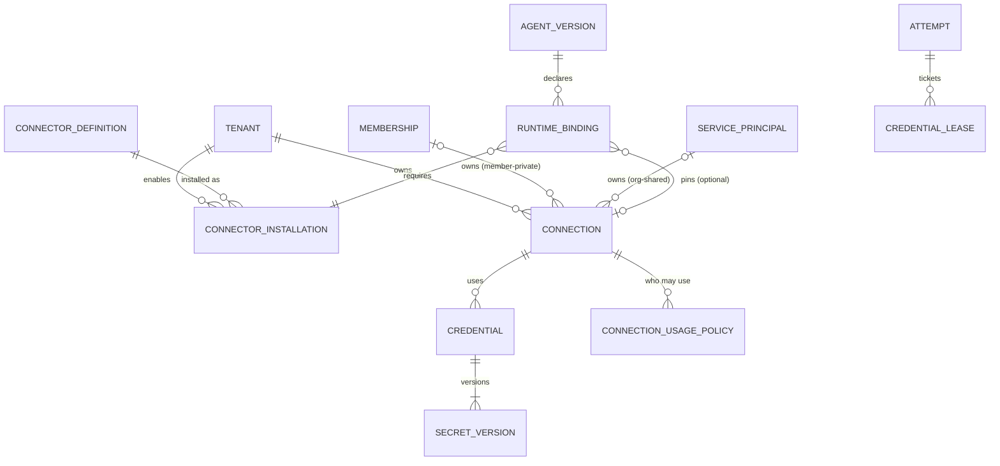
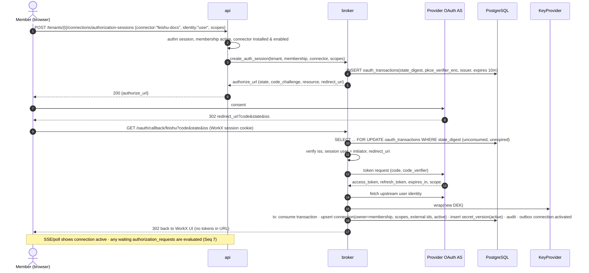
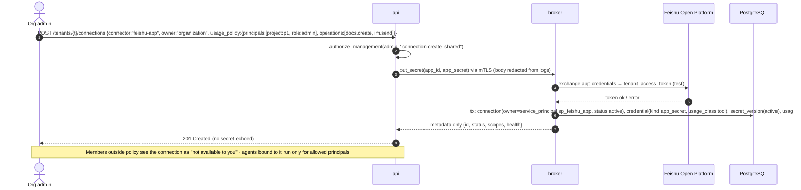
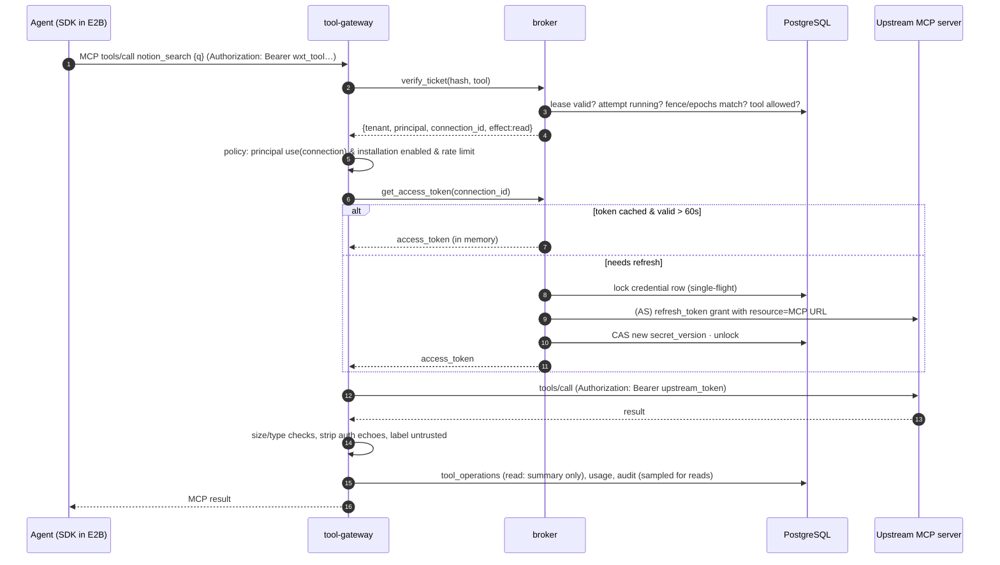
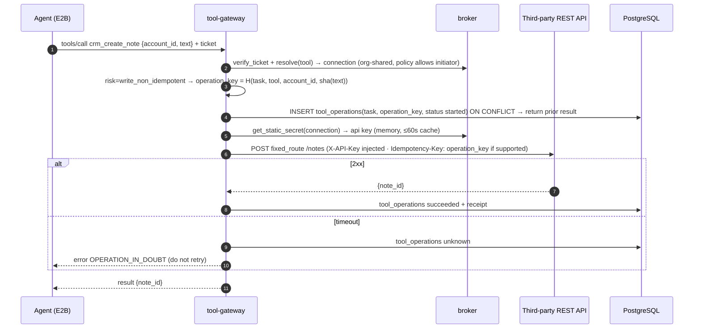
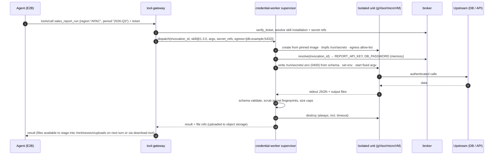
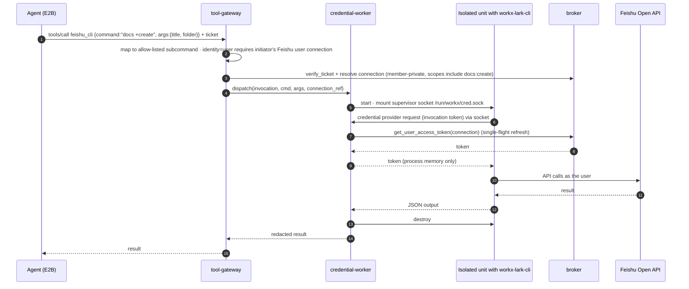
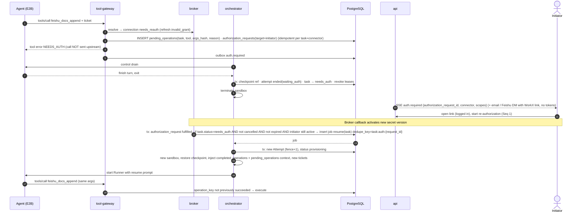
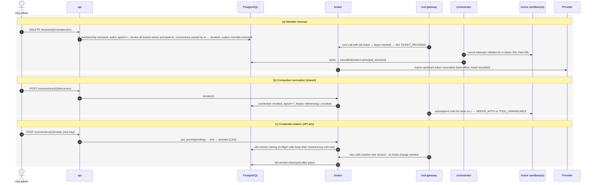

# Part 6 — Credentials, OAuth, MCP, Skills, CLI, and connectors (request §5.4)

Status: **[PROTO]** stores connection *metadata only* (provider, auth mode none/static/oauth/exchange/envfile, owner scope member/space, agent links) with an explicit allow-list that never persists secrets (`spaces-model.js` `saveConnectionMetadata`); channel secrets live only in modal memory (IN-14). **[DOC]** `CREDENTIAL-SOLUTION.md` (normative) defines classes 0/A/B/C/D, PG ciphertext + OpenBao Transit, Broker/Gateway, Credential Worker, no Nango. This part keeps those rules and makes them implementable.

## 1. Integration classification

| Request category | WorkX class | Where the credential is used | Agent sees | R1? |
| --- | --- | --- | --- | --- |
| No-auth HTTP MCP | **0** | Tool Gateway → upstream without auth header | `mcp__workx__<tool>` + attempt ticket | ✔ |
| API key / bearer / custom header (HTTP MCP or REST) | **A** | Tool Gateway injects header on fixed route | same | ✔ |
| OAuth-protected HTTP MCP / REST (user-delegated) | **B** | Broker holds refresh token, Gateway injects short-lived access token | same; `needs_auth` when missing | ✔ (1–2 providers) |
| App credentials exchanged/signed (Feishu `tenant_access_token`, WeCom `access_token`, HMAC-signed APIs) | **C** | Broker exchanges/signs; Gateway calls | same | ✔ (Feishu) |
| Local stdio MCP **without** secrets | **0** (in-sandbox) | Runs inside sandbox as a stdio server with non-secret env | tool from local server | R2 (curated only) |
| Local stdio MCP **with** secrets; Skills needing env vars, `.env`, certificates, DB passwords | **D** | Credential Worker: isolated unit per invocation, secret env/files materialized there | remote tool via Gateway | R2 |
| CLI tools needing credentials (Feishu CLI `lark-cli`) | **C/D** | Credential Worker with credential-provider extension (§8) | remote tool via Gateway | R2 |
| Webhook / event-driven inbound (Feishu events, third-party webhooks) | **Channel / inbound** | channel-worker verifies signatures with channel-class secrets | nothing; produces tasks | ✔ (Feishu) |

Rule: a Skill or connector declares the **least powerful class** that works. A Skill that could call an API through the Gateway (class A) must not be packaged as class D.

## 2. Ownership and scope model



| Owner type | Who can use it | Typical use | Example |
| --- | --- | --- | --- |
| **Personal-tenant connection** (`tenant=personal`, owner=the user's membership) | Only that user, only in their personal workspace | Personal Google Drive, personal GitHub token | Never visible to any organization |
| **Member-private connection in an org** (`tenant=org`, owner=membership) | Only that member, in tasks they initiate in that org (and delegated automations they own) | Member's Feishu user OAuth (docs/calendar) | Org admins see metadata only and can revoke; cannot use |
| **Org-shared connection** (`tenant=org`, owner=service principal) | Principals allowed by `connection_usage_policy`: roles, projects, listed members, specific agents | Org's Feishu app (class C), team CRM API key (class A) | Created by owner/admin; every use audited with the initiating principal |

Rules:
1. The same upstream account used in two workspaces requires two separate connections (two consents). Refresh tokens are never copied across tenants **[DOC]**.
2. Sharing an agent never shares a member-private connection. Bindings resolve per initiator (§4).
3. Org-shared connections must state **explicit usage scope**: `allowed_principals` and `allowed_operations` (subset of the connector's tools); default is "owners/admins only, no tools", so creating one does not silently empower everyone.

## 3. Storage, keys, lifecycle

### 3.1 Records

| Table | Holds | Access |
| --- | --- | --- |
| `connector_definitions` (global catalog) | transport, auth_mode, identity_mode (user/app), usage_class, execution_location, tool schemas with `effect` and `risk`, fixed upstream routes, scopes catalog, adapter version | read-only to all services |
| `connector_installations` | tenant enablement, non-secret config, allowed tools | api, gateways |
| `connections` | tenant, owner, provider, external account/tenant ids, granted scopes, status, `authz_epoch`, `refresh_owner='broker'`, last refresh/health | api (metadata), broker |
| `credentials` | tenant, connection, `usage_class` (tool/channel/model/infrastructure), kind (oauth_refresh/api_key/app_secret/cert/env_bundle), `active_version_id` | broker |
| `secret_versions` | AEAD ciphertext, nonce, wrapped DEK, `key_ref`, `key_version`, fingerprint (HMAC of plaintext for duplicate detection), `not_after`, `state` (pending/active/retiring/destroyed) | **broker DB role only** |
| `credential_leases` | ticket hash, tenant, principal, task/attempt, sandbox, audience, tools, epochs, fence, expiry, revoked_at | broker (write), gateways (read via broker) |
| `oauth_transactions` | state digest, PKCE verifier (encrypted), issuer, client_ref, redirect_uri, requested scopes, initiator membership, expiry, consumed_at | broker |
| `authorization_requests` | task/attempt/pending op, requested connector/scopes, target membership, status | api (metadata), broker |

### 3.2 Encryption

- Per secret version: random 256-bit DEK; AES-256-GCM (or XChaCha20-Poly1305) with associated data `tenant_id|credential_id|version|usage_class`.
- DEK wrapped by `KeyProvider.wrap(key_ref)`; `key_ref` is per tenant for organization tenants (`kek/t/{tenant_id}`) and per region-cell for personal tenants (`kek/personal/{cell}`) to keep KMS key count bounded — trade-off documented; crypto-shredding of an org = destroy its KEK.
- `KeyProvider` implementations: `CloudKmsProvider` (managed SaaS), `OpenBaoTransitProvider` (self-hosted; Transit encrypt/decrypt with key versions per [OpenBao Transit](https://openbao.org/docs/secrets/transit/) — page linked by repo docs; OpenBao 2.6.x is the current stable line per [OpenBao release notes](https://openbao.org/community/release-notes/2-7-0/) ◐).
- Unwrapped DEKs and plaintext live only in Broker memory; optional in-memory cache ≤ 60 s for hot access tokens, zeroized best-effort on eviction.

### 3.3 Lifecycle operations

| Operation | Mechanism |
| --- | --- |
| Create (API key / app secret) | UI → `api` → Broker RPC `put_secret` over mTLS (value never stored by api, never logged; request body redaction middleware) → new `secret_version(pending)` → optional test call → `active` |
| Rotate | New version → validate → atomically switch `active_version_id` → old version `retiring` (kept for in-flight calls ≤ 10 min) → `destroyed` (ciphertext overwritten, DEK discarded) |
| Expiry | `not_after` from provider metadata; sweeper notifies owners 14/3/1 days ahead; expired → connection `needs_reauth` |
| Refresh (OAuth) | Broker only. Single-flight per connection: `SELECT ... FOR UPDATE` on `credentials` row (or advisory lock), refresh with current refresh token, write new version with CAS on `active_version_id`; if the provider rotates refresh tokens single-use (Feishu does: each `refresh_token` usable once and replaced, lifetime returned in `refresh_token_expires_in` — [Feishu refresh user_access_token](https://open.feishu.cn/document/authentication-management/access-token/refresh-user-access-token.md) ◐), the new refresh token is committed **before** returning the access token to callers |
| Revocation (local) | `connections.status='revoked'`, `authz_epoch++`, revoke leases, purge caches; Gateways reject next call |
| Revocation (upstream) | Async job calls provider revocation endpoint if available; result recorded separately (local revocation does not depend on upstream success) |
| Audit | Every create/rotate/use/refresh/revoke/test writes `audit_events` with principal, tenant, connection, operation, outcome — never values |

## 4. Declaring requirements and binding them

### 4.1 Skill / connector manifest (WorkX extension, alongside SKILL.md)

```yaml
# workx-skill.yaml (schema v1) — packaged with the Skill; contains no secret values
skill_id: sales-report
version: 1.3.0
execution:
  location: sandbox            # sandbox | credential_worker
requires:
  tools:
    - connector: crm-api       # resolved to a ConnectorInstallation
      operations: [search_accounts, get_opportunity]
      class: A
    - connector: feishu-docs
      operations: [create_doc, append_blocks]
      class: B
      identity: user           # user | app
  config:
    REGION: {type: string, required: true, secret: false}
  secrets: []                  # sandbox Skills may not declare secrets
```

A Skill with `execution.location: credential_worker` may declare `secrets` with `inject: env|file` and a fixed `argv`; it is exposed to the agent as a Gateway tool, not as an in-sandbox script.

### 4.2 Resolution at run time

```text
AgentVersion.runtime_bindings
  → for each required (connector, operations, identity):
      installation = enabled installation in task.tenant
      candidate connections =
          identity=user → member-private connection of the INITIATOR in this tenant
          identity=app  → org-shared connection whose usage policy allows initiator + operations
      pinned connection (if the agent version pins one) must be in candidates
      none → missing dependency → needs_auth (user) or needs_configuration (admin)
  → Broker issues ONE attempt ticket listing allowed tools and their resolved connection ids
```

The task "authorizes integration use" by receiving a ticket that names tools, not secrets. The sandbox never learns which credential or version backs a tool.

## 5. Runtime identity: attempt tickets

| Property | Value |
| --- | --- |
| Format | 256-bit random, base64url, prefix `wxt_`; stored as SHA-256 hash |
| Audience | `tool-gateway` or `model-gateway` (separate tickets) |
| Binding | tenant, principal (membership or service principal), task, attempt, sandbox id, fencing token, tenant epoch, principal epoch, allowed tools/connection ids, budget id |
| TTL | 15 min; orchestrator renews while Attempt heartbeats (`renew` extends `expires_at`, never scope) |
| Revocation | On Attempt end, cancel, pause, member removal, connection revocation, tenant suspension |
| Threat assumption | Readable by any code in the sandbox; therefore useful only for this Attempt's declared tools during its lifetime |

Why opaque instead of JWT: immediate revocation, no key distribution to gateways, small blast radius. Cost: one indexed lookup per call (cached ≤ 5 s with revocation pub/sub).

## 6. Gateway and injection

### 6.1 Tool Gateway as MCP aggregator

- Presents **one** MCP server (`workx`) to the sandbox with tools namespaced by connector (`crm_search_accounts`, `feishu_docs_create_doc`). Tool list = tools in the ticket.
- Upstream side, acts as an MCP **client** (or REST client) per connection. The MCP authorization model forbids passing through tokens received from the client to upstream servers; WorkX never does this — upstream tokens are obtained by WorkX as its own OAuth client, audience-bound to the upstream resource ([MCP authorization 2025-11-25](https://modelcontextprotocol.io/specification/2025-11-25/basic/authorization) ◐; latest dated spec is 2026-07-28 per the spec repository listing ✅ [repo](https://github.com/modelcontextprotocol/modelcontextprotocol/tree/main/docs/specification)).
- Fixed routes: upstream base URL comes from `connector_definitions` or admin-configured installation (validated: HTTPS, public IP after DNS resolution, no redirects to private ranges, re-resolved per connection, pinned per request).
- Response handling: size caps, content-type checks, removal of echoed `Authorization`/cookies, credential-pattern scrubbing (defense in depth), and annotation of results as untrusted content.

### 6.2 MCP OAuth client registration strategy

Per the 2025-11-25 spec, clients SHOULD support Client ID Metadata Documents (CIMD) and MAY use Dynamic Client Registration; secondary sources report the 2026-07-28 revision deprecates DCR in favor of CIMD (⚠, not verified against the official changelog from this session). WorkX order:

1. **Pre-registered client** (admin enters client_id/secret for the upstream AS, or WorkX registered centrally for well-known servers).
2. **CIMD**: WorkX hosts `https://workx.example/.well-known/oauth-client/{connector}.json`; used when AS metadata advertises `client_id_metadata_document_supported`.
3. **DCR**: only if the AS advertises `registration_endpoint` and policy allows; registrations stored per (issuer, connector) as class-C secrets.
4. Otherwise: connector marked `unsupported_auth` with an admin message.

Always: PKCE S256, `state` (digest stored), exact redirect URI, RFC 8707 `resource` parameter set to the MCP server URL, `iss` validation in the authorization response when present, protected-resource metadata discovery with SSRF guards. **[VALIDATE S-08]** against at least three real MCP servers.

### 6.3 Optional: E2B native header injection

E2B can inject stored secrets into outbound HTTPS requests per host via an egress proxy outside the sandbox; plain HTTP gets no injection; unresolved references drop the header ([E2B secrets inject](https://docs.e2b.dev/secrets/inject) ◐). Useful later for tools that must call an API directly from the sandbox with a static header (class A) — but it would duplicate secrets into a vendor store and bypass WorkX per-call policy and ledger. Not used in R1; evaluate only for high-volume, low-risk read APIs.

## 7. Controlled-worker execution (class D)

| Aspect | Design |
| --- | --- |
| Unit of isolation | One ephemeral microVM/container per invocation (gVisor `runsc` or Firecracker) from a pinned image per runtime (python, node, lark-cli). No reuse across tenants; R2 may reuse per (tenant, connection) for ≤ 5 min with process restart. |
| Inputs | Fixed `argv` from manifest; arguments as JSON via stdin validated against the tool schema; files from the attempt passed by reference (object key) and copied in by the worker |
| Secrets | Resolved by Broker for this invocation; written to `env` of the child process only, or to files in a tmpfs (`0400`) inside the unit; never to disk images or logs |
| Network | Egress allow-list = the connector's declared upstream hosts |
| Outputs | stdout JSON (schema-validated), files to an output dir uploaded by the worker; scrubbed for secret fingerprints (exact match against known values + patterns) before returning |
| Cleanup | Unit destroyed after invocation; supervisor outside the unit enforces timeout and kill |
| Not allowed | Arbitrary shell from the agent; reading the Skill's own source from the agent workspace; persistence between invocations |

## 8. Feishu CLI (`lark-cli`) in a controlled worker

Facts: `lark-cli` is MIT-licensed; it supports a custom **credential provider** extension (chain of providers; first non-nil wins; a provider that takes over an account owns token resolution) and a **transport** extension; the official sidecar protocol is explicitly same-machine and "cross-machine deployment ... is not supported by this feature" ([lark-cli sidecar package](https://pkg.go.dev/github.com/larksuite/cli/sidecar) ◐, [Feishu: embed CLI in your agent](https://open.larkoffice.com/document/mcp_open_tools/feishu-cli/embed-feishu-cli-in-agent.md) ◐).

Design:
1. Build `workx-lark-cli` = upstream `lark-cli` + a WorkX credential provider compiled in, pinned version.
2. The provider calls the Broker over a Unix socket that the Credential Worker supervisor exposes **inside the isolated unit** (socket served by the supervisor outside the unit), passing the invocation ticket; the Broker returns the user or tenant access token for the bound connection only.
3. The agent invokes a Gateway tool such as `feishu_cli` with a structured command (`{"command": "docs +create", "args": {...}}`); the worker maps it to an allow-listed CLI subcommand (no free-form shell).
4. User identity commands require a member-private Feishu user connection of the initiator; bot/app commands require an org-shared Feishu app connection whose usage policy allows the initiator.
5. Never copy a user's local `lark-cli` login cache or keychain into any sandbox or worker **[DOC]**.
6. In-sandbox `lark-cli` with a cross-machine relay to WorkX remains a separate PoC; HMAC between relay and Gateway would not prove the caller is the CLI (agent code shares the sandbox) **[DOC]**.

## 9. OAuth callback protection, identity mapping, refresh races, recovery

| Concern | Control |
| --- | --- |
| Callback CSRF / mix-up | `state` is 256-bit random, digest stored with initiator membership, tenant, connector, issuer, expiry (10 min), single-use; callback validates issuer (`iss`) and redirect URI; one callback route per provider family |
| Session binding | Callback requires the initiator's WorkX session cookie *or* a one-time handoff code tied to the authorization request (for mobile/Feishu in-app browsers); mismatch → reject |
| Code injection | PKCE S256 always; code exchange from Broker only |
| External identity mapping | After token exchange, Broker fetches the upstream user id (e.g., Feishu `open_id`/`union_id` + tenant key) and stores it on the connection; for channel identity, `external_identities` links the Feishu user to the membership only via (a) an explicit WorkX-initiated linking flow, or (b) org admin bulk mapping by verified email from the Feishu directory (R2) — never by display name |
| Wrong account | If the user authorizes a different upstream account than an existing connection expects (re-auth), Broker refuses to replace silently; UI asks to create a new connection or confirm replacement |
| Refresh race | Single-flight + CAS (§3.3); losers wait for the winner's result; if refresh fails with `invalid_grant`, connection → `needs_reauth`, outstanding tool calls get `NEEDS_AUTH` |
| Refresh-token single-use loss (crash after provider rotated but before commit) | Write-ahead: store an `inflight_refresh` marker; on restart, attempt the stored token; if `invalid_grant`, mark `needs_reauth` and notify — unavoidable with single-use tokens; documented in runbook |
| Revocation detection | 401/invalid_token from upstream → one forced refresh attempt → still failing → `needs_reauth` |
| Recovery after re-auth | New secret version; connection `active`; waiting tasks with matching authorization requests are scheduled (seq 7) |

## 10. Credential platform options compared

| Option | License / commercial terms | Covers | Gaps for WorkX | Ops/TCO | Verdict |
| --- | --- | --- | --- | --- | --- |
| **Native adapters + Broker/Gateway (WorkX)** | Own code; uses Apache/MIT libs (Authlib, httpx, MCP SDK) ○ | Exactly classes 0–D, tenant model, ledger, tickets, Feishu/WeCom specifics | Each provider adapter costs effort; long-tail SaaS coverage slow | Part of the monolith; no extra vendor | **Recommended** |
| **Nango** | Elastic License (source-available, not OSI) per [Nango repo](https://github.com/NangoHQ/nango) ✅; free self-hosting "limited feature set" (auth + proxy, intended for hobby/evaluation), **MCP server not included** in free self-hosting, enterprise self-hosting has license + maintenance fees ([Nango free self-hosting](https://nango.dev/docs/guides/platform/free-self-hosting.md) ◐) | Large catalog of OAuth providers; token refresh; proxy | Does not cover class D, CLI, WorkX tickets/ledger, per-tenant ownership semantics; Feishu/WeCom coverage unverified; a second connection lifecycle to reconcile | Extra service + license cost at scale | Not adopted; **revisit trigger**: > 12 long-tail OAuth SaaS providers requested within two quarters, each with < 5% tenant adoption, and adapter effort > 1 engineer-quarter |
| **Hosted tool-auth platforms** (e.g., Composio, Arcade, Pipedream Connect) | Proprietary SaaS ○ | Fast catalog, managed OAuth, tool execution | Tokens and data processed by a third party; region constraints; per-tenant isolation model not WorkX's | Usage pricing | Not adopted (data-processing and residency concerns) |
| **Vault/OpenBao KV as secret store** | MPL-2.0 (OpenBao) ○ | Secret storage, leases | Second store for values that also need PG metadata, joins and RLS | Operate HA + seal | Not adopted; Transit-only use is acceptable (C-08) |
| **E2B secrets + header injection** | E2B terms | Outbound header injection | No refresh, no per-call policy/ledger, vendor-held copies | Low | Optional later adapter (§6.3) |

## 11. Sequence diagrams

### Seq 1 — User-authorized OAuth connection (member-private)



Checks: initiator authenticated and active; connector enabled for tenant; state single-use; PKCE; issuer. SoR: PG. Idempotency: second callback with same state → "already consumed" page. Audit: `connection.authorized`.

### Seq 2 — Organization-shared connection with explicit scope



### Seq 3 — OAuth-protected MCP invocation from an agent



### Seq 4 — API-key integration through broker/gateway (class A)



### Seq 5 — Skill requiring temporary environment variables or `.env` (class D)



### Seq 6 — Feishu CLI execution in a controlled worker



### Seq 7 — Expired authorization → `needs_auth` → safe continuation



Late or duplicate callbacks: if the task was cancelled or the request expired, the callback still stores the connection (user consented) but schedules nothing.

### Seq 8 — Revocation, member removal, and credential rotation during active tasks


