# Part 8 — User journeys and sequence diagrams (request C)

Each journey lists: **Auth** (authentication/authorization checks), **Tenant/SoR**, **APIs/events/states**, **Idempotency/recovery**, **Feedback/audit**. Credential internals referenced from Part 6 are not repeated.

## J1. Sign up and access the personal workspace

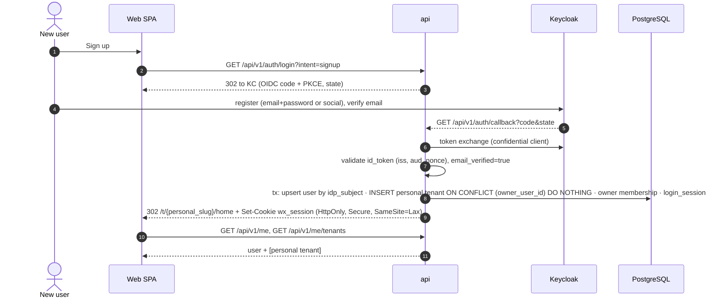

| Aspect | Detail |
| --- | --- |
| Auth | OIDC with PKCE; email must be verified before tenant provisioning |
| Tenant/SoR | Keycloak = credentials SoR; PG = user/tenant SoR |
| APIs/states | `auth/login`, `auth/callback`, `me`, `me/tenants`; tenant `provisioning→active` |
| Idempotency | Partial unique index on personal tenant; callback replay rejected by state |
| Feedback/audit | Lands in personal Home (empty state like prototype); `user.signed_up`, `tenant.created` |

## J2. Create an organization and invite a member

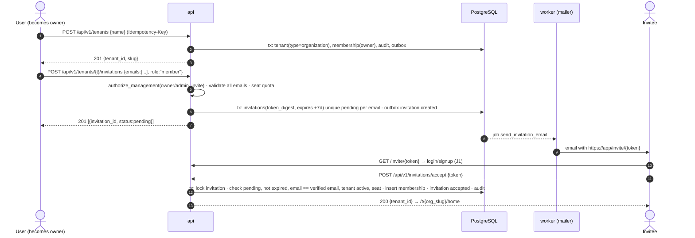

| Aspect | Detail |
| --- | --- |
| Auth | Owner/admin for invite; invitee must be authenticated with matching verified email |
| Tenant/SoR | Org tenant in PG; invitation tokens only as digests |
| APIs/states | Invitation `pending→accepted/cancelled/expired`; membership `active` |
| Idempotency | Batch invite all-or-nothing; acceptance replay returns same membership; email job dedupe per invitation |
| Feedback/audit | Pending list in Members page (prototype SA-08); `invitation.created/accepted`; email delivery status recorded |

## J3. Switch workspace and load only authorized resources and connections

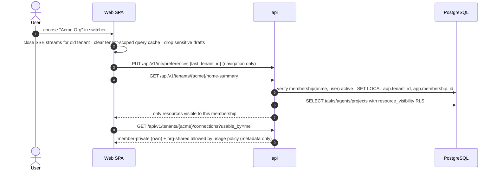

| Aspect | Detail |
| --- | --- |
| Auth | Per-request membership verification; RLS visibility policy |
| Tenant/SoR | Path tenant; no server "current tenant" |
| APIs | `home-summary`, list endpoints with cursor pagination |
| Idempotency/recovery | Background tasks in old tenant continue; their events arrive only to subscribers of that tenant |
| Feedback/audit | Toast "Switched to Acme"; no audit for reads except sensitive ones (connections list is not sensitive metadata) |

## J4. Create or configure an AI partner with Skills and Knowledge

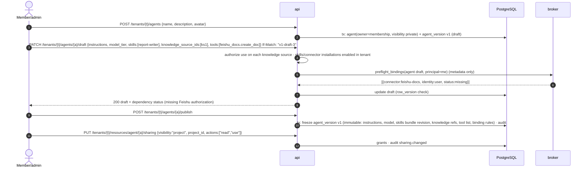

| Aspect | Detail |
| --- | --- |
| Auth | `edit` on agent; `use` on each attached knowledge source and connection; installation enabled |
| SoR | `agents`, `agent_versions` (immutable on publish), `runtime_bindings` |
| Concurrency | `If-Match` ETag on draft |
| Feedback | Dependency checklist (missing config / needs authorization / ready) mirroring `SKILL-RUNTIME-CONTRACT` states |
| Audit | `agent.published`, `sharing.changed` |

Sharing the agent shares instructions, skills, and knowledge *references*; other members still need `use` on the knowledge sources (or the share dialog offers to share them too) and their own connections for user-identity tools.

## J5. Submit a task and receive streamed progress and deliverables

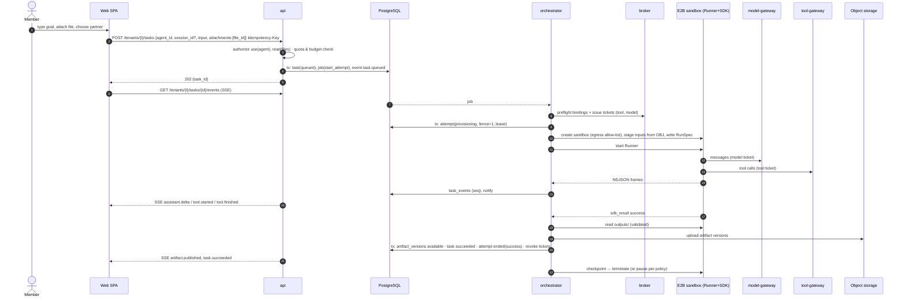

| Aspect | Detail |
| --- | --- |
| Auth | Session + membership; `use` on agent; `read` on attachments; tickets per Attempt |
| SoR | PG (task, attempt, events, artifacts), object storage (files) |
| States | Task `queued→running→finalizing→succeeded`; Attempt `provisioning→running→draining→ended` |
| Idempotency | Idempotency-Key; job dedupe `task:{id}:attempt:{n}`; event `(attempt, runner_event_id)`; artifact content hash |
| Recovery | SSE reconnect with `Last-Event-ID`; orchestrator crash → lease expiry → reconciler |
| Feedback/audit | Streaming text, tool progress (redacted), artifact cards; `task.created`, tool operations (writes), `artifact.published` |

## J6. Feishu message → tenant/user/connection resolution → task → reply in channel

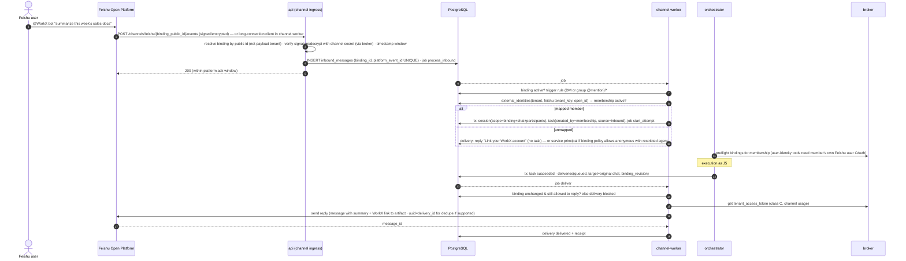

| Aspect | Detail |
| --- | --- |
| Auth | Platform signature; binding active; identity mapping to active membership; bot identity never substitutes user consent for user-identity tools |
| Tenant/SoR | Tenant from binding; PG for inbound/task/delivery |
| States | Inbound `received→processed`; Task as J5; Delivery `queued→sending→delivered/failed/unknown/blocked` |
| Idempotency | `(binding_id, platform_event_id)`; delivery record per (task, artifact_version, target); Feishu message `uuid` when supported ○ |
| Recovery | Delivery retry reuses artifact; `unknown` → receipt query or manual |
| Feedback/audit | Bot typing/ack message optional; in-app inbox shows source; `channel.inbound`, `delivery.*` |

Group-chat privacy: replies in a group contain only content the group may see; if the task used member-private sources, the reply is posted as a WorkX link requiring login, not inline content (policy default).

## J7. Upload a document and later retrieve an authorized passage with citation

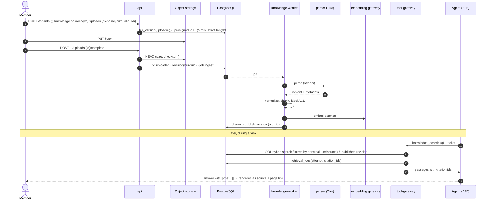

| Aspect | Detail |
| --- | --- |
| Auth | `edit` on knowledge source to upload; `use` at retrieval through the initiator principal |
| SoR | Object storage (raw, parse results), PG (chunks) |
| States | File `uploading→uploaded→scanning→parsing→indexed/failed`; Revision `building→published→superseded` |
| Idempotency | Upload complete idempotent by file version; ingest job dedupe by revision; chunk upsert by `chunk_key` |
| Feedback/audit | Per-file status; citations clickable; `knowledge.uploaded`, `knowledge.published` |

## J8. Execute a Skill or MCP tool using scoped credentials

Sequences: Part 6 Seq 3 (OAuth MCP), Seq 4 (API key), Seq 5 (env/.env Skill), Seq 6 (Feishu CLI). Summary of the shared checks:

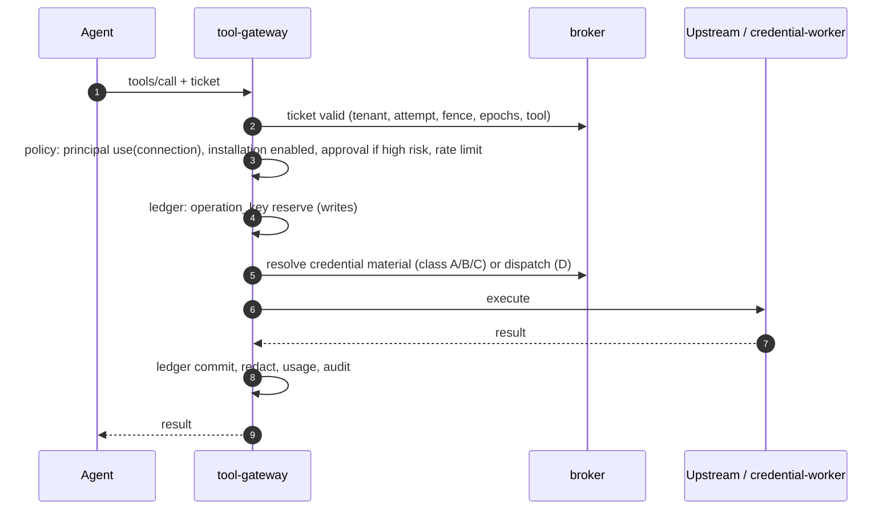

| Aspect | Detail |
| --- | --- |
| Auth | Ticket + policy + connection usage policy + approval |
| SoR | `tool_operations`, `audit_events`, upstream |
| Idempotency | Operation ledger |
| Feedback | `tool.started/finished` events with redacted summary; approval prompts in chat |

## J9. Suspend for missing authorization, authorize, resume safely

Part 6 Seq 7 is the full diagram. User-facing summary:

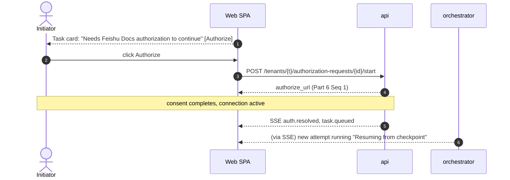

| Aspect | Detail |
| --- | --- |
| Auth | Only the target principal can complete the request; group chats receive only a WorkX login link |
| States | Task `running→needs_auth→queued→running`; old Attempt `ended(waiting_auth)`; new Attempt fence+1 |
| Idempotency | Resume job dedupe per authorization request; duplicate callbacks schedule once |
| Recovery | Expiry (default 7 days) → task `failed(auth_timeout)`; cancel while waiting → request cancelled; late consent stores connection only |
| Audit | `auth.required`, `connection.authorized`, `task.resumed` |

## J10. Cancel, retry, recover failed sandbox, partial results

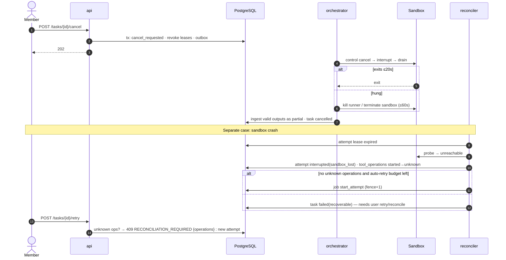

| Aspect | Detail |
| --- | --- |
| Auth | `edit`/initiator or admin can cancel; retry requires `use` again (re-evaluated) |
| States | Task `cancel_requested→cancelled`; Attempt `interrupted`; partial artifacts |
| Idempotency | Cancel idempotent; retry uses Idempotency-Key; fencing blocks old attempt writes |
| Feedback/audit | "Stopped. 2 files saved as partial results"; "Needs your review: 1 action may or may not have completed" |

## J11. Remove a member or revoke a connection while tasks are active

Part 6 Seq 8 covers the credential side. User-facing and task outcomes:

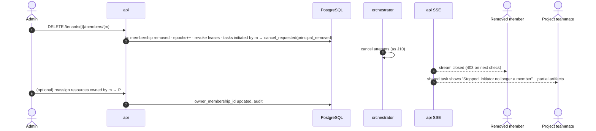

| Aspect | Detail |
| --- | --- |
| Auth | Admin management action; cannot remove last owner |
| States | Tasks → `cancelled(principal_removed)`; connections owned by m → `revoked` |
| Recovery | A teammate can start a new task from the partial result under their own authorizations |
| Audit | `member.removed`, `connection.revoked`, `task.cancelled`, `resource.reassigned` |
