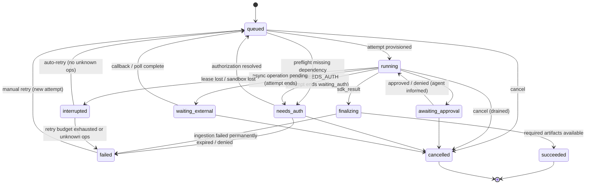
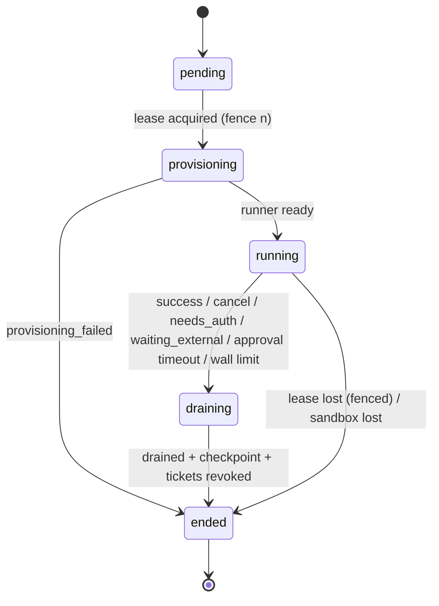
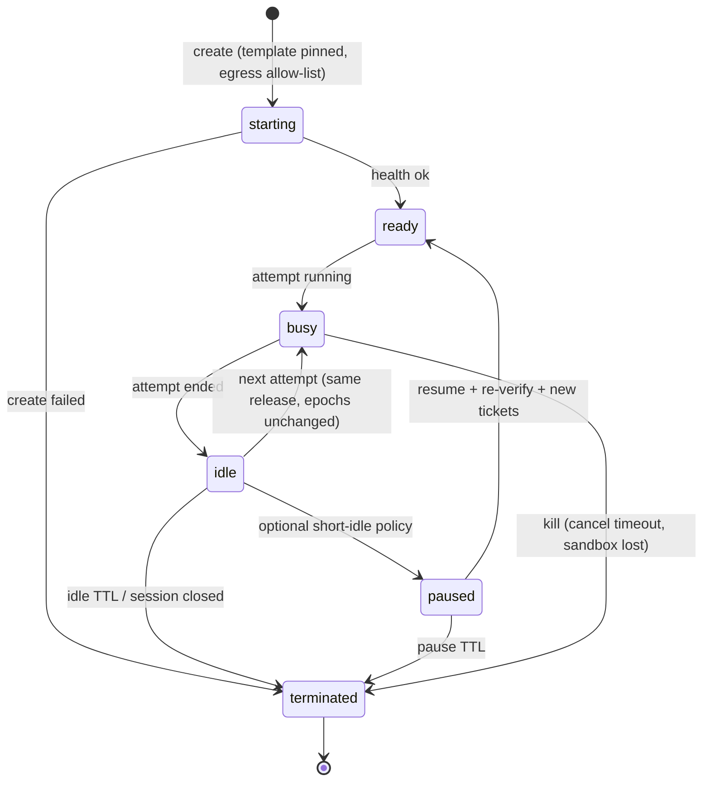
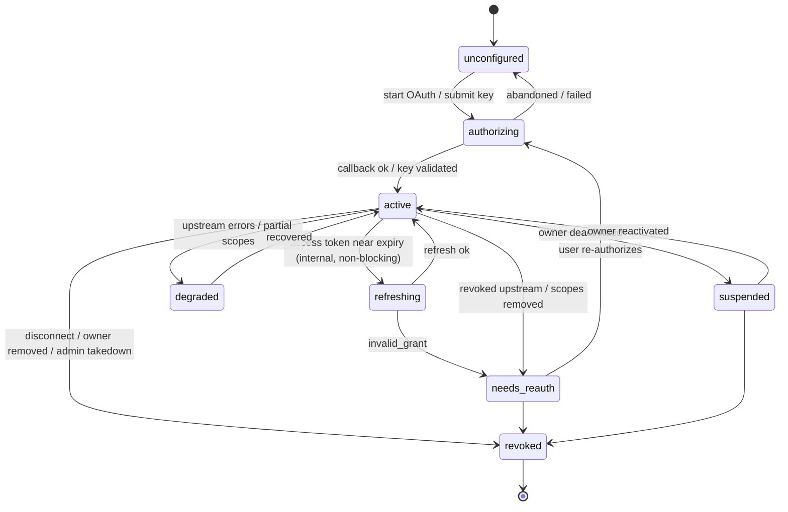
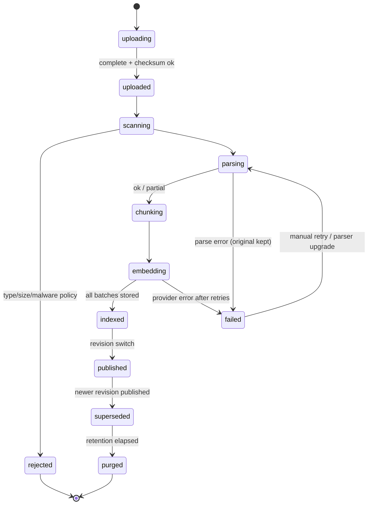

# Part 11 — Data, API, and event contracts (request F)

## 1. Domain model (ER)

```mermaid
erDiagram
  USER ||--o{ LOGIN_SESSION : has
  USER ||--o{ MEMBERSHIP : holds
  TENANT ||--|{ MEMBERSHIP : contains
  TENANT ||--o{ INVITATION : issues
  TENANT ||--o{ DEPARTMENT : defines
  DEPARTMENT o|--o{ MEMBERSHIP : labels
  TENANT ||--o{ SERVICE_PRINCIPAL : has
  TENANT ||--o{ RESOURCE_GRANT : records
  TENANT ||--o{ PROJECT : owns
  PROJECT ||--o{ PROJECT_MEMBER : has
  MEMBERSHIP ||--o{ PROJECT_MEMBER : joins
  TENANT ||--o{ AGENT : owns
  AGENT ||--|{ AGENT_VERSION : versions
  AGENT_VERSION ||--o{ RUNTIME_BINDING : declares
  SKILL_BUNDLE ||--o{ AGENT_VERSION : "pinned by"
  CONNECTOR_DEFINITION ||--o{ CONNECTOR_INSTALLATION : installed
  TENANT ||--o{ CONNECTOR_INSTALLATION : enables
  RUNTIME_BINDING }o--|| CONNECTOR_INSTALLATION : requires
  TENANT ||--o{ CONNECTION : owns
  CONNECTION ||--o{ CREDENTIAL : uses
  CREDENTIAL ||--|{ SECRET_VERSION : versions
  TENANT ||--o{ SESSION : owns
  PROJECT o|--o{ SESSION : groups
  SESSION ||--o{ TASK : contains
  AGENT_VERSION ||--o{ TASK : "executes"
  TASK ||--|{ ATTEMPT : tries
  ATTEMPT o|--|| SANDBOX_BINDING : uses
  ATTEMPT ||--o{ CREDENTIAL_LEASE : tickets
  TASK ||--o{ TASK_EVENT : emits
  TASK ||--o{ TOOL_OPERATION : ledger
  TASK ||--o{ PENDING_OPERATION : blocked
  TASK ||--o{ AUTHORIZATION_REQUEST : needs
  TASK ||--o{ APPROVAL : requires
  TASK ||--o{ ARTIFACT : produces
  ARTIFACT ||--|{ ARTIFACT_VERSION : versions
  ARTIFACT_VERSION }o--|| FILE_OBJECT : stores
  TASK ||--o{ DELIVERY : returns
  TENANT ||--o{ CHANNEL_BINDING : configures
  CHANNEL_BINDING ||--o{ INBOUND_MESSAGE : receives
  INBOUND_MESSAGE o|--o| TASK : creates
  TENANT ||--o{ EXTERNAL_IDENTITY : maps
  EXTERNAL_IDENTITY }o--o| MEMBERSHIP : "links to"
  TENANT ||--o{ KNOWLEDGE_SOURCE : owns
  KNOWLEDGE_SOURCE ||--|{ KNOWLEDGE_REVISION : versions
  KNOWLEDGE_SOURCE ||--o{ KNOWLEDGE_DOCUMENT : contains
  KNOWLEDGE_DOCUMENT ||--o{ FILE_OBJECT : "raw bytes"
  KNOWLEDGE_REVISION ||--o{ KNOWLEDGE_CHUNK : indexes
  TENANT ||--o{ JOB : queues
  TENANT ||--o{ AUDIT_EVENT : logs
  TENANT ||--o{ USAGE_EVENT : meters
```



## 2. Main tables

Conventions: every tenant table has `tenant_id uuid NOT NULL`, `id uuid` (UUIDv7), `PRIMARY KEY (id)`, `UNIQUE (tenant_id, id)`, composite FKs `(tenant_id, x_id) → x(tenant_id, id)`, `created_at`, `updated_at`, and RLS. Mutable aggregates carry `row_version bigint`. Soft delete via `deleted_at` where users can restore.

### 2.1 Identity and tenancy

| Table | Key fields | Constraints / indexes | Retention / deletion |
| --- | --- | --- | --- |
| `users` (global) | `idp_subject`, `primary_email`, `email_verified_at`, `status`, `locale`, `display_name` | unique `idp_subject`; unique lower(`primary_email`) | Deleted: PII nulled, `pseudonym_id` kept for audit |
| `login_sessions` (global) | `user_id`, `session_hash`, `auth_strength`, `idp_sid`, `expires_at`, `revoked_at`, `ip_hash`, `ua` | unique `session_hash` | 90 days after expiry |
| `tenants` (global table, RLS by membership) | `type`, `slug`, `name`, `owner_user_id`, `status`, `plan_id`, `authz_epoch`, `region_cell` | unique `slug`; partial unique `(owner_user_id) WHERE type='personal'` | Purged after deletion grace (30 days) except billing/audit stubs |
| `memberships` | `tenant_id`, `user_id`, `role`, `status`, `department_id`, `authz_epoch` | unique `(tenant_id,user_id)`; trigger: personal tenant ≤ 1 membership; deferred constraint: ≥ 1 active owner per org | Removed memberships kept 1 year (audit), then pseudonymized |
| `invitations` | `email_normalized`, `role`, `token_digest`, `expires_at`, `status`, `invited_by`, `consumed_by_user_id` | unique `(tenant_id,email_normalized) WHERE status='pending'`; unique `token_digest` | 90 days after closure |
| `departments` | `name`, `parent_id` | org tenants only (check via trigger) | With tenant |
| `service_principals` | `kind`, `ref_id`, `status` | | With tenant |
| `resource_grants` | `resource_type`, `resource_id`, `principal_type`, `principal_id`, `actions text[]`, `granted_by`, `expires_at` | unique `(tenant_id,resource_type,resource_id,principal_type,principal_id)`; idx by principal | Deleted with resource |
| `projects`, `project_members` | `name`, `context_md`, `owner_membership_id`, `visibility`; member `status`, `project_role` | unique `(tenant_id, project_id, membership_id)` | Soft delete 30 days |
| `external_identities` | `provider`, `external_tenant_key`, `external_user_id`, `membership_id`, `verified_via`, `linked_at` | unique `(tenant_id,provider,external_tenant_key,external_user_id)` | Deleted on unlink/removal |

### 2.2 Agents, skills, connectors, credentials

| Table | Key fields | Constraints / indexes |
| --- | --- | --- |
| `agents` | `name`, `description`, `avatar`, `owner_membership_id`, `visibility`, `current_version_id`, `draft jsonb`, `row_version` | idx `(tenant_id, owner_membership_id)` |
| `agent_versions` | `agent_id`, `version_no`, `instructions`, `model_tier`, `skill_bundle_id`, `skills text[]`, `tool_refs jsonb`, `knowledge_source_ids uuid[]`, `published_by`, `published_at` | unique `(agent_id, version_no)`; immutable (trigger blocks UPDATE) |
| `skill_bundles` (global catalog) | `bundle_revision`, `sha256`, `object_key`, `manifest jsonb`, `review_status` | unique `bundle_revision` |
| `connector_definitions` (global) | `key`, `version`, `transport`, `auth_mode`, `identity_modes`, `usage_class`, `execution_location`, `routes jsonb`, `tools jsonb` (with `effect`, `risk`, `operation_key_fields`), `status` | unique `(key, version)` |
| `connector_installations` | `connector_key`, `version`, `config jsonb` (non-secret), `allowed_tools text[]`, `enabled` | unique `(tenant_id, connector_key)` |
| `runtime_bindings` | `agent_version_id`, `installation_id`, `operations text[]`, `identity_mode`, `pinned_connection_id` | |
| `connections` | `provider`, `owner_type`, `owner_membership_id`/`owner_service_principal_id`, `external_account_ref`, `scopes text[]`, `status`, `authz_epoch`, `health jsonb`, `last_used_at` | check exactly one owner column set; idx `(tenant_id, owner_membership_id)` |
| `connection_usage_policies` | `connection_id`, `principal_type`, `principal_id`, `operations text[]` | |
| `credentials` | `connection_id`, `usage_class`, `kind`, `active_version_id`, `status` | |
| `secret_versions` (schema `creds`, only `broker_rw`) | `credential_id`, `version_no`, `ciphertext bytea`, `nonce`, `wrapped_dek`, `key_ref`, `key_version`, `fingerprint`, `not_after`, `state` | unique `(credential_id, version_no)`; no SELECT for other roles |
| `credential_leases` | `ticket_hash`, `audience`, `principal_ref`, `task_id`, `attempt_id`, `sandbox_id`, `fencing_token`, `tenant_epoch`, `principal_epoch`, `tools text[]`, `connection_ids uuid[]`, `expires_at`, `revoked_at` | unique `ticket_hash`; idx `(attempt_id)` | 
| `oauth_transactions`, `authorization_requests` | as Part 6 §3.1 | unique `state_digest`; unique pending request per `(task_id, connector_key)` |

### 2.3 Execution

| Table | Key fields | Constraints / indexes |
| --- | --- | --- |
| `sessions` | `project_id`, `agent_id`, `source` (web/channel/automation), `principal_scope jsonb`, `sdk_session_id`, `release_id`, `status` | |
| `tasks` | `session_id`, `agent_version_id`, `created_by_membership_id`/`service_principal_id`, `assignee_membership_id`, `status`, `status_reason`, `input jsonb`, `knowledge_revision_ids uuid[]`, `idempotency_key`, `request_hash`, `cancel_requested_at`, `budget_id`, `row_version` | unique `(tenant_id, created_by, idempotency_key)`; idx `(tenant_id, status, updated_at)` |
| `attempts` | `task_id`, `attempt_no`, `fencing_token`, `status`, `end_reason`, `lease_owner`, `lease_expires_at`, `release_id`, `sandbox_id`, `checkpoint_ref`, `started_at`, `ended_at`, usage totals | unique `(task_id, attempt_no)`; partial unique `(session_id) WHERE status NOT IN ('ended')` (one live attempt per session) |
| `sandbox_bindings` | `session_id`, `provider`, `provider_sandbox_id`, `status`, `template_id`, `created_at`, `terminated_at` | partial unique `(session_id) WHERE status IN ('starting','ready','busy','idle','paused')` |
| `task_events` (partitioned by month) | `task_id`, `seq bigint`, `attempt_id`, `runner_event_id`, `type`, `payload jsonb` (redacted), `occurred_at` | PK `(task_id, seq)`; unique `(attempt_id, runner_event_id)` |
| `task_messages` | `task_id`, `role`, `content` (final text), `citations jsonb` | |
| `tool_operations` | `task_id`, `attempt_id`, `operation_key`, `tool`, `connection_id`, `effect`, `args_hash`, `status` (started/succeeded/failed/unknown/reconciled), `external_receipt jsonb`, `result_ref` | unique `(task_id, operation_key)` |
| `pending_operations` | `task_id`, `tool`, `args_hash`, `reason`, `authorization_request_id`, `status` | |
| `approvals` | `task_id`, `attempt_id`, `operation_key`, `args_digest`, `risk`, `requested_at`, `expires_at`, `decision`, `decided_by` | unique `(task_id, operation_key)` |
| `artifacts` / `artifact_versions` | `task_id`, `logical_name`, `kind`; version: `file_object_id`, `sha256`, `mime`, `size`, `completeness`, `source_attempt_id`, `created_by` | unique `(task_id, logical_name, sha256)` |
| `file_objects` | `object_key`, `sha256`, `size`, `mime`, `scan_status`, `storage_class` | unique `object_key` |
| `deliveries` | `task_id`, `artifact_version_id`, `channel_binding_id`, `binding_revision`, `target jsonb`, `status`, `attempts`, `platform_receipt` | unique `(task_id, artifact_version_id, channel_binding_id, target_hash)` |
| `channel_bindings` | `platform`, `method`, `public_id`, `agent_id`, `connection_id` (channel credential), `capabilities`, `trigger_rules`, `revision`, `status` | unique `public_id` (global) |
| `inbound_messages` | `channel_binding_id`, `platform_event_id`, `conversation_ref`, `sender_ref`, `payload_ref`, `status`, `task_id` | unique `(channel_binding_id, platform_event_id)` |

### 2.4 Knowledge

| Table | Key fields | Constraints |
| --- | --- | --- |
| `knowledge_sources` | `name`, `kind` (upload/connector), `owner_membership_id`, `visibility`, `published_revision_id`, `embedding_profile` | |
| `knowledge_documents` | `source_id`, `external_ref`, `title`, `file_object_id`, `acl_key`, `status` | unique `(source_id, external_ref)` |
| `knowledge_revisions` | `source_id`, `revision_no`, `state` (building/published/superseded/failed), `stats jsonb` | unique `(source_id, revision_no)` |
| `knowledge_chunks` (partitioned by tenant hash) | `source_id`, `document_id`, `revision_id`, `chunk_key`, `text`, `heading_path`, `locator jsonb`, `tsv tsvector`, `embedding vector(d)`, `embedding_profile`, `acl_key`, `content_flags` | GIN `(tsv)`; HNSW `(embedding)`; idx `(tenant_id, revision_id)` |
| `retrieval_logs` | `attempt_id`, `query_hash`, `citation_ids`, `latency_ms` | 30-day retention |

### 2.5 Platform

| Table | Notes |
| --- | --- |
| `jobs`, `outbox_events` | Part 10 §4 |
| `audit_events` (partitioned) | `actor_type`, `actor_id`, `on_behalf_of`, `action`, `target_type`, `target_id`, `outcome`, `ip_hash`, `request_id`, `details jsonb` (redacted), `prev_hash`, `hash` |
| `usage_events` | `attempt_id`, `kind` (model_tokens, sandbox_seconds, tool_call, embedding_tokens, storage_bytes), `quantity`, `unit_cost_ref`; unique `(attempt_id, kind, source_event_id)` |
| `budgets`, `quotas` | Per tenant and per task |
| `runtime_releases` | Part 4 §5 |

## 3. API conventions

- Base: `/api/v1`; tenant routes `/api/v1/tenants/{tenant_id}/...`; global `/api/v1/me`, `/api/v1/invitations/accept`, `/api/v1/auth/*`.
- JSON, snake_case; IDs are prefixed strings externally (`tsk_01J…`), UUID internally.
- **Idempotency**: `Idempotency-Key` required on POST that creates tasks, tenants, invitations, connections; stored 24 h per `(tenant, principal, route)` with request hash; replay returns the original status/body; different body → `409 IDEMPOTENCY_KEY_REUSED`.
- **Optimistic concurrency**: GET returns `ETag: "<row_version>"`; PATCH/PUT require `If-Match`; mismatch → `412 PRECONDITION_FAILED` with current resource.
- **Pagination**: cursor-based `?limit=50&cursor=<opaque>`; response `{items, next_cursor}`; stable ordering `(updated_at desc, id)`; no total counts on permission-filtered lists (prevents inference), optional `has_more`.
- **Errors** (RFC 9457 problem details + WorkX fields):

```json
{
  "type": "https://docs.workx.example/errors/needs-auth",
  "title": "Authorization required",
  "status": 409,
  "code": "NEEDS_AUTH",
  "detail": "Feishu Docs authorization is required to continue this task.",
  "request_id": "req_01J…",
  "retryable": false,
  "data": {"authorization_request_id": "arq_01J…", "connector": "feishu-docs"}
}
```

| HTTP | Codes (examples) |
| --- | --- |
| 400 | `VALIDATION_FAILED` |
| 401 | `UNAUTHENTICATED`, `SESSION_REVOKED` |
| 403 | `FORBIDDEN`, `TENANT_REAUTH_REQUIRED`, `TENANT_SUSPENDED` |
| 404 | `NOT_FOUND` (also for unauthorized reads) |
| 409 | `CONFLICT`, `IDEMPOTENCY_KEY_REUSED`, `RECONCILIATION_REQUIRED`, `NEEDS_AUTH`, `INVALID_STATE` |
| 412 | `PRECONDITION_FAILED` |
| 422 | `UNSUPPORTED_FILE_TYPE`, `DEPENDENCY_MISSING` |
| 429 | `RATE_LIMITED`, `QUOTA_EXCEEDED`, `BUDGET_EXCEEDED` |
| 5xx | `INTERNAL`, `UPSTREAM_UNAVAILABLE` (retryable true) |

### 3.1 Representative requests

Create task:

```http
POST /api/v1/tenants/ten_acme/tasks
Idempotency-Key: 3b7f0d0e-6f1c-4c7a-9a39-2d1f7c1a2b10
Content-Type: application/json

{"agent_id": "agt_report", "session_id": null, "project_id": "prj_q3",
 "input": {"text": "Summarize Q3 sales and produce an XLSX of top accounts"},
 "attachments": [{"file_id": "fil_01J…"}]}
```

```http
HTTP/1.1 202 Accepted
Location: /api/v1/tenants/ten_acme/tasks/tsk_01J…
{"task_id": "tsk_01J…", "session_id": "ses_01J…", "status": "queued", "events_url": "/api/v1/tenants/ten_acme/tasks/tsk_01J…/events"}
```

Update sharing:

```http
PUT /api/v1/tenants/ten_acme/resources/agent/agt_report/sharing
If-Match: "17"
{"visibility": "selected", "grants": [{"principal": {"type": "membership", "id": "mem_b"}, "actions": ["read", "use"]}]}
```

Approval decision:

```http
POST /api/v1/tenants/ten_acme/tasks/tsk_01J…/approvals/apr_01J…/decision
{"decision": "approve", "args_digest": "sha256:9f2…"}
```

Start authorization from a pending request:

```http
POST /api/v1/tenants/ten_acme/authorization-requests/arq_01J…/start
→ 200 {"authorize_url": "https://accounts.feishu.cn/open-apis/authen/v1/authorize?..."}
```

Knowledge search (also exposed to agents as a Gateway tool):

```http
POST /api/v1/tenants/ten_acme/knowledge/search
{"query": "差旅报销标准", "source_ids": ["kns_policy"], "k": 8}
→ {"passages": [{"citation_id": "cit_…", "text": "…", "source": {"id": "kns_policy", "title": "Travel Policy"}, "revision": 4, "locator": {"page": 12}}]}
```

## 4. Event contracts

### 4.1 Internal event envelope (outbox)

```json
{
  "event_id": "evt_01J…",
  "type": "task.status_changed",
  "schema_version": 1,
  "tenant_id": "ten_acme",
  "aggregate": {"type": "task", "id": "tsk_01J…", "version": 9},
  "occurred_at": "2026-10-30T18:00:00Z",
  "actor": {"type": "membership", "id": "mem_a"},
  "correlation_id": "req_01J…",
  "causation_id": "evt_01J…",
  "payload": {"from": "running", "to": "needs_auth", "reason": "connection_needs_reauth"}
}
```

Rules: payloads contain IDs and redacted summaries only; consumers are idempotent by `event_id`; schemas in `packages/contracts/events/*.json`, compatibility checked in CI (additive changes only within a major version).

### 4.2 SSE event (client-facing)

```text
id: 42
event: tool.finished
data: {"task_id":"tsk_…","attempt_id":"att_…","seq":42,"type":"tool.finished","schema_version":1,
       "occurred_at":"…","payload":{"tool":"feishu_docs_create_doc","outcome":"succeeded","summary":"Created document “Q3 Summary”"}}
```

Event types (extends `API-AND-EVENTS.md`): `task.queued|provisioning|running|awaiting_approval|needs_auth|waiting_external|finalizing|succeeded|failed|cancelled|interrupted`, `assistant.delta`, `assistant.message`, `tool.started|finished`, `approval.requested|resolved`, `auth.required|resolved|expired`, `artifact.staged|published|rejected`, `delivery.queued|sending|delivered|failed|unknown|blocked`, `usage.updated`, `stream.cursor_expired`.

### 4.3 Runner protocol frames (sandbox → orchestrator)

```json
{"protocol_version":"1","runner_event_id":118,"attempt_id":"att_…","fencing_token":7,
 "type":"tool_started","ts":"…","payload":{"tool_use_id":"toolu_…","name":"mcp__workx__crm_search","input_digest":"sha256:…"}}
```

Types: `ready`, `heartbeat`, `assistant_delta`, `assistant_message`, `tool_started`, `tool_finished`, `approval_requested`, `auth_required`, `artifact_candidate`, `checkpoint_ready`, `sdk_result`, `runner_error`, `drained`. Max frame 256 KiB; larger content referenced by file path in `/run/workx/<attempt>/blobs/`.

Control messages (orchestrator → Runner): `cancel`, `drain`, `approval_decision`, `throttle`, `renew_tickets` — each with `control_id`, `attempt_id`, `fencing_token`.

### 4.4 External callbacks

| Callback | Verification | Idempotency |
| --- | --- | --- |
| OAuth redirect `/oauth/callback/{provider}` | state digest, PKCE, issuer, session binding | single-use transaction |
| Channel events `/channels/{platform}/{binding_public_id}/events` | platform signature/decryption, timestamp window, binding status | `(binding, platform_event_id)` |
| Async operation callbacks `/callbacks/{callback_id}` | HMAC-SHA256 over `timestamp.body` with per-callback secret; ±5 min window | `callback_id` single-use |

## 5. State machines

### 5.1 Task



### 5.2 Attempt



`end_reason` ∈ {`success`, `cancelled`, `waiting_auth`, `waiting_external`, `approval_timeout`, `wall_limit`, `budget_exceeded`, `model_error`, `runner_error`, `sandbox_lost`, `lease_lost`, `provisioning_failed`, `principal_removed`}.

### 5.3 Sandbox binding



### 5.4 Connection and authorization



### 5.5 Knowledge indexing



## 6. Audit and sensitive-data redaction

| Data class | Examples | Logs/traces | Events/SSE | Audit | DB |
| --- | --- | --- | --- | --- | --- |
| Secrets | API keys, refresh/access tokens, app secrets, PKCE verifiers, invitation tokens, tickets | Never (middleware + pattern scrubbers + canary tests) | Never | Never (fingerprint only) | Ciphertext or digest only |
| Personal data | Emails, names, external user ids | Hashed/omitted | Display names only to authorized viewers | Actor ids; emails only where needed | Plain, access-controlled |
| Content | Prompts, documents, tool args/results, artifacts | Not logged by default | Redacted summaries | Digests + target ids | Plain in tenant tables / object storage |
| Metadata | IDs, statuses, timings, token counts | Yes | Yes | Yes | Yes |

Implementation: a single `redact()` policy applied by (1) structured logging processors, (2) OTel span processors, (3) event serializers, (4) audit writer. Canary secrets are injected in CI and staging; any appearance in logs/traces/events/artifacts fails the build or pages on-call.

Audit actions (minimum): auth (login, logout, failed login, MFA), tenant lifecycle, membership/role changes, invitations, sharing changes, connection lifecycle and *use* of shared connections, secret create/rotate/destroy, approvals, task create/cancel/retry, tool write operations, deliveries, exports, admin takedowns, break-glass access.
