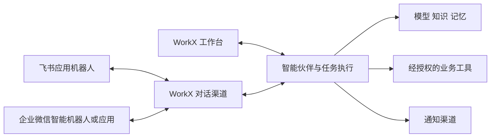

# WorkX 生态接入调研

调研日期：2026 年 10 月 29 日  
范围：飞书、企业微信的 AI 对话接入，以及个人微信的区别  
用途：校准产品概念和后续接入方案；未接入真实平台，后续原型调整见“原型落地状态”

## 结论

在平台聊天中使用 WorkX 伙伴，需要适配对应平台的机器人或应用消息通道。AI 伙伴本身由 WorkX 的模型、指令、上下文和任务执行能力承载；平台的资料和业务操作则按相应接口授权。

飞书应用机器人与企业微信智能机器人适合作为双向对话入口。生态接入还包括通知推送、应用网页入口和业务 API，不能把全部接入方式都归成同一种“机器人”。飞书官方有不要求启用机器人能力的多维表格 API 教程；腾讯官方也提供通过企业微信自建应用承载 Agent 的方案。[飞书创建多维表格教程](https://open.feishu.cn/document/introduction-2?lang=zh-CN)、[企业微信应用接入指南](https://cloud.tencent.com/document/product/1759/119175)

## 接入形态对比

| 平台与形态 | 官方资料确认的能力 | 在 WorkX 中的建议定位 |
| --- | --- | --- |
| 飞书应用机器人 | 在开放平台应用中启用机器人能力，配置消息事件和权限后进行会话交互。[机器人概述](https://open.feishu.cn/document/client-docs/bot-v3/bot-overview) | 智能伙伴在飞书的对话身份与任务入口。 |
| 飞书自定义群机器人 | 通过群 Webhook 推送通知，官方明确不能响应用户 @，也不自带业务数据访问权限。[自定义机器人指南](https://open.feishu.cn/document/client-docs/bot-v3/add-custom-bot?lang=zh-CN) | 群通知和任务结果出口。 |
| 飞书应用 API | 至少部分业务 API 无需机器人能力；创建多维表格教程支持使用用户或应用身份调用。[官方 API 教程](https://open.feishu.cn/document/introduction-2?lang=zh-CN) | 伙伴调用的业务工具和资料连接，各接口分别确认权限。 |
| 企业微信智能机器人 API 模式 | 支持单聊、群内 @ 交互；官方接入指南提供长连接和 URL 回调模式，后端 Agent 处理后回复。[智能机器人接入指南](https://intl.cloud.tencent.com/zh/document/product/1316/84454)、[企微助理指南](https://cloud.tencent.com/document/product/1831/134441) | 智能伙伴在企业微信的双向对话入口。 |
| 企业微信传统群 Webhook | 官方通过“消息推送／自定义消息推送”获取 Webhook，用于向企业微信群投递告警通知。[腾讯官方告警接入指南](https://cloud.tencent.com/document/product/248/50413) | 群通知出口；双向 AI 对话另选智能机器人或应用接入。 |
| 企业微信自建应用 | 官方提供两种 Agent 接入方式：应用主页打开 AI 网页，以及配置 API 接收后通过应用聊天交互。[企业微信应用接入指南](https://cloud.tencent.com/document/product/1759/119175) | 应用入口或应用消息通道，可按业务需要选用。 |

上表中的群 Webhook 与智能机器人的 URL 回调用途不同：前者把外部结果推送进群；后者把用户交互传给接入服务。选择方案时应看消息方向和支持能力，不能只依据是否出现“Webhook”这个词。[群消息推送配置](https://cloud.tencent.com/document/product/248/50413)、[智能机器人 API 接入模式](https://cloud.tencent.com/document/product/1831/134441)

机器人也可能结合工具授权。腾讯的企微助理快捷绑定流程包含用户信息、创建和编辑文档等授权，因此产品上需要同时呈现“消息通道状态”和“已授权能力”，不应由一个“已连接”状态推断所有业务工具都可使用。[企微助理授权流程](https://cloud.tencent.com/document/product/1831/134441)

## 微信与企业微信

个人微信、企业微信、微信客服和公众号应分别记录接入形态。腾讯官方的渠道数据结构将企业微信应用、企微智能机器人、微信客服、微信 ClawBot 等分别列为不同渠道。[腾讯智能体平台渠道定义](https://cloud.tencent.com/document/product/1759/132545)

个人微信当前已有 ClawBot 通道。腾讯官方文档描述了扫码绑定后，从微信向电脑上的 Agent 下发任务并接收结果的流程。因此不能沿用“个人微信没有任何官方 AI 接入”的旧结论；也不能把企业微信机器人的配置直接用于个人微信。[微信 ClawBot 接入指南](https://cloud.tencent.com/document/product/1831/137450)

该证据确认了现有产品的 ClawBot 接入方式。WorkX 自行适配所需协议、可用范围和部署条件仍需独立验证；本次调研不将个人微信自动加入已承诺的开发范围。

## WorkX 的产品建模建议

以下为基于调研的产品建议，不是平台强制的架构，也不是本轮已经实现的服务。

| 概念 | 应记录的内容 |
| --- | --- |
| 智能伙伴 | WorkX 内的角色、指令、模型、知识、记忆和可调用工具；“助手”“分身”可作为不同定位或模板。 |
| 对话渠道 | 平台、接入形态、外部机器人或应用身份、关联伙伴、消息能力及连接状态。 |
| 通知渠道 | 群 Webhook 等结果投递目标，明确为输出用途。 |
| 工具授权 | 可调用的业务接口、身份及资料范围，与消息收发能力分别展示。 |
| 项目协作 | 成员分工、项目背景、任务过程及成果归集，由 WorkX 统一组织；跨平台消息按项目和身份对应。 |

建议允许一个 WorkX 伙伴绑定多个渠道，复用其角色和能力配置。各渠道的用户身份、会话及项目授权需要明确映射，不能默认跨平台自动共享全部上下文。飞书消息和业务工具可复用同一应用的配置基础，产品上区分职责不意味着必须创建两个独立应用。

## 对生态页的调整建议

1. 顶层按平台组织为“飞书”“企业微信”；个人微信作为独立候选生态。
2. 平台内选择接入用途和形态，例如飞书应用机器人、群通知，企业微信智能机器人、自建应用、群通知。
3. 对话渠道关联已有 WorkX 伙伴；创建 WorkX 伙伴本身不强制要求先配置外部机器人。
4. 分别呈现消息接入、业务工具授权及通知投递状态，按实际支持范围展示单聊、群 @、文件和结果回传等能力。
5. 第一阶段双向对话建议优先验证飞书应用机器人与企业微信智能机器人 API 模式，群 Webhook 作为可选通知出口；具体排序随首个业务场景确认。

## 原型落地状态

功能清单 0.4 按上述结论调整了本地原型，统一使用“平台 → 接入方式 → 关联伙伴 → 授权能力”四步配置。飞书提供应用机器人、群自定义机器人 Webhook、业务 API 授权；企业微信提供智能机器人 API、自建应用消息接入、群机器人 Webhook，智能机器人可记录 WebSocket 长连接或 HTTP 回调方式。

每条绑定独立记录名称、平台、方式、伙伴、拟申请能力和启停状态，同一智能伙伴可以绑定多个平台。生态页管理全部绑定，伙伴详情只显示自己的绑定，并在新增时预选当前伙伴；支持编辑、预览、暂停、恢复和删除确认。业务场景仍仅提供入口和本地草稿，个人微信未实现，也未因此调研列入承诺范围。

“授权能力”步骤分开呈现消息交互和业务工具，当前只保存拟申请范围，统一视为待真实授权。原型将群 Webhook 限定为通知输出，不提供双向对话或工具授权；切换方式会移除不兼容选择。可选业务工具是后续联调的需求候选，不代表平台已授予权限或已确认所有接口可用。上述四步绑定不填写平台密钥、不执行授权、不收发外部消息，也不替代下述真实接入验证。

功能清单 0.5 在四步绑定之后补充“参数 → 授权步骤 → 连接测试”。参数依接入方式展示，授权采用平台设置清单确认；连接测试可选择模拟成功、凭证错误、权限缺失或超时，并提供取消、修正与重试。保存的模拟结果与真实平台状态始终分开；当前仍不发送外部请求、执行 OAuth、投递消息或确认真实连通。

可填示例参数体验流程。Secret、Token、AES 密钥、签名密钥及完整 Webhook URL 仅在当前配置弹窗内存中使用，保存或关闭即清除；本地持久化仅包含非敏感配置、步骤确认和模拟结果。参数或授权变化会清除测试，绑定接入条件变化会重置配置，避免把旧测试结果展示为新配置的结果。真实部署仍需服务端凭据管理和实测。

功能清单 0.6 将上述接入配置延伸到本地使用流程：在消息工作台模拟平台收消息，由绑定中的伙伴创建 WorkX 任务；工作台、项目和详情共用任务进度，执行成功后生成演示成果，再独立展示回传至来源会话的过程。该闭环没有接收真实平台事件、调用模型或投递消息。

本轮只允许启用且保存了当前配置模拟连接成功结果的双向绑定进入演示。飞书应用机器人和企业微信智能机器人提供单聊与群内 @；企业微信自建应用消息只做单聊演示。群 Webhook 和业务 API 不作为收消息入口。该选择限定的是 WorkX 原型的体验范围，不替代平台实际消息类型、权限及可见范围的验证。

消息、平台绑定、关联伙伴及来源会话分别留有本地快照，结果不因后续绑定变化而改投其他会话。执行失败在原任务重试，回传失败复用已有成果；正在运行的流程刷新后标记中断并等待显式恢复。原型支持重放同一事件验证不重复创建任务，运行取消后旧计时回调不能继续完成。真实实现仍需补齐事件验签、消息去重、持久队列、执行恢复与平台回执，不能用模拟成功代替真实交付证据。

## 飞书参数与授权步骤核对

本轮补充查阅飞书官方 SDK 与开放平台文档，用于设计参数表单和授权指引。表单字段用于表达接入需求，原型不调用这些接口。

| 接入方式 | 参数与配置职责 | 授权和生效步骤 |
| --- | --- | --- |
| 应用机器人：长连接 | 应用凭证为 App ID 和 App Secret；SDK 建立出站 WebSocket 连接，不需要为接收消息填写公网 HTTP 回调地址。 | 创建企业自建应用、开启机器人能力，按需申请消息权限并订阅接收消息事件；完成应用发布及管理员审核。 |
| 应用机器人：HTTP 回调 | 仍需应用凭证；另外配置公网事件请求地址，按安全配置使用 Verification Token、Encrypt Key。 | 在开放平台配置事件接收方式和安全校验，完成消息事件、权限与发布流程；回调校验和消息收发分别验证。 |
| 群自定义机器人 Webhook | 使用完整群 Webhook 地址；若开启签名校验，另需签名密钥。关键词、IP 白名单和签名是不同的安全设置，可组合配置。 | 在目标群添加自定义机器人并设置安全方式；该通道仅投递群通知，无应用业务 API 授权流程。 |
| 业务 API | 使用 App ID 和 App Secret，由服务端获得并维护应用访问凭证；不把短期 access token 作为长期手工配置项。 | 申请相应 API 权限并发布应用；按具体资源补齐访问范围。需要用户身份的接口，另行验证用户授权流程。 |

应用机器人配置依据 [机器人概述](https://open.feishu.cn/document/client-docs/bot-v3/bot-overview)、[事件概述](https://open.feishu.cn/document/uAjLw4CM/ukTMukTMukTM/event-subscription-guide/event-subscriptions) 和 [官方 Node SDK 的 Channel 配置](https://github.com/larksuite/node-sdk/blob/main/docs/channel.md)。消息事件按单聊或群内 @ 的实际需求申请权限，不应默认申请全群消息读取。

Webhook 地址含调用凭据，不能当作普通可公开地址。签名开启后，请求还要包含时间戳和计算得到的签名；输入格式正确不代表服务端已校验成功。[自定义机器人使用指南](https://open.feishu.cn/document/client-docs/bot-v3/add-custom-bot?lang=zh-CN)

飞书当前的自建应用凭证文档将 App ID、App Secret 用于服务端客户端凭证流程；生效 scope 仍受应用已经开通的权限约束，应用未安装、未启用或凭据不匹配均可能失败。原型只表达配置和演示状态，不展示真实 token，也不把模拟成功写为平台授权成功。[自建应用获取 tenant_access_token](https://open.feishu.cn/document/uAjLw4CM/ukTMukTMukTM/authentication-management/access-token/tenant_access_token)

## 企业微信参数与授权步骤核对

| 接入方式 | 参数与配置职责 | 授权和生效步骤 |
| --- | --- | --- |
| 智能机器人：长连接 | Bot ID 与 Bot Secret，用于建立机器人 API 长连接；不把 Corp ID 作为该模式的通用必填参数。 | 在企业微信配置智能机器人的 API 模式和长连接方式，按实际范围使用单聊或群内 @。 |
| 智能机器人：HTTP 回调 | 开发者提供接收地址，配置 Token 与 EncodingAESKey；这与群通知 Webhook 地址不同。 | 配置回调并通过平台验证后接收用户交互；工具能力按平台及所用产品另行授权和验证。 |
| 自建应用消息接入 | 企业 Corp ID、应用 Agent ID 与 Secret；接收消息时还需 URL、Token、EncodingAESKey。 | 配置应用和接收消息服务，按平台要求配置可信 IP、应用可见范围等；验证所选接口权限。 |
| 群机器人 Webhook | 使用目标群的 Webhook 地址，作为向该群发送通知的调用凭据。 | 在群中启用相应消息推送入口并核对地址与目标群，不进行智能机器人长连接或应用授权。 |

智能机器人的两种模式由 [腾讯官方企微机器人渠道指南](https://cloud.tencent.com/document/product/1759/121473) 确认；长连接的 Bot ID、Secret 配置可交叉参考 [腾讯官方智能机器人接入指南](https://intl.cloud.tencent.com/zh/document/product/1316/84454)。厂商渠道产品的连接数量或绑定限制不直接套用为 WorkX 的伙伴绑定限制；真实实现仍需协调同一机器人连接的归属与生命周期。

自建应用的企业、应用凭证、消息接收配置以及可信 IP 和可见范围，参考 [企业微信应用接入指南](https://cloud.tencent.com/document/product/1759/119175)。群 Webhook 用作通知出口的步骤参考 [腾讯官方群消息推送指南](https://cloud.tencent.com/document/product/248/50413)。原型采用不可真实访问的示例回调地址；本轮没有用企业账号验证这些参数，也没有调用平台接口。

## 证据边界与后续验证

- 飞书结论来自飞书开放平台官方文档；企业微信和个人微信结论来自腾讯官方产品文档，未采用开发者社区个人文章作为技术依据。
- 企业微信开发者站部分页面在本次检索中无法直接读取，使用腾讯官方接入指南交叉确认。传统群 Webhook 的官方资料确认了通知推送用途；本次未取得其所有接收能力的完整否定清单。
- 腾讯 ADP、WorkBuddy、CodeBuddy 文档中的产品配额、绑定数量、白名单和默认策略，不自动等于平台通用限制。
- 真实接入前还需针对选定形态验证消息范围、身份映射、文件支持、长任务结果返回、应用可见范围和工具授权。尚未使用真实账号联调，也未检查用户企业是否已开通相关能力。
